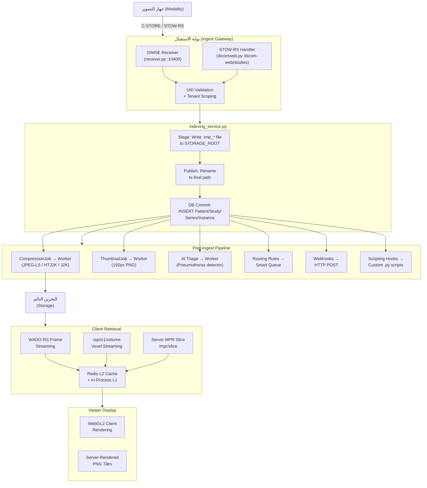

# 🏗️ PAXS Archive Server — Project Structure & System Architecture
# الهيكل التنظيمي والمعمارية الكاملة لنظام PAXS Archive Server

> **الإصدار**: 0.1.0 &nbsp;|&nbsp; **تاريخ التحديث**: سبتمبر 2026
>
> يوفر هذا المستند مخططاً تقنياً تفصيلياً وشاملاً لمنصة **PAXS Archive Server** — نظام أرشفة وعرض الصور الطبية (PACS) المبني بالكامل بلغة Python.
> الشروحات مكتوبة باللغة العربية مع الحفاظ على المصطلحات التقنية الإنجليزية الأصلية لضمان الوضوح المهني.

---

## 1. نظرة عامة على المعمارية (High-Level Architecture Overview)

### 1.1 المكونات الأساسية للنظام (Core System Components)

يتكون نظام PAXS Archive Server من الطبقات المعمارية التالية:

```
┌──────────────────────────────────────────────────────────────────────────┐
│                         طبقة العرض (Presentation Layer)                 │
│                                                                          │
│  ┌──────────────┐  ┌──────────────┐  ┌──────────────┐  ┌──────────────┐ │
│  │  PaxsViewer  │  │ Study List   │  │ Control Panel│  │  Login Page  │ │
│  │  (OHIF v3)   │  │ (React/Vite) │  │   (/admin)   │  │  (/login)    │ │
│  │  /viewer     │  │ /studies-ui  │  │   Web Bridge │  │   HTML SPA   │ │
│  └──────┬───────┘  └──────┬───────┘  └──────┬───────┘  └──────┬───────┘ │
│         │                  │                  │                 │         │
│         └──────────────────┴──────────────────┴─────────────────┘         │
│                              │ HTTP / WebSocket                           │
├──────────────────────────────┼────────────────────────────────────────────┤
│                         طبقة الـ API (API Layer)                          │
│                                                                           │
│  FastAPI v0.115+ (Uvicorn ASGI)                                          │
│  ┌─────────────┐  ┌─────────────┐  ┌─────────────┐  ┌──────────────┐   │
│  │ DICOMweb    │  │ Dashboard   │  │ Volume/MPR  │  │ Auth/Users   │   │
│  │ QIDO/WADO   │  │ REST API    │  │ Streaming   │  │ Sessions     │   │
│  │ STOW-RS     │  │ /api/v1/*   │  │ Negotiate   │  │ RBAC/Lockout │   │
│  └─────────────┘  └─────────────┘  └─────────────┘  └──────────────┘   │
│  ┌─────────────┐  ┌─────────────┐  ┌─────────────┐  ┌──────────────┐   │
│  │ HL7/FHIR    │  │ Worklist    │  │ Routing     │  │ 38+ أخرى...  │   │
│  │ Gateway     │  │ MWL/MPPS    │  │ Smart Queue │  │              │   │
│  └─────────────┘  └─────────────┘  └─────────────┘  └──────────────┘   │
├───────────────────────────────────────────────────────────────────────────┤
│                     طبقة الخدمات (Services Layer)                        │
│                                                                           │
│  ┌────────────────┐  ┌────────────────┐  ┌──────────────────────────┐    │
│  │ Volume Service │  │ DICOM Receiver │  │ Background Worker        │    │
│  │ MPR Slicer     │  │ C-STORE/C-FIND │  │ Compression / Thumbnails │    │
│  │ MIP/VRT Engine │  │ C-GET / C-MOVE │  │ Triage / Lifecycle       │    │
│  └────────────────┘  └────────────────┘  └──────────────────────────┘    │
│  ┌────────────────┐  ┌────────────────┐  ┌──────────────────────────┐    │
│  │ Redis L2 Cache │  │ Indexing Svc   │  │ Storage Service          │    │
│  │ Frame + Volume │  │ Atomic Ingest  │  │ Local FS / S3 / MinIO   │    │
│  └────────────────┘  └────────────────┘  └──────────────────────────┘    │
├───────────────────────────────────────────────────────────────────────────┤
│                     طبقة البيانات (Data Layer)                           │
│                                                                           │
│  ┌────────────────────────┐  ┌──────────────────────────────────────┐    │
│  │ MySQL 8 / SQLite       │  │ Object Storage                      │    │
│  │ 45 جدول ORM            │  │ STORAGE_ROOT (local) أو S3 bucket   │    │
│  │ Alembic migrations     │  │ DICOM Part-10 files + thumbnails    │    │
│  └────────────────────────┘  └──────────────────────────────────────┘    │
│  ┌────────────────────────┐                                              │
│  │ Redis 6.x+             │                                              │
│  │ L2 decoded-frame cache │                                              │
│  │ Volume array cache     │                                              │
│  │ Server-rendered tiles  │                                              │
│  └────────────────────────┘                                              │
└───────────────────────────────────────────────────────────────────────────┘
```

### 1.2 الخادم الخلفي — FastAPI Backend

الخادم الخلفي مبني على **FastAPI v0.115+** ويعمل عبر **Uvicorn ASGI**. يقدم ما يلي:

- **DICOMweb REST API** (`/dicom-web/`): تنفيذ كامل لمعيار PS3.18 يشمل QIDO-RS (البحث)، WADO-RS (استرجاع الصور والبيانات)، WADO-URI، و STOW-RS (رفع الصور).
- **Dashboard REST API** (`/api/v1/`): واجهة برمجية شاملة تضم أكثر من 42 وحدة توجيه (Router) تغطي كافة الوظائف الإدارية والسريرية.
- **DICOM DIMSE Receiver** (المنفذ `10400`): مستقبل DICOM يعمل على بروتوكول TCP ويدعم C-STORE و C-FIND و C-GET و C-MOVE و C-ECHO و MWL و MPPS و Storage Commitment.
- **HL7 v2 MLLP Listener** (المنفذ `2575`): بوابة HL7 لاستقبال رسائل ADT^A01 من أنظمة المستشفيات.

### 1.3 قاعدة البيانات — SQLite / MySQL Metadata Store

- **MySQL 8** هو الخيار الافتراضي للإنتاج — يوفر فهرسة كاملة، دعم utf8mb4، والمفاتيح الأجنبية.
- **SQLite** (عبر `aiosqlite`) متاح للتطوير المحلي بدون أي إعداد مسبق.
- يحتوي المخطط على **45 جدول ORM** مُعرّفة في `app/db/models.py`، تشمل:
  - **التسلسل الهرمي DICOM IOD**: `Patient` → `Study` → `Series` → `Instance`
  - **المستأجرين (VNA Multi-Tenancy)**: `Tenant`, `TenantAeTitle`
  - **الأمان**: `User`, `Session`, `AuthAuditLog`
  - **سير العمل السريري**: `ScheduledProcedureStep` (MWL), `PerformedProcedureStep` (MPPS), `RadiologyReport`, `CriticalResult`, `PeerReviewCase`
  - **التوجيه والأرشفة**: `RoutingRule`, `RoutingQueueItem`, `StudyLifecycleRule`, `ReplicationRecord`
  - **وأكثر من ذلك**: `PatientShare`, `HangingProtocol`, `StorageBackendConfig`, `StorageQuota`, `ServerSetting`, إلخ.
- **Alembic** يدير عمليات الترحيل (migrations) عبر أكثر من 40 ملف ترحيل في `migrations/versions/`.

### 1.4 ذاكرة التخزين المؤقت — Redis L2 Volume Cache

يعمل Redis كطبقة ثانية (L2) للتخزين المؤقت خلف طبقة L1 داخل العملية (in-process):

| المكوّن | مفتاح Redis | الوظيفة |
|---------|------------|---------|
| Decoded Frame Cache | `paxs:frame:{sop}:{idx}` | تخزين بيانات بكسل الإطارات المفكوكة لتسريع التصفح |
| Volume Array Cache | `paxs:vol:array:{series}:{n}` | تخزين مصفوفات HU المادية للتقطيع MPR |
| Server-Rendered Tiles | `series+plane+index+window` | صور PNG المُعدّة مسبقاً للعملاء الخفيفين |

- عند تعطيل Redis أو انقطاع الاتصال، يتراجع النظام تلقائياً إلى ذاكرة L1 فقط — يعمل لكن بكفاءة أقل مع العملاء المتزامنين.
- الحدود القصوى للذاكرة تُدار عبر: `VOLUME_CACHE_BUDGET_MB` (افتراضي 1024 MB) و `DICOM_FRAME_CACHE_MB` (افتراضي 256 MB).

### 1.5 محرك DICOMweb — WADO-RS / STOW-RS Streaming Engine

- **WADO-RS Frame Streaming**: يدعم الاسترجاع المتوازي عبر `asyncio.to_thread()` مع مُجمّع خيوط I/O من 64 خيطاً (`IO_THREAD_POOL_WORKERS`).
- **STOW-RS Upload**: رفع متدفق (streaming) للأجزاء المتعددة (multipart) — جزء واحد في الذاكرة في كل مرة، لا يُحمّل الطلب بالكامل.
- **ETag Caching**: تخزين مؤقت للإطارات مع ترويسات `immutable` و `304 Not Modified`.
- **Warm-on-Open**: عند فتح دراسة، يتم تحضير الصور المصغرة والإطارات الأولى في الخلفية.

### 1.6 معمارية المعالجة ثلاثية الأوضاع (3-Mode Processing Architecture)

يدعم النظام ثلاثة أوضاع لعرض الصور الطبية — يُختار الوضع تلقائياً أو يدوياً عبر `VIEWER_PROCESSING_MODE`:

| الوضع | الوصف | المتطلبات |
|-------|------|-----------|
| **`server`** | كل المعالجة على الخادم — يرسل إطارات PNG/JPEG مُعدّة للعرض فقط | يعمل على أي متصفح، بما في ذلك الأجهزة اللوحية |
| **`client`** | بيانات الفوكسل الخام تُرسل للمتصفح — العرض ثلاثي الأبعاد محلياً عبر WebGL2 | يتطلب WebGL2 وذاكرة GPU كافية |
| **`hybrid`** (افتراضي) | كشف تلقائي — العملاء الأقوياء يحصلون على الوضع `client`، والباقون على `server` | مفاوضة تلقائية عبر `/negotiate` |

- **نقطة نهاية المفاوضة**: `GET /api/v1/volume/{series_uid}/negotiate` — يرسل العميل `webgl_score` و `rtt_ms` ويحصل على الوضع الأنسب.
- **حدود الإعداد**: `HYBRID_CLIENT_SCORE_THRESHOLD=40`, `HYBRID_RTT_THRESHOLD_MS=150`, `HYBRID_MAX_SERVER_MPR_SESSIONS=20`, `HYBRID_SERVER_VOL_BUDGET_MB=4096`.
- **تجاوز حسب الدور**: `VIEWER_PROCESSING_ROLE_MAP` يسمح بتثبيت وضع معين لكل دور (مثلاً: `{"RADIOLOGIST":"client","PHYSICIAN":"server"}`).

### 1.7 العزل متعدد المستأجرين (Tenant Isolation — VNA)

يعمل نظام VNA (Vendor Neutral Archive) على ثلاث حدود عزل:

1. **الاستقبال (Ingest)**: كل اسم AE Title مُربط بمستأجر — الصور المستلمة تُوسم تلقائياً بمُعرّف المستأجر.
2. **الاستعلام (Query)**: C-FIND / QIDO من AE Title مُربط يرى فقط دراسات مستأجره.
3. **الإدارة (Admin)**: مدراء المستأجرين يديرون الربطات — الحركة غير المُربطة تبقى في النطاق القديم (`tenant_id=NULL`).

### 1.8 المصادقة والأمان (Authentication & Security Layers)

- **PBKDF2-HMAC-SHA256** (200,000 تكرار) لتجزئة كلمات المرور — لا تبعيات خارجية.
- **HS256 JWT** لرموز الوصول القصيرة (15 دقيقة افتراضياً).
- **Rotating Refresh Tokens**: رمز تحديث دوّار مُخزّن بتجزئة SHA-256 مع كشف إعادة الاستخدام (theft detection) وإلغاء كامل العائلة.
- **HttpOnly Session Cookie**: `paxs_session` — SameSite=Lax, مع دعم Secure في الإنتاج.
- **Viewer Auth Gate**: برمجية وسيطة (Middleware) تحمي `/viewer` و `/studies-ui` و `/settings`.
- **قفل الحسابات**: بعد 5 محاولات فاشلة، يُقفل الحساب لمدة 15 دقيقة.
- **Rate Limiting**: حد عام (300/دقيقة) وحد تسجيل الدخول (10/دقيقة) عبر Redis أو in-memory.
- **Security Headers**: CSP, X-Frame-Options: DENY, HSTS (مع HTTPS)، وغيرها.
- **RBAC (أدوار)**: `ADMIN`, `RADIOLOGIST`, `PHYSICIAN`, `TECHNOLOGIST`.
- **LDAP/Active Directory**: دعم اختياري عبر `ldap3` مع ربط مجموعات الدليل بأدوار PAXS.

---

## 2. الشجرة الهيكلية المفصّلة (Exhaustive Directory & File Tree)

```
D:\Paxs Archive\
│
├── run_paxs.py                    # نقطة الدخول الرئيسية — تشغيل Uvicorn مع TLS/proxy
├── run_all.bat                    # مُشغّل رئيسي: Redis + Backend + Frontend dev server
├── health_monitor.bat             # لوحة تحكم تفاعلية لمراقبة حالة الخدمات
├── build_standalone.bat           # بناء حزمة Windows مستقلة (PAXS-Server.exe)
├── run-all-providers.bat          # تشغيل مزودات خدمة متعددة
│
├── requirements.txt               # تبعيات Python (FastAPI, pydicom, pynetdicom, ...)
├── alembic.ini                    # تكوين Alembic لترحيل قاعدة البيانات
├── paxs.spec                      # مواصفات PyInstaller لبناء PAXS-Server.exe
├── .env                           # التكوين المحلي النشط
├── .env.example                   # قالب التكوين الشامل مع شرح كل متغير
├── settings.json                  # إعدادات الخادم المخزنة (runtime overrides)
├── README.md                      # وثائق المشروع الأساسية
│
├── app/                           # ═══ الحزمة الرئيسية للتطبيق ═══
│   ├── __init__.py                # الإصدار: __version__ = "0.1.0"
│   ├── main.py                    # ★ نقطة دخول FastAPI — Middleware, Lifespan, Routers, SPAs
│   │
│   ├── core/                      # ═══ الأساسيات والتكوين ═══
│   │   ├── __init__.py
│   │   ├── config.py              # ★ Settings (pydantic-settings) — كل المتغيرات البيئية
│   │   ├── security.py            # تجزئة كلمات المرور PBKDF2, JWT HS256, إدارة الجلسات
│   │   ├── roles.py               # RBAC: ADMIN, RADIOLOGIST, PHYSICIAN, TECHNOLOGIST
│   │   ├── proxy_prefix.py        # ForwardedPrefixMiddleware — دعم الـ reverse proxy
│   │   ├── cache_stats.py         # تتبع أداء ذاكرة التخزين المؤقت L1 (volume + frame)
│   │   ├── dicom_diagnostics.py   # أدوات تشخيص DICOM
│   │   └── licensing/             # ═══ نظام التراخيص ═══
│   │       ├── __init__.py        # تصدير: LicenseManager, crypto, fingerprint
│   │       ├── crypto.py          # RSA-2048-PSS / AES-256-GCM توقيع وتشفير التراخيص
│   │       ├── fingerprint.py     # بصمة الأجهزة (MAC, CPU, MB, OS)
│   │       ├── manager.py         # LicenseManager — التحقق المحلي والشبكي
│   │       └── deps.py            # FastAPI dependencies: require_valid_license
│   │
│   ├── db/                        # ═══ طبقة قاعدة البيانات ═══
│   │   ├── __init__.py
│   │   ├── models.py              # ★ 45 نموذج ORM — Patient, Study, Series, Instance, ...
│   │   ├── session.py             # محركات Async + Sync, اتصال MySQL/SQLite, Read Replica
│   │   └── perf.py                # تتبع الاستعلامات البطيئة وإحصائيات Connection Pool
│   │
│   ├── api/                       # ═══ طبقة واجهات API ═══
│   │   ├── __init__.py
│   │   ├── ratelimit.py           # ★ Rate limiter — Redis sliding window أو in-memory
│   │   └── v1/                    # ═══ API الإصدار الأول ═══
│   │       ├── __init__.py
│   │       ├── deps.py            # ★ مركز الأمان — JWT/Cookie auth, tenant isolation
│   │       ├── dicomweb.py        # ★ DICOMweb PS3.18: QIDO/WADO/STOW (1098 سطر)
│   │       ├── volume.py          # ★ Volume/MPR/MIP — 3-mode processing (1259 سطر)
│   │       ├── dashboard.py       # ★ Dashboard + Study CRUD + Stats (942 سطر)
│   │       ├── auth.py            # تسجيل الدخول/الخروج, تسجيل المستخدمين, تحديث الرموز
│   │       ├── settings.py        # إعدادات المؤسسة + قوالب التقارير
│   │       ├── users.py           # إدارة المستخدمين CRUD + الجلسات + قفل الحسابات
│   │       ├── nodes.py           # سجل عقد DICOM + C-ECHO/C-STORE/C-FIND/DICOMweb proxy
│   │       ├── worklist.py        # جدول العمل MWL — C-FIND procedure steps
│   │       ├── worklist_tasks.py  # مهام سير العمل الفني
│   │       ├── mpps.py            # MPPS — خطوات الإجراء المنفّذة
│   │       ├── commitments.py     # Storage Commitment (N-ACTION / N-EVENT)
│   │       ├── reports.py         # تقارير الأشعة + ORU write-back to EMR
│   │       ├── routing.py         # قواعد التوجيه التلقائي
│   │       ├── share.py           # روابط مشاركة المريض + رمز QR
│   │       ├── export.py          # تصدير مجهول الهوية (anonymized ZIP)
│   │       ├── config.py          # إعدادات الخادم الديناميكية (CRUD)
│   │       ├── tenants.py         # إدارة المستأجرين VNA
│   │       ├── storage.py         # إدارة واجهات التخزين المتعددة (Local/S3)
│   │       ├── quota.py           # حصص التخزين لكل مستأجر/واجهة
│   │       ├── metrics.py         # Prometheus text-format metrics + MetricsMiddleware
│   │       ├── ai.py              # تكامل الذكاء الاصطناعي
│   │       ├── admin_panel.py     # جسر لوحة التحكم Electron
│   │       ├── clinical_protocols.py  # بروتوكولات إكلينيكية معيارية
│   │       ├── critical_results.py    # نتائج حرجة ← إبلاغ إلزامي
│   │       ├── database.py        # إدارة قاعدة البيانات (backup/restore/switch)
│   │       ├── db_panel.py        # لوحة أداء قاعدة البيانات
│   │       ├── redis_panel.py     # لوحة مراقبة Redis
│   │       ├── dicomdir.py        # توليد DICOMDIR
│   │       ├── dose.py            # تقارير جرعات الإشعاع RDSR
│   │       ├── fhir.py            # FHIR R4 gateway
│   │       ├── fusion.py          # دمج صور PET/CT, MR/CT registration
│   │       ├── gsps.py            # GSPS — حالات العرض (Presentation States)
│   │       ├── hanging_protocols.py  # بروتوكولات تخطيط العرض
│   │       ├── ian.py             # IAN — إشعارات توفر الصور
│   │       ├── kin.py             # KIN/KO — ملاحظات الصور المفتاحية
│   │       ├── ldap.py            # تكامل LDAP / Active Directory
│   │       ├── license.py         # إدارة التراخيص عبر API
│   │       ├── lifecycle.py       # إدارة دورة حياة الدراسات (archive/restore/purge)
│   │       ├── lossy_compression.py  # قواعد الضغط مع فقد
│   │       ├── migration.py       # هجرة/استيراد الدراسات بالجملة
│   │       ├── peer_review.py     # مراجعة الأقران RADPEER QA
│   │       ├── pix_pdq.py         # IHE PIX/PDQ — هويات المرضى المتقاطعة
│   │       ├── prefetch.py        # جلب تلقائي للدراسات السابقة
│   │       ├── priors.py          # عرض الدراسات السابقة للمريض
│   │       ├── replication.py     # نسخ احتياطي DR إلى S3 بعيد
│   │       ├── scripts.py         # تنفيذ سكربتات Python مخصصة
│   │       ├── split_merge.py     # فصل/دمج الدراسات والسلاسل
│   │       ├── xdsi.py            # IHE XDS-I.b — سجل المستندات
│   │       └── worklist_tasks.py  # مهام سير عمل التقنيين
│   │
│   ├── dicom/                     # ═══ خدمات DICOM DIMSE ═══
│   │   ├── __init__.py
│   │   ├── receiver.py           # ★ SCP Receiver — C-STORE/C-FIND/C-GET/C-MOVE/MWL/MPPS
│   │   ├── sender.py             # SCU — إرسال C-STORE/C-MOVE للعقد البعيدة
│   │   ├── parser.py             # تحليل بيانات DICOM الوصفية (metadata)
│   │   ├── hl7.py                # بوابة HL7 v2 MLLP — ADT/ORM/ORU
│   │   ├── commit_sender.py      # إرسال Storage Commitment N-EVENT
│   │   └── tls.py                # DICOM TLS — إعداد ssl_context
│   │
│   ├── services/                  # ═══ طبقة منطق الأعمال ═══
│   │   ├── __init__.py
│   │   ├── volume_service.py     # ★ تجميع حجم ثلاثي الأبعاد + تقطيع MPR + MIP
│   │   ├── settings_service.py   # إعادة تحميل إعدادات الخادم من DB إلى config
│   │   ├── worker.py             # ★ خلفية: ضغط + صور مصغرة + AI triage + lifecycle
│   │   ├── storage_service.py    # ★ قراءة/كتابة الملفات — Local FS أو S3
│   │   ├── indexing_service.py   # ★ فهرسة ذرية: staging → publish → DB commit
│   │   ├── dicomweb_service.py   # مساعدات DICOMweb: DICOM JSON, multipart builder
│   │   ├── wado_rs_bulk_service.py  # WADO-RS frame bulk retrieval مع single-flight
│   │   ├── redis_service.py      # عميل Redis مع auto-reconnect
│   │   ├── compression_service.py # ضغط JPEG-LS/JPEG2000/HTJ2K/RLE
│   │   ├── imaging.py            # معالجة الصور: windowing, تحويل, تصدير
│   │   ├── warm_service.py       # Warm-on-Open: تحضير الصور المصغرة والإطارات
│   │   ├── thumbnail_service.py  # توليد صور مصغرة 192px
│   │   ├── query_service.py      # استعلامات QIDO مع عزل المستأجرين
│   │   ├── tenant_service.py     # منطق عزل VNA
│   │   ├── sharing_service.py    # إنشاء/التحقق من روابط المشاركة
│   │   ├── audit_service.py      # سجل المراجعة مع تجزئة SHA-256
│   │   ├── anonymizer.py         # إزالة البيانات الشخصية من DICOM
│   │   ├── routing_service.py    # محرك التوجيه التلقائي + قائمة الانتظار
│   │   ├── report_service.py     # خدمة التقارير + Jinja2 templates
│   │   ├── node_service.py       # اختبار عقد DICOM (C-ECHO, SSRF guard)
│   │   ├── dicomweb_client.py    # عميل DICOMweb للعقد البعيدة (SSRF-safe)
│   │   ├── accelerator_service.py # Transfer Accelerator — STOW-RS متوازي
│   │   ├── fusion_service.py     # دمج صور متعددة الأوضاع
│   │   ├── ai_service.py         # خدمة نماذج الذكاء الاصطناعي
│   │   ├── triage_service.py     # AI emergency triage
│   │   ├── lifecycle_service.py  # archive/restore/purge automation
│   │   ├── replication_service.py # نسخ DR لـ S3 بعيد
│   │   ├── scripting_service.py  # محرك السكربتات المخصصة
│   │   ├── mpps_service.py       # MPPS service logic
│   │   ├── worklist_service.py   # MWL service logic
│   │   ├── gsps_service.py       # GSPS presentation state logic
│   │   ├── kin_service.py        # Key Image Note logic
│   │   ├── dose_service.py       # Radiation dose report parsing
│   │   ├── xdsi_service.py       # XDS-I.b document registry
│   │   ├── prior_service.py      # Prior studies retrieval
│   │   ├── prefetch_service.py   # Auto-prefetch from remote nodes
│   │   ├── migration_service.py  # Batch migration/import
│   │   ├── split_merge_service.py # Study/series split/merge
│   │   ├── ldap_service.py       # LDAP bind/search
│   │   ├── critical_results_service.py  # Critical result tracking
│   │   ├── clinical_protocol_service.py # Protocol matching
│   │   ├── hanging_protocol_service.py  # Hanging protocol matching
│   │   ├── ian_service.py        # IAN notification sending
│   │   ├── lossy_compression_service.py # Lossy transcode rules
│   │   ├── storage_commit_service.py    # Storage Commitment logic
│   │   ├── peer_review_service.py       # RADPEER QA logic
│   │   ├── pix_pdq_service.py    # Patient identity cross-reference
│   │   ├── dicomdir_service.py   # DICOMDIR generation
│   │   ├── quota_service.py      # Storage quota enforcement
│   │   ├── reading_worklist_service.py  # Radiologist reading worklist
│   │   ├── webhook_service.py    # Webhook notifications
│   │   ├── db_admin.py           # DB backup/restore/switch
│   │   ├── db_panel.py           # DB performance dashboard data
│   │   └── admin_panel_service.py # Control panel service config
│   │
│   └── static/                    # ═══ الأصول الثابتة ═══
│       ├── index.html             # صفحة الهبوط الرئيسية (Dashboard SPA)
│       ├── login.html             # صفحة تسجيل الدخول الموحدة
│       ├── viewer.html            # عارض بسيط بديل (عند غياب PaxsViewer)
│       ├── logo/                  # شعارات PAXS و PaxsViewer
│       ├── uploads/               # ملفات الشعارات المرفوعة
│       │
│       ├── viewer/                # ═══ PaxsViewer (OHIF v3 Fork) ═══
│       │   ├── index.html         # نقطة دخول العارض
│       │   ├── app-config.js      # ★ تكوين DICOMweb data source (QIDO/WADO roots)
│       │   ├── paxs-mpr.js        # ★ محرك MPR ثنائي الأبعاد — WebGL2 + server fallback
│       │   ├── paxs-mpr-geometry.js  # حسابات هندسة MPR ثلاثية الأبعاد
│       │   ├── paxs-about.js      # معلومات "حول" PAXS
│       │   ├── paxs-study-list-enhance.js  # تحسينات قائمة الدراسات
│       │   ├── paxs-study-list-theme.css   # سمة مخصصة لقائمة الدراسات
│       │   ├── manifest.json      # PWA manifest
│       │   ├── app.bundle.*.js    # حزم Webpack المجزأة (code-split bundles)
│       │   ├── *.wasm             # وحدات WebAssembly (codecs)
│       │   └── ...                # ~70 ملف bundle مجزأ بتجزئة المحتوى
│       │
│       ├── studies-ui/            # Study List SPA مبنية (إنتاج)
│       ├── admin/                 # Control Panel SPA (Electron web bridge)
│       └── settings/              # Organization Settings SPA
│
├── study-list-ui/                 # ═══ مصدر قائمة الدراسات (Vite + React) ═══
│   ├── package.json               # React 19, Tailwind CSS v4, shadcn/ui, Radix UI
│   ├── vite.config.ts             # base: '/studies-ui/', proxy → localhost:8000
│   ├── tsconfig.json              # TypeScript 6.0
│   ├── index.html                 # HTML entry point
│   └── src/
│       ├── main.tsx               # React DOM root
│       ├── App.tsx                # التطبيق الرئيسي
│       ├── index.css              # Tailwind CSS imports
│       ├── types/
│       │   └── study.ts           # أنماط TypeScript لبيانات الدراسات
│       ├── hooks/
│       │   └── use-studies.ts     # React hook لجلب الدراسات من API
│       ├── lib/
│       │   ├── api.ts             # عميل HTTP للـ API
│       │   ├── constants.ts       # ثوابت التطبيق
│       │   └── utils.ts           # أدوات مساعدة (cn, formatDate, ...)
│       └── components/
│           ├── common/
│           │   └── PaxsFooter.tsx
│           ├── study-list/
│           │   ├── StudyListPage.tsx    # الصفحة الرئيسية لقائمة الدراسات
│           │   ├── StudyTable.tsx       # جدول الدراسات + الفرز
│           │   ├── SearchToolbar.tsx    # شريط البحث والتصفية
│           │   ├── KpiHeader.tsx        # بطاقات الإحصائيات
│           │   ├── StatusChips.tsx      # شارات حالة الدراسة
│           │   ├── StudyDetailDrawer.tsx # درج تفاصيل الدراسة
│           │   ├── Pagination.tsx       # ترقيم الصفحات
│           │   ├── ShareModal.tsx       # نافذة المشاركة
│           │   ├── ForwardModal.tsx     # نافذة إعادة التوجيه
│           │   └── DeleteModal.tsx      # نافذة حذف الدراسة
│           ├── viewer/                  # مكونات العارض
│           └── ui/                      # shadcn/ui components (button, card, dialog, ...)
│
├── tests/                         # ═══ مجموعات الاختبارات ═══
│   ├── conftest.py                # fixtures عامة (TestClient, async DB sessions)
│   ├── helpers.py                 # أدوات اختبار مشتركة
│   ├── _db_guard.py               # حارس لمنع الاختبارات من لمس DB الإنتاج
│   │
│   │   # --- اختبارات Python (pytest) — 100+ ملف ---
│   ├── test_volume.py             # ★ Volume streaming core
│   ├── test_volume_geometry.py    # حسابات هندسة الحجم
│   ├── test_volume_mpr_slice.py   # Server-side MPR slicing
│   ├── test_volume_server_mode.py # Server processing mode
│   ├── test_volume_client_mode.py # Client processing mode
│   ├── test_volume_strided_dims.py # أبعاد متدرجة
│   ├── test_multiframe_volume.py  # Multi-frame DICOM volumes
│   ├── test_mip.py                # MIP projection
│   ├── test_hybrid_engine.py      # ★ Hybrid mode negotiation
│   ├── test_hybrid_integration.py # تكامل hybrid مع viewer
│   ├── test_negotiate.py          # /negotiate endpoint
│   ├── test_dicomweb.py           # QIDO/WADO/STOW
│   ├── test_wado_bulk.py          # WADO-RS bulk frames
│   ├── test_stow_upload.py        # STOW-RS upload
│   ├── test_auth.py               # تسجيل الدخول/الخروج + JWT
│   ├── test_auth_defenses.py      # brute-force lockout + rate limit
│   ├── test_sessions.py           # token rotation + theft detection
│   ├── test_login_gate.py         # Viewer auth gate middleware
│   ├── test_route_auth_matrix.py  # auth requirements per route
│   ├── test_ratelimit.py          # sliding window limiter
│   ├── test_tenant_isolation.py   # VNA isolation
│   ├── test_cstore.py             # C-STORE receive
│   ├── test_cfind.py              # C-FIND query
│   ├── test_cget.py               # C-GET retrieve
│   ├── test_receiver.py           # DIMSE receiver lifecycle
│   ├── test_compression.py        # JPEG-LS / J2K / HTJ2K / RLE
│   ├── test_routing.py            # Auto-routing rules
│   ├── test_routing_queue.py      # Durable routing queue
│   ├── test_share.py              # Patient sharing + QR
│   ├── test_config.py             # Settings validation
│   ├── test_no_embedded_secrets.py # Source code secret scan
│   ├── test_storage_containment.py # Path traversal prevention
│   ├── test_p1_hardening.py       # Production hardening gates
│   └── ... (90+ اختبار إضافي)
│   │
│   └── js/                        # ═══ اختبارات JavaScript ═══
│       ├── paxs-mpr-client-mode.test.js   # MPR client mode
│       ├── paxs-mpr-server-mode.test.js   # MPR server mode
│       ├── paxs-mpr-geometry.test.js      # MPR geometry calculations
│       ├── paxs-mpr-plane-extraction.test.js  # plane extraction
│       ├── paxs-mpr-wiring.test.js        # MPR event wiring
│       ├── paxs-mpr-disposal.test.js      # Resource disposal
│       ├── paxs-mpr-worker-lifecycle.test.js  # Worker lifecycle
│       ├── paxs-study-list-refresh.test.js    # Study list refresh
│       ├── test_viewer_fallback.test.js    # Viewer fallback behavior
│       ├── extract.js             # Test utilities
│       └── phantom.js             # Phantom browser stubs
│
├── migrations/                    # ═══ Alembic Database Migrations ═══
│   ├── env.py                     # Alembic environment (reads DATABASE_URL)
│   ├── script.py.mako             # Migration template
│   └── versions/                  # 40+ ملف ترحيل
│       ├── 56d9f882c2e4_create_paxs_core_tables.py  # الجداول الأساسية
│       ├── 87b28a09bb37_add_triage_flags.py
│       ├── c0d1e2f3a4b5_add_auth_sessions_and_lockout.py
│       ├── c3d4e5f60709_add_dicom_nodes.py
│       ├── d4e5f6070910_add_scheduled_procedure_steps.py
│       ├── w1234567x8y9_add_radiology_reports.py
│       └── ... (35+ ملف ترحيل إضافي)
│
├── deploy/                        # ═══ النشر والإنتاج ═══
│   ├── Dockerfile                 # حاوية Python 3.12-slim عديمة الحالة
│   ├── docker-compose.lb.yml      # ★ نشر متوسع: HAProxy + 3 عقد + MySQL + MinIO
│   ├── docker-compose.monitoring.yml  # Prometheus + Grafana
│   ├── haproxy.cfg                # ★ موازنة الحمل: HTTP + DIMSE TCP + HL7 MLLP
│   ├── prometheus.yml             # Scrape targets: HAProxy + PAXS nodes
│   ├── paxsviewer-app-config.js   # تكوين PaxsViewer المرجعي
│   ├── REVERSE-PROXY.md           # ★ دليل الـ reverse proxy (nginx/Traefik/Caddy/HAProxy)
│   ├── LOAD-BALANCING.md          # دليل موازنة الحمل
│   ├── MONITORING.md              # دليل المراقبة
│   ├── PERFORMANCE.md             # دليل تحسين الأداء
│   ├── SCALE-OUT-GUIDE.md         # دليل التوسع الأفقي
│   ├── PAXSVIEWER-INTEGRATION.md  # دليل دمج PaxsViewer
│   ├── CONTROL-PANEL-INTEGRATION.md  # دليل لوحة التحكم
│   ├── grafana/                   # لوحات Grafana + provisioning
│   │   ├── dashboards/paxs-overview.json
│   │   └── provisioning/
│   │       ├── dashboards/paxs.yml
│   │       └── datasources/prometheus.yml
│   └── vendor-portal-php/         # بوابة تراخيص البائع (PHP)
│       ├── index.php, login.php, auth.php, crypto.php, db.php
│       ├── config.php, schema.sql, portal.db
│       └── api/ (activate.php, validate.php)
│
├── scripts/                       # ═══ سكربتات الأدوات ═══
│   ├── build_exe.bat              # بناء PAXS-Server.exe عبر PyInstaller
│   ├── install_service.bat        # تسجيل كخدمة Windows عبر NSSM
│   ├── 00_demo.py                 # سكربت خادم مخصص تجريبي
│   ├── 01_critical_alert.py       # تنبيه النتائج الحرجة
│   ├── generate_license.py        # توليد تراخيص رقمية
│   ├── run_remote_migration.py    # هجرة بعيدة
│   ├── sync_agents.py             # مزامنة الوكلاء
│   └── reset_admin_password.php   # إعادة تعيين كلمة مرور المسؤول
│
├── build-win/                     # ═══ أدوات بناء Windows ═══
│   ├── build.bat                  # بناء شامل: PAXS.exe + HealthCheck + Setup + Tray
│   ├── build-offline.bat          # بناء بدون اتصال
│   ├── build-installer.bat        # بناء مُثبّت Inno Setup
│   ├── portable-mysql/            # MySQL محمول (port 3307)
│   ├── third-party/redis/         # Redis مُضمّن
│   │   ├── redis-server.exe
│   │   ├── paxs-redis.conf        # تكوين: maxmemory 256MB, allkeys-lru
│   │   ├── start-redis.bat
│   │   └── stop-redis.bat
│   └── pyibuild-*/                # PyInstaller build artifacts
│
├── certs/                         # شهادات TLS (HTTPS + DICOM TLS)
│   ├── https.crt
│   └── https.key
│
├── feature-plans/                 # ═══ وثائق التخطيط والتطوير ═══
│   ├── MASTER-ROADMAP.md
│   ├── 2026-08-13-MASTER-PLAN.md
│   ├── paxs-docs/                 # وثائق المعمارية الداخلية
│   └── phase-5-clinical/          # خطط الميزات السريرية (MWL, MPPS, ORU, ...)
│
└── .tools/                        # ═══ أدوات تطوير مُضمّنة ═══
    ├── mysql/                     # MySQL 8.0 محمول للتطوير
    ├── mysql-data/                # بيانات MySQL المحلية (paxs_db)
    └── redis/                     # Redis محلي (اختياري)
```

---

## 3. شرح الوظائف وتدفق البيانات (Functional Roles & Data Flow)

### 3.1 تدفق بيانات DICOM الكامل (Complete DICOM Data Flow)



#### المراحل بالتفصيل:

1. **الاستقبال (Ingest)**:
   - **DIMSE C-STORE** (`app/dicom/receiver.py`): يستقبل صور DICOM عبر TCP على المنفذ `10400` (AE Title: `PAXS_SCP`)، يدعم حتى 16 اتصالاً متزامناً.
   - **STOW-RS** (`app/api/v1/dicomweb.py`): رفع HTTP متدفق — حدود: 2 GiB لكل جزء.
   - **HL7 ADT** (`app/dicom/hl7.py`): تسجيل المرضى عبر HL7 v2 MLLP.

2. **الفهرسة الذرية (Atomic Indexing)** — `app/services/indexing_service.py`:
   - **المرحلة 1 — Staging**: كتابة ملف `.tmp_*` مؤقت في `STORAGE_ROOT`.
   - **المرحلة 2 — Publish**: إعادة تسمية ذرية إلى المسار النهائي.
   - **المرحلة 3 — DB Commit**: إدراج/تحديث `Patient` → `Study` → `Series` → `Instance` مع عزل المستأجرين.
   - **الحماية**: انهيار بين Staging و Publish يُخلّف ملفاً مؤقتاً — المُنظّف الساعي (`_storage_sweep_loop`) يحذف الملفات المؤقتة الأقدم من ساعة.

3. **المعالجة الخلفية (Background Worker)** — `app/services/worker.py`:
   - **الضغط**: `compression_service.py` — JPEG-LS (lossless افتراضي)، JPEG2000، HTJ2K، RLE.
   - **الصور المصغرة**: `thumbnail_service.py` — 192px PNG لكل instance.
   - **AI Triage**: `triage_service.py` — كاشف pneumothorax تجريبي.
   - **Lifecycle Sweep**: أرشفة/استعادة/حذف تلقائي حسب القواعد.
   - **Routing Queue**: إرسال دراسات للعقد البعيدة مع backoff تصاعدي.
   - **Session Sweep**: تنظيف الجلسات المنتهية.

4. **التخزين المؤقت (Caching)**:
   - **L1 In-Process**: `_VOL_CACHE` (مصفوفات float32 HU) و `_FRAME_CACHE` (بيكسلات مفكوكة) مع إخلاء LRU.
   - **L2 Redis**: إطارات مفكوكة + مصفوفات حجمية + بلاطات مُعدّة — يتراجع لـ L1 عند الانقطاع.

5. **الاسترجاع والعرض (Retrieval & Display)**:
   - **WADO-RS Frames** (`dicomweb.py`): إطارات فردية أو مجمعة (bulk) مع ETag caching.
   - **Volume Streaming** (`volume.py`): بيانات فوكسل خام (raw HU float32) أو NPY لـ WebGL2.
   - **Server MPR** (`volume.py /mpr/slice`): تقطيع مستوي (axial/sagittal/coronal/oblique) من جانب الخادم.
   - **Server Tiles** (`volume.py /tiles`): إطارات PNG مُعدّة للعملاء الخفيفين.
   - **MIP/VRT** (`volume.py /mip`): إسقاطات ثلاثية الأبعاد.

### 3.2 مخطط المكونات الرئيسية لكل ملف (Key File Responsibilities)

| الملف | المسؤولية الوظيفية |
|-------|-------------------|
| `app/main.py` | نقطة دخول FastAPI: سلسلة Middleware (Security Headers → Proxy Prefix → Auth Gate → Metrics → Gzip → Rate Limit → CORS)، Lifespan (init DB → start Worker → start Receiver → start HL7)، تركيب 42+ Router، تقديم 4 SPA (/viewer, /studies-ui, /admin, /settings) |
| `app/core/config.py` | كل متغيرات البيئة (90+ إعداد) — pydantic-settings مع `.env` — بوابات الأمان للإنتاج (H06) |
| `app/core/security.py` | PBKDF2 (200K iterations) + HS256 JWT (stdlib only) + rotating refresh tokens + cookie management |
| `app/core/proxy_prefix.py` | ForwardedPrefixMiddleware: X-Forwarded-Prefix, Host, Proto — يدعم stripping و non-stripping proxies |
| `app/db/models.py` | 45 نموذج SQLAlchemy: Patient→Study→Series→Instance + Tenant + User/Session + كل الجداول السريرية |
| `app/db/session.py` | محركات Async (NullPool) + Sync (QueuePool) + Read Replica اختياري + SQLite pragma setup |
| `app/api/v1/deps.py` | مركز الأمان: JWT/Cookie auth, tenant scoping, share token validation, RBAC gates |
| `app/api/v1/dicomweb.py` | QIDO-RS (studies/series/instances), WADO-RS (metadata/frames/rendered/thumbnail/bulk), STOW-RS |
| `app/api/v1/volume.py` | /negotiate (3-mode), /info, /data (voxel streaming), /mpr/slice, /mip, /tiles |
| `app/api/v1/dashboard.py` | /health, /stats, /studies (CRUD), /triage, /audit, /storage/presign |
| `app/api/v1/auth.py` | /register, /login (lockout), /refresh (rotation + theft detection), /logout, /me |
| `app/dicom/receiver.py` | pynetdicom SCP: C-STORE handler → indexing_service, C-FIND handler → query_service |
| `app/services/volume_service.py` | تجميع الحجم ثلاثي الأبعاد من سلسلة instances، تقطيع MPR، MIP/MinIP/Average/VRT |
| `app/services/indexing_service.py` | Atomic ingest: stage → publish → DB commit — حماية من Cross-Tenant Ingest |
| `app/services/worker.py` | Background polling loop: compression → thumbnails → triage → lifecycle → routing → session sweep |
| `app/services/storage_service.py` | تجريد التخزين: Local FS read/write أو S3 (boto3) — atomic staging + purge |
| `app/services/redis_service.py` | Redis client wrapper: auto-reconnect, graceful fallback |
| `app/services/wado_rs_bulk_service.py` | WADO-RS frame bulk retrieval: single-flight coalescing لمنع فك ترميز متكرر |
| `run_paxs.py` | CLI entry: Uvicorn run مع TLS validation + proxy headers + auto-reload (dev) |
| `run_all.bat` | Master launcher: pre-flight checks → Redis → Backend → Frontend dev → Health monitor |

### 3.3 خريطة محرك العرض ثلاثي الأوضاع (3-Mode Viewing Engine Map)

```
┌─────────────────────────────────────────────────────────────┐
│              التكوين (Configuration)                        │
│  .env: VIEWER_PROCESSING_MODE = "hybrid"                   │
│  .env: VIEWER_PROCESSING_ROLE_MAP = '{"RAD":"client"}'     │
│  app/core/config.py → Settings class                       │
└─────────────────────┬───────────────────────────────────────┘
                      │
                      ▼
┌─────────────────────────────────────────────────────────────┐
│         المفاوضة (Negotiation Arbiter)                      │
│  app/api/v1/volume.py:                                      │
│    resolve_mode_detail(user) → global/role override         │
│    resolve_hybrid_mode(webgl_score, rtt_ms, sessions, RAM)  │
│    GET /api/v1/volume/{series}/negotiate                    │
│      Returns: mode, endpoints, capabilities, thresholds    │
└──────────┬──────────────────────────┬───────────────────────┘
           │                          │
    mode="client"              mode="server"
           │                          │
           ▼                          ▼
┌──────────────────────┐  ┌──────────────────────────────────┐
│  Client WebGL2       │  │  Server-Side Slicing             │
│  Rendering           │  │                                  │
│                      │  │  /api/v1/volume/{s}/data          │
│  paxs-mpr.js         │  │  /api/v1/volume/{s}/mpr/slice    │
│  paxs-mpr-geometry.js│  │  /api/v1/volume/{s}/tiles        │
│  WebGL2 context      │  │  /api/v1/volume/{s}/mip          │
│  GPU texture upload  │  │                                  │
│  Real-time reslicing │  │  volume_service.py               │
│  in browser          │  │  (numpy resampling)              │
└──────────────────────┘  └──────────────────────────────────┘
```

---

## 4. خريطة وحدات API الكاملة (Complete API Router Map)

يتضمن النظام **42+ وحدة توجيه** (Router) مُسجّلة في `app/main.py`:

| الوحدة | البادئة (Prefix) | الوظيفة |
|--------|-----------------|---------|
| `dicomweb` | `/dicom-web` | DICOMweb PS3.18 (QIDO/WADO/STOW) |
| `dashboard` | `/api/v1` | Dashboard + Studies CRUD + Stats + Triage |
| `volume` | `/api/v1/volume` | Volume streaming + MPR + MIP + 3-mode negotiate |
| `auth` | `/api/v1/auth` | Login/Register/Refresh/Logout/Me |
| `users` | `/api/v1/users` | User CRUD + Sessions + Lockout management |
| `nodes` | `/api/v1/nodes` | DICOM node registry + C-ECHO/C-STORE/DICOMweb proxy |
| `worklist` | `/api/v1/worklist` | Modality Worklist (MWL) CRUD |
| `mpps` | `/api/v1/mpps` | Modality Performed Procedure Step |
| `commitments` | `/api/v1/commitments` | Storage Commitment tracking |
| `reports` | `/api/v1/reports` | Radiology reports + ORU EMR write-back |
| `routing` | `/api/v1/routing` | Auto-routing rules + queue management |
| `share` | `/api/v1/share` | Patient share links + QR codes |
| `export` | `/api/v1/export` | Anonymized DICOM ZIP export |
| `tenants` | `/api/v1/tenants` | VNA multi-tenancy management |
| `storage` | `/api/v1/storage` | Multi-storage backends (Local/S3) |
| `quota` | `/api/v1/quota` | Storage quotas per tenant/backend |
| `metrics` | `/metrics` | Prometheus text-format metrics |
| `config` | `/api/v1/config` | Dynamic server settings CRUD |
| `settings` | `/api/v1/settings` | Organization branding + report templates |
| `license` | `/api/v1/license` | License management + activation |
| `clinical_protocols` | `/api/v1/clinical-protocols` | Clinical protocol library |
| `critical_results` | `/api/v1/critical-results` | Critical result tracking |
| `lifecycle` | `/api/v1/lifecycle` | Study lifecycle (archive/restore/purge) |
| `gsps` | `/api/v1/gsps` | Grayscale Presentation States |
| `kin` | `/api/v1/kin` | Key Image Notes |
| `hanging_protocols` | `/api/v1/hanging-protocols` | Viewport layout protocols |
| `dose` | `/api/v1/dose` | Radiation Dose Reports (RDSR) |
| `prefetch` | `/api/v1/prefetch` | Auto-prefetch prior studies |
| `priors` | `/api/v1/priors` | Prior study retrieval |
| `peer_review` | `/api/v1/peer-review` | RADPEER quality assurance |
| `fhir` | `/api/v1/fhir` | FHIR R4 gateway (conditional) |
| `fusion` | `/api/v1/fusion` | PET/CT & MR/CT image fusion (conditional) |
| `ldap` | `/api/v1/ldap` | LDAP/AD integration |
| `replication` | `/api/v1/replication` | DR replication to remote S3 |
| `scripts` | `/api/v1/scripts` | Custom Python server scripts |
| `migration` | `/api/v1/migration` | Batch study migration/import |
| `split_merge` | `/api/v1/split-merge` | Study/series split & merge |
| `dicomdir` | `/api/v1/dicomdir` | DICOMDIR generation |
| `xdsi` | `/api/v1/xdsi` | IHE XDS-I.b document registry |
| `pix_pdq` | `/api/v1/pix-pdq` | IHE PIX/PDQ patient identity |
| `ian` | `/api/v1/ian` | Instance Availability Notification |
| `lossy_compression` | `/api/v1/lossy-compression` | Aging lossy transcode rules |
| `admin_panel` | `/api/v1/admin-panel` | Control Panel web bridge |
| `database` | `/api/v1/database` | DB admin (backup/restore/switch) |
| `db_panel` | `/api/v1/db-panel` | DB performance dashboard |
| `redis_panel` | `/api/v1/redis-panel` | Redis monitoring panel |
| `ai` | `/api/v1/ai` | AI integration endpoints |

---

## 5. سلسلة Middleware (Middleware Chain — Execution Order)

تُنفّذ البرمجيات الوسيطة من الخارج إلى الداخل:

```
Request ──→
  1. SecurityHeadersMiddleware        ← X-Frame-Options, CSP, HSTS, ...
  2. ForwardedPrefixMiddleware        ← X-Forwarded-Prefix/Host/Proto
  3. ViewerAuthGateMiddleware         ← /viewer + /studies-ui + /settings gate
  4. MetricsMiddleware                ← HTTP request counter
  5. GzipCompressionMiddleware        ← text responses compression (skips binary paths)
  6. RateLimitMiddleware              ← Per-IP sliding window (skips /static, /dicom-web)
  7. CORSMiddleware                   ← Cross-Origin Resource Sharing
  ──→ FastAPI Route Handler
```

---

> **ملاحظة**: هذا المستند يعكس الحالة الفعلية للكود المصدري في المستودع. أي تغييرات مستقبلية في هيكل الملفات أو إضافة وحدات جديدة يجب أن تُحدّث هنا.
