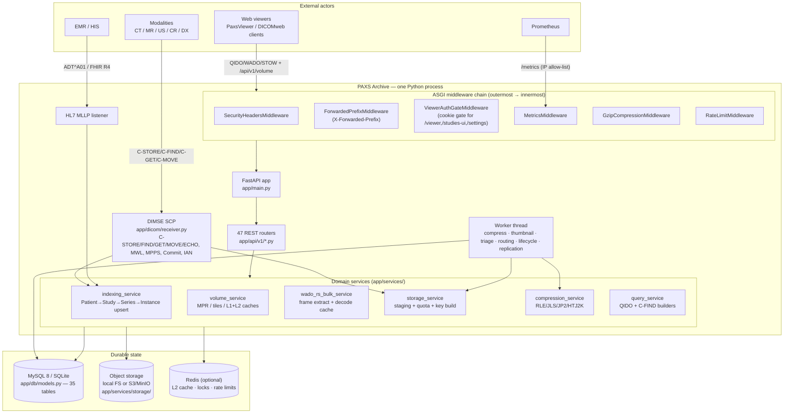
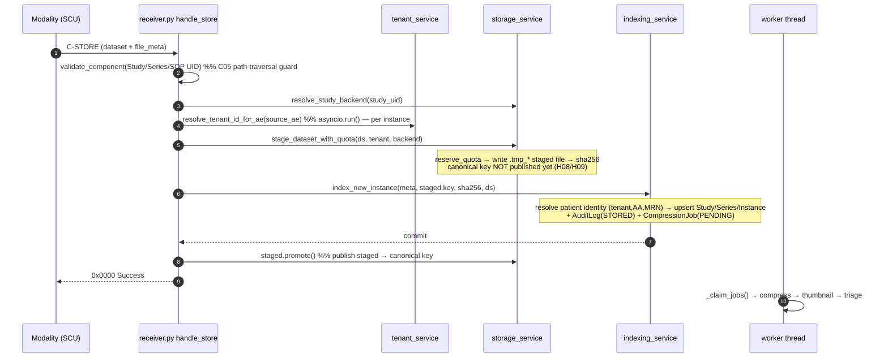
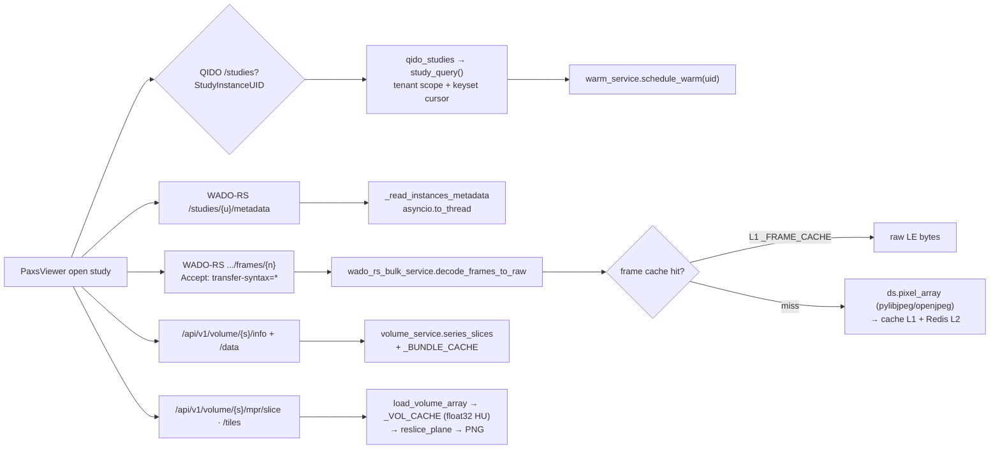

# 01 — PAXS Archive & PAXS Viewer: Codebase Architecture

> **Audit scope:** full repository at `D:/Paxs Archive` (136 Python modules under `app/`, ~183 hand-authored + bundled JS files under `app/static/`).
> **Method:** line-by-line reading of the shipping source. Every claim below is grounded in a concrete file/class/function.
> **Baseline environment (verified):** Python 3.14 host with `./venv`; `pydicom 3.0.2`, `pynetdicom 3.0.4`, `fastapi 0.141.1`, `sqlalchemy 2.0.51`, `numpy 2.5.1`, `pillow 12.3.0`, `imagecodecs 2026.6.26`, `pylibjpeg 2.1.0`, `pylibjpeg-openjpeg 2.5.0`, `pyjpegls 1.5.1`, `redis 8.1.0`. All four lossless codecs (RLE / JPEG-LS / JPEG2000 / HTJ2K) report `available=True` via `compression_service.codec_status()`.

---

## 1. System Overview

PAXS is a **single-process, self-hosted DICOM archive (PACS/VNA)** built on FastAPI + pynetdicom + SQLAlchemy. One `python run_paxs.py` boots five co-resident subsystems in the same OS process:

| Subsystem | Entry point | Transport |
|---|---|---|
| Async REST API | `app/main.py` → `FastAPI(...)` | HTTP `:8000` (`PAXS_PORT`) |
| DICOM DIMSE SCP | `app/dicom/receiver.py:start_receiver_in_thread()` | DICOM `:10400` (`DICOM_PORT`) |
| Background worker | `app/services/worker.py:start_worker()` | daemon thread |
| HL7 v2 MLLP listener (optional) | `app/dicom/hl7.py:start_hl7_listener()` | `:2575` |
| Four embedded SPAs | `app/static/{viewer,studies-ui,admin,settings}` | served same-origin |

The process is **stateless with respect to the API tier**: all durable state lives in MySQL 8 / SQLite and in local-or-S3 object storage, which is what allows the HAProxy scale-out documented in `deploy/SCALE-OUT-GUIDE.md`.

### 1.1 Component topology

### 1.2 Layering rules (as implemented)

* **`app/core/`** — cross-cutting primitives with no upward imports: `config.py` (pydantic-settings + `resolve_public_base_url`), `security.py` (PBKDF2 + stdlib HS256 JWT), `roles.py`, `proxy_prefix.py`, `dicom_diagnostics.py`, `cache_stats.py`, `licensing/`.
* **`app/db/`** — `models.py` (declarative ORM), `session.py` (async + sync engines, read replica), `perf.py` (slow-query hooks).
* **`app/services/`** — 50+ domain services; the only layer allowed to touch storage + ORM together.
* **`app/api/v1/`** — thin HTTP adapters; auth is enforced by `app/api/v1/deps.py` dependencies.
* **`app/dicom/`** — DIMSE/HL7 protocol adapters; run on **sync** SQLAlchemy sessions because pynetdicom handlers execute on its own threads.
* **`app/static/`** — SPA shells + viewer bundle; the hand-written viewer enhancements are the `paxs-*.js` files.

---

## 2. End-to-End Data Flow

### 2.1 Ingest (modality → archive)

Key guarantees implemented here:
* **Quota before bytes** — `storage_service.stage_dataset_with_quota` reserves quota before writing, and `StagedObject.discard()` compensates on any failure.
* **Nothing published until the DB row is durable** — `stage → index → commit → promote` ordering (H08/H09).
* **Idempotent re-import** — storage keys are `{StudyUID}/{SeriesUID}/{SOPUID}.dcm`, so a re-sent instance overwrites its own object.

### 2.2 Query/Retrieve (viewer → pixels)

### 2.3 The three in-process caches (memory budget surface)

| Cache | Module | Key | Bound |
|---|---|---|---|
| Decoded frame LRU | `wado_rs_bulk_service._FRAME_CACHE` | `(sop_uid, frame_idx)` | `DICOM_FRAME_CACHE_MB` (256 MB) — byte-budgeted, LRU |
| Materialised volume L1 | `volume_service._VOL_CACHE` | `series_uid` | `VOLUME_CACHE_BUDGET_MB` (1024 MB) — byte-budgeted, LRU |
| Rendered tile L1 | `volume_service._TILE_CACHE` | `series:plane:index:window` | 256 entries (count-bounded) |
| Bundle metadata | `volume_service._BUNDLE_CACHE` | `series_uid` | 32 entries — **not tenant-scoped** (see 02 §M-7) |

Redis is the L2 tier for frames (`paxs:frame:*`), volumes (`paxs:vol:*`), tiles, rendered images and thumbnails.

---

## 3. Annotated Module Map

### 3.1 `app/core/`

| File | Role |
|---|---|
| `config.py` | `Settings` (pydantic-settings, ~150 keys). `validate_production_settings` (H06 fail-closed), `validate_memory_budgets`, `resolve_public_base_url` (single source for share/QR/FHIR URLs, V2-2). |
| `security.py` | PBKDF2-HMAC-SHA256 (200k iters) passwords; stdlib HS256 JWT; opaque rotating refresh tokens (SHA-256 hashed at rest). |
| `roles.py` | Role vocabulary incl. `DESTRUCTIVE_ROLES`. |
| `proxy_prefix.py` | `normalise_prefix`, `prefix_path`, `inject_boot`, `ForwardedPrefixMiddleware` (sub-path deployments, V2-4). |
| `dicom_diagnostics.py` | `decode_context(ds)` — PHI-free decode-failure context (syntax + pixel layout). |
| `cache_stats.py` | Counters/gauges for the L1 caches (hit/miss/evict/bytes). |
| `licensing/` | `manager.py`, `crypto.py`, `fingerprint.py`, `deps.py` — offline license + online heartbeat. |

### 3.2 `app/db/`

| File | Role |
|---|---|
| `models.py` | 35 tables. Hot indexes: `ix_studies_tenant_date`, `ix_studies_state_created`, `ix_series_study_number`, `ix_instances_series_number`, `ix_patient_identities_tenant_aa_identifier` (unique), `ix_triage_reviewed_severity`. |
| `session.py` | **Async engine = `NullPool`** (one connection per request; never reuse across event loops). **Sync engine = bounded `QueuePool`** (`DB_POOL_SIZE`/`MAX_OVERFLOW`, pre-ping, recycle) for the receiver + worker. Optional read replica + `get_read_db`. `init_db` runs Alembic for an empty DB and only *checks* drift otherwise (H11). |
| `perf.py` | Slow-query hooks feeding the Admin → DB Pool ring buffer. |

### 3.3 `app/dicom/`

| File | Role | Notable |
|---|---|---|
| `receiver.py` | DIMSE SCP: `handle_store/find/get/move`, `handle_worklist_find`, `handle_n_create/n_set/n_action`. | Storage Commitment N-ACTION + MPPS + MWL. `handle_store` uses `asyncio.run()` **per instance**. |
| `sender.py` | SCU helpers: `send_file`, `send_find`, `send_move`, `send_get`, `send_echo`, `send_keys`, `send_to_node_sync`, `pull_from_node_sync`. | Builds a **new `AE`/association per instance**; no ACSE/DIMSE timeouts. **No `c_move_study`** (see 02 §H-1). |
| `parser.py` | `parse_metadata` — flat dict for the ORM. | Defensive `getattr`; captures `transfer_syntax_uid`. |
| `hl7.py` | MLLP listener + ADT/ORU builders. | Thread-per-connection, unbounded buffer (02 §H-3/H-4). |
| `tls.py` | `server_context` / `client_context` / `scu_tls_args`. | SCU defaults to `CERT_NONE` (02 §M-10). |
| `commit_sender.py` | Async N-EVENT-REPORT delivery for Storage Commitment. | Association registry keyed by Transaction UID. |

### 3.4 `app/services/` (selected critical modules)

| File | Role |
|---|---|
| `storage_service.py` | Backend facade + `validate_component` (C05 path safety) + `StagedObject` (stage/promote/discard) + quota integration. |
| `indexing_service.py` | `resolve_patient_identity` (C10 tenant+AA+MRN identity, conflict quarantine), `get_or_create_study/series`, `index_new_instance` (audit + compression job + GSPS/KIN/RDSR fan-out). |
| `query_service.py` | QIDO + C-FIND query builders; **tenant scoping defaults to `include_all=False`** (safe-by-default). |
| `volume_service.py` | `series_slices` (geometry, multi-frame expansion, Enhanced dimension ordering), `volume_bundle`, `iter_volume_bytes`, `reslice_plane`, `render_plane_tile`, L1/L2 caches, in-flight coalescing (V3-1), hybrid mode resolution. |
| `wado_rs_bulk_service.py` | `extract_frame_bytes` / `decode_frames_to_raw` + byte-budgeted frame cache. |
| `compression_service.py` | `compress_file` with graceful RLE fallback; HTJ2K via `imagecodecs` on pydicom 3.0.x. |
| `worker.py` | `CompressionWorker`: atomic PENDING→RUNNING claim, triage (Redis-locked), lifecycle/routing/replication/session sweeps. |
| `dicomweb_client.py` | Remote QIDO/WADO/STOW with SSRF guard (`validate_web_url`). |
| `imaging.py` | `dataset_to_image` / `dataset_to_bytes` — display rendering (modality LUT + VOI + percentile stretch). |
| `anonymizer.py` | PS3.15 Basic-profile subset de-identification for research export. |
| `audit_service.py` | `add_audit` — STORED/RETRIEVED/COMPRESSED/DELETED/SHARED with SHA-256 fingerprint. |
| `lossy_compression_service.py` | Lossy re-compression rule engine. **Defective** (02 §C-2). |
| `split_merge_service.py` | Study split/merge with DICOM header rewrite. **Defective** (02 §C-1). |
| `prefetch_service.py` | Prior-study prefetch via C-FIND + C-MOVE. **Dead C-MOVE path** (02 §H-1). |

### 3.5 `app/api/v1/` — route surface

278 route decorators across 49 routers. Auth is dependency-based:

* `deps.py` provides `get_current_user`, `get_optional_user`, `get_current_user_any`, `require_admin`, `require_destructive_role`, `require_dicomweb_access/read/write`, `require_study_access`, `require_series_access`, `require_instance_access`, and share-token resolution (`get_share_scope`).
* **Router-level guards** exist only on `dicomweb.py` (`require_dicomweb_access`), `auth.py`, `ldap.py`; every other router guards per-route. Verified: 1:1 route-to-guard coverage except intentional public endpoints (`/health/live`, `/health/ready`, share-token reads).
* `deps.py` publishes the resolved request scope via `_request_scope: ContextVar` consumed by `current_scope()` inside the DICOMweb handlers.

### 3.6 `app/static/` — viewer frontend

Hand-written (non-bundled) custom JS:

| File | Lines | Role |
|---|---|---|
| `viewer/paxs-mpr.js` | 3769 | Full MPR workspace: 3 Canvas-2D planes + Three.js 3D + WebGL2 R3F texture shader + decode Worker pool. |
| `viewer/paxs-mpr-geometry.js` | 480 | Pure UMD voxel/viewport/patient transform + measurement module (Node-testable). |
| `viewer/paxs-study-list-enhance.js` | 1105 | Study-list thumbnails, footer, report modal, global fetch/XHR 401-retry guard, `getContext` patch. |
| `viewer/paxs-toolbar-enhance.js` | 654 | OHIF toolbar icon replacement + telemetry pill from `window.__getPaxsMprState()`. |
| `viewer/paxs-about.js` | 555 | Custom About/telemetry modal. |
| `viewer/app-config.js` | 58 | DICOMweb data-source config (prefix-rewritten per request). |
| `viewer/google.js` | 0 | **Empty dead file.** |

The `*.bundle.*.js` chunks are the upstream PaxsViewer/OHIF webpack build (vendor); `ort/` is onnxruntime-web.

---

## 4. External Dependencies & Environmental Assumptions

### 4.1 Declared dependencies (`requirements.txt`)

Core: `fastapi`, `uvicorn[standard]`, `pydantic(-settings)`, `sqlalchemy[asyncio]`, `aiosqlite`, `aiomysql`, `pymysql`, `alembic`, `pydicom>=3.0`, `pynetdicom>=2.1`, `numpy`, `pillow`, `python-multipart`, `qrcode`, `cryptography`.
Codecs (required): `pylibjpeg`, `pylibjpeg-libjpeg`, `pylibjpeg-openjpeg`, `pylibjpeg-rle`, `pyjpegls`, `imagecodecs` (HTJ2K/openjph).
Optional: `boto3`/`botocore` (S3), `ldap3` (LDAP — **not installed** in this venv), `celery`/`redis` (commented out).

### 4.2 Environmental assumptions (verified in code)

1. **Ports** — API `:8000` (`PAXS_PORT`), DIMSE `:10400`, HL7 `:2575`. `:8042` (Orthanc) must never appear; its presence indicates a stale template.
2. **Database default is MySQL 8** (`config.py:DATABASE_URL`), SQLite is the zero-setup fallback. `session.py` deliberately uses `NullPool` for async and a bounded `QueuePool` for sync.
3. **Redis is optional but on by default** (`REDIS_CACHE_ENABLED=True`). Cache-dependent tests must disable it for determinism.
4. **`SpecificCharacterSet` is not persisted** — `parse_metadata` never reads it; names are decoded by pydicom at read time and stored as `utf8mb4`. The DB charset is forced to `utf8mb4` by `session._ensure_charset`.
5. **`STORAGE_ALLOW_LEGACY_PATHS`** is the documented one-shot migration escape hatch that bypasses storage containment while enabled.
6. **Single-process deployment** is the baseline; the worker can also run standalone (`python -m app.services.worker`) for CPU scale-out.
7. **Windows-first host** — `session.py` applies the `WindowsSelectorEventLoopPolicy` on Python < 3.14; the repo ships `.bat` launchers and a PyInstaller spec.

### 4.3 Configuration divergence worth noting

`.env.example` ships `DEFAULT_COMPRESSION=RLE` and `TOKEN_EXPIRE_MINUTES=480`, whereas `config.py` defaults are `JPEG-LS` and `15`. Operators who copy `.env.example` therefore run RLE compression and 8-hour access tokens — the latter weakens the short-lived-token design (auth plan §2.1).

---

## 5. Test & Tooling Surface

* `tests/` (pytest, 77 suites claimed in README) and `.workbuddy-ai/tmp/` extracted-source harnesses (`about-test.js`, `toolbar-test.js`, `cascade-test.js`, `auth-guard-test.js`, `tex-upload-test.js`, `fetch-deadline-test.js`, `spa-404-test.py`, `volume-coalesce-test.py`, `proxy-prefix-test.py`, `proxy-integration-test.py`, `memory-observability-test.py`).
* `migrations/versions/` — 20+ Alembic revisions; `session.init_db` treats Alembic as the sole schema authority.
* `deploy/` — Dockerfile, `docker-compose.lb.yml`, `haproxy.cfg`, Prometheus + Grafana, reverse-proxy recipes, vendor portal (PHP).
* `scripts/` — demo, license generation, EXE build, service install, remote migration, gateway server.

---

## 6. Architectural Strengths (to preserve)

1. **Safe-by-default tenant scoping** — `apply_study_tenant_scope` defaults `include_all=False`; forgetting the argument yields the restrictive behaviour.
2. **Stage-then-publish ingest** — no partial objects on failure; quota is reserved before bytes land.
3. **Byte-budgeted caches** — L1 volume/frame caches are bounded by bytes, LRU, and independently capped from the negotiation budget.
4. **PHI-free logging discipline** — `decode_context` and the negotiate audit trail deliberately exclude demographics and paths.
5. **Fail-closed production gate** — `validate_production_settings` refuses to boot with a default secret / insecure cookies.
6. **Atomic work claims** — `worker._claim_jobs` uses a guarded `UPDATE ... WHERE status='PENDING'` and checks `rowcount`.

The findings in `02` and `03` are where this otherwise-disciplined codebase still has gaps — concentrated in the *newer, less-travelled* clinical features (lossy compression, split/merge, prefetch, FHIR patient search) and in the frontend memory model.
