# PAXS Archive — Application Workflows

> How PAXS Archive behaves end to end, one workflow at a time: who starts it, which code runs, what gets written,
> and what the user sees. Snapshot of commit `5a32aa4` (baseline `e90d32c`). File references are `path:line` at
> `5a32aa4`.
>
> ⚠️ callouts mark places where today's code differs from the intended flow. The IDs point to
> [CODE_REVIEW.md](CODE_REVIEW.md): baseline IDs (S-, D-, F-) keep their meaning, and NEW-xx are findings first
> seen in `5a32aa4`.

**Contents**

0. [The life of a study (overview)](#0-the-life-of-a-study-overview)
1. [Server startup](#1-server-startup)
2. [Sign-in, session and sign-out](#2-sign-in-session-and-sign-out)
3. [Image ingest over DIMSE (C-STORE)](#3-image-ingest-over-dimse-c-store)
4. [Background worker loop](#4-background-worker-loop)
5. [DIMSE query / retrieve (C-FIND, C-MOVE, C-GET)](#5-dimse-query--retrieve-c-find-c-move-c-get)
6. [Browsing and viewing a study (QIDO / WADO / MPR)](#6-browsing-and-viewing-a-study)
7. [Web upload (STOW-RS)](#7-web-upload-stow-rs)
8. [Order-to-report clinical workflow](#8-order-to-report-clinical-workflow)
9. [Critical results and peer review](#9-critical-results-and-peer-review)
10. [Forwarding and routing](#10-forwarding-and-routing)
11. [Pulling from remote nodes, migration and prefetch](#11-pulling-from-remote-nodes-migration-and-prefetch)
12. [Storage lifecycle, compression, quotas and DR replication](#12-storage-lifecycle-compression-quotas-and-dr-replication)
13. [Patient share links](#13-patient-share-links)
14. [Export: anonymized ZIP and DICOMDIR](#14-export-anonymized-zip-and-dicomdir)
15. [Administration: settings, users and consoles](#15-administration-settings-users-and-consoles)
16. [Licensing: activation and heartbeat](#16-licensing-activation-and-heartbeat)
17. [Event hooks: webhooks and custom scripts](#17-event-hooks-webhooks-and-custom-scripts)
18. [Behind a reverse proxy (sub-path)](#18-behind-a-reverse-proxy-sub-path)

---

## 0. The life of a study (overview)

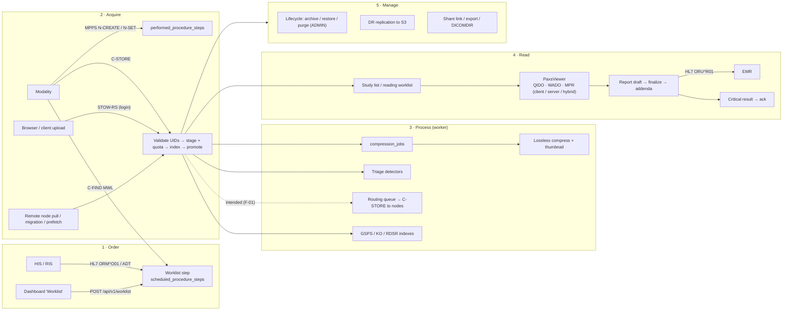

---

## 1. Server startup

**Trigger:** `python run_paxs.py` (also `run_all.bat`, the NSSM service or Docker `CMD`). **Code:** `run_paxs.py`,
`app/main.py:477-535`, `app/db/session.py:234-278`.

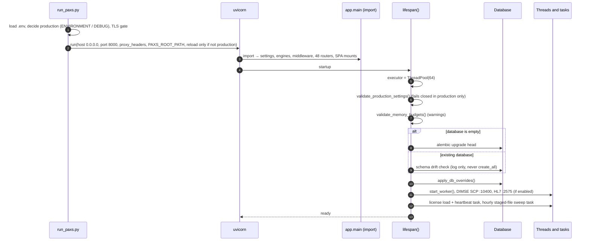

> ⚠️ A clean checkout still fails at import (B-01, B-02). The production gate is skipped by default because
> `ENVIRONMENT=development` (S-01). On a fresh MySQL install the first boot runs the migration chain, which probably
> stops at `b4567890c1d2` (NEW-04).

---

## 2. Sign-in, session and sign-out

**Code:** `app/static/login.html`, `app/api/v1/auth.py`, `app/api/v1/ldap.py`, `app/services/ldap_service.py`,
`app/core/security.py`, `app/api/v1/deps.py`, `ViewerAuthGateMiddleware` (`main.py:337`).

| Credential | Format | Where it lives | Used by |
|---|---|---|---|
| Access token | HS256 JWT `{sub, role, iat, exp}`, 15 min | `localStorage["paxs_token"]`, sent as `Authorization: Bearer` | `get_current_user` routes |
| Refresh session | `"<family>.<random>"`, SHA-256 stored in `sessions`, 7-day sliding window, **expiry checked on every request** | HttpOnly `paxs_session` cookie | Viewer gate, `/auth/refresh`, `get_current_user_any`, DICOMweb guard |
| Share token | `token_urlsafe(32)` | `paxs_share` HttpOnly cookie (≤ 1 day), `?share=`, or `X-PAXS-Share-Token` | Read access to one study (§13) |

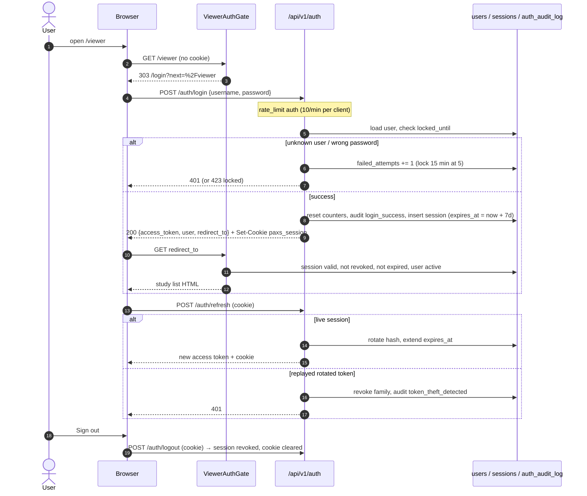

**Registration** (`POST /api/v1/auth/register`, `auth.py:172-240`): on an **empty** database the first caller
becomes ADMIN, even with registration disabled. After that it returns 403 unless `ALLOW_REGISTER=true`, and then
only roles in `REGISTER_ALLOWED_ROLES` (default PHYSICIAN; ADMIN and RADIOLOGIST never) can be chosen.

**LDAP / Active Directory** (`POST /api/v1/ldap/login`, `ldap.py:60-107`):
1. The request is rate-limited. It returns 503 unless `LDAP_ENABLED` and the server and base DN are set.
2. The service binds with `LDAP_USER_DN_TEMPLATE`, looks up the user's groups, and maps the first matching group
   through `LDAP_GROUP_ROLE_MAP`, falling back to `LDAP_DEFAULT_ROLE` or denying.
3. On failure: audit `login_failed` and a generic 401.
4. On success: create a user (no local password) or update the existing one, check `is_active`, audit, and return
   a **bearer JWT only**, with no refresh cookie.
5. The login page has no LDAP option, so directory users are sent back to `/login` by the cookie-gated pages.

> ⚠️ The forgeable default key outside production (S-01). First-run takeover (NEW-07). `/login?next=/\host` is
> still an open redirect. `GET /logout` only clears the cookie, and access tokens outlive logout.
> `LDAP_USE_TLS` is not implemented (NEW-08). LDAP adopts local accounts with the same name (NEW-10).

---

## 3. Image ingest over DIMSE (C-STORE)

**Actors:** modality or PACS (SCU) and the PAXS SCP `PAXS_SCP@:10400`. **Code:** `app/dicom/receiver.py:85-166`,
`app/services/storage_service.py`, `app/services/indexing_service.py`, `app/services/quota_service.py`.

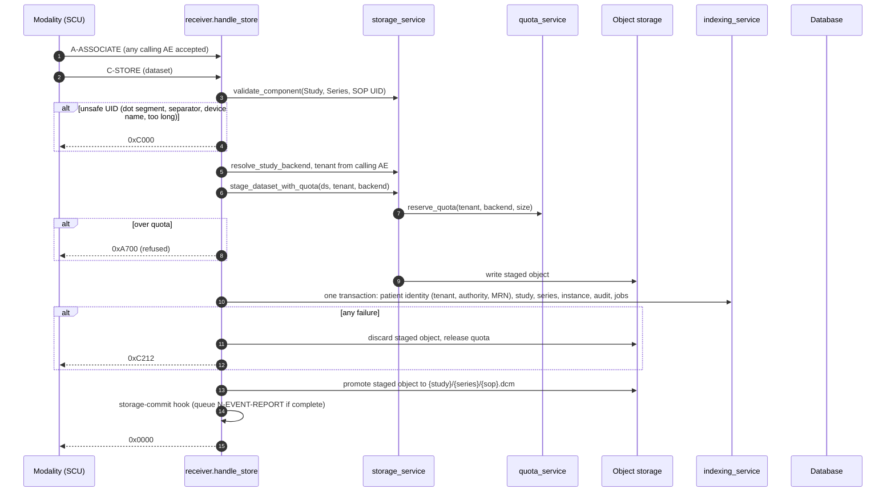

**Patient identity:** a patient is identified by (tenant, assigning authority, MRN). A missing PatientID becomes
`UNIDENTIFIED-<StudyInstanceUID>`. Demographic mismatches are written to `patient_identity_conflicts` instead of
overwriting validated data, and HIS-sourced values are authoritative.

**What lands where:** object storage (staged first, then promoted), `patients`/`studies`/`series`/`instances`,
`audit_log` (`STORED`), `compression_jobs`, the derived GSPS/KO/RDSR tables, `storage_quotas.used_bytes`
(reserved), `replication_records` when DR is on.

> ⚠️ Routing, webhooks and scripts still fire inside the uncommitted transaction, so auto-routing never matches
> (F-01). Study/series/instance creation has no savepoints, and a promote failure after commit leaves a dangling
> row (D-01). Any AE may store (S-11). Missing UIDs share one fallback key (NEW-26). NULL-tenant MRNs are not
> unique (NEW-03).

---

## 4. Background worker loop

**Code:** `app/services/worker.py`. **Unchanged** since the baseline.

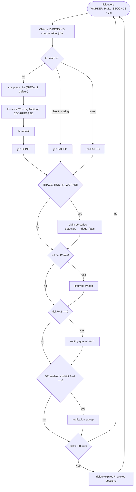

A separate asyncio task in the API process sweeps abandoned `.tmp_*` staged objects every hour.

> ⚠️ The lifecycle sweep is still a no-op (F-02). Jobs can be processed twice (F-08). The standalone worker
> (`python -m app.services.worker`) still calls `create_all` (NEW-25).

---

## 5. DIMSE query / retrieve (C-FIND, C-MOVE, C-GET)

**Code:** `app/dicom/receiver.py`, `app/services/query_service.py`. Behaviour is unchanged since the baseline,
except that the calling AE's tenant also scopes these queries.

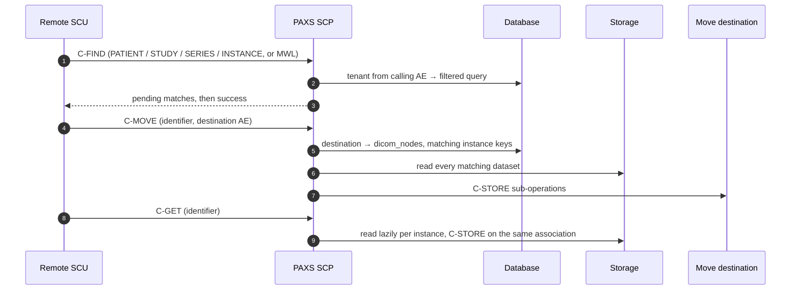

> ⚠️ S-11: no AE allow-list. A missing or empty UID still matches everything. SERIES and INSTANCE C-FIND ignore
> the parent UID.

---

## 6. Browsing and viewing a study

**Code:** `main.py:752-806`, `api/v1/dashboard.py`, `api/v1/dicomweb.py` (router guard `require_dicomweb_access`),
`api/v1/volume.py`, `services/volume_service.py`, `static/viewer/paxs-*.js`.

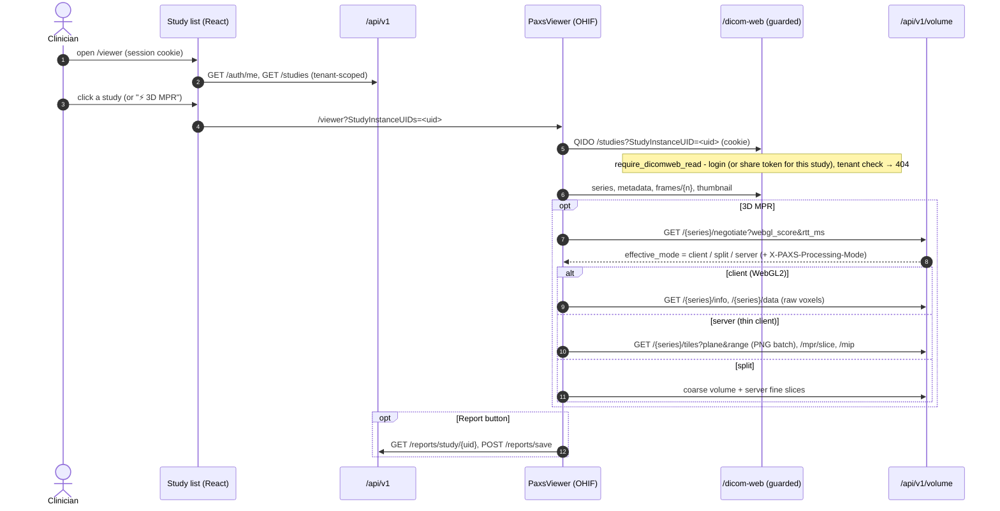

**MPR processing modes** (`volume.py`):
- The mode is set by `VIEWER_PROCESSING_MODE` (default `hybrid`) and can be overridden per role through
  `VIEWER_PROCESSING_ROLE_MAP`.
- In hybrid mode the server decides from the client's GPU score and RTT, the server-session count and the memory
  budget.
- In server mode `/data` returns 503 with `X-PAXS-Mode-Hint: server`. In client mode `/mip` and `/mpr/slice` return
  503 with `X-PAXS-Mode-Hint: client`. `force=1` bypasses both guards.
- Every volume response carries `X-PAXS-Server-Load` and `X-PAXS-Vol-Cache-MB`.

**Viewer tools:**
- Layouts: 4-grid, 1×2, 1×3, 3D and single planes. W/L presets: soft tissue, brain, lung, bone, angio.
- Interaction: cine, LOD while interacting, crosshair, calipers (mm), elliptical ROI with HU statistics, Cobb
  angle, CTR.
- PET/CT fusion, plus 3D cut planes, VRT and MIP with presets.
- Toolbar telemetry pill and an About dialog.

> ⚠️ NEW-02: the GPU path can show the wrong pixel rows in sagittal/coronal. NEW-06: fusion is aligned by index,
> not geometry. NEW-23: other viewer defects. NEW-13: volume routes have no byte caps. NEW-22: GSPS/`zorder`
> tenant gaps.

---

## 7. Web upload (STOW-RS)

**Entry:** the dashboard "Upload" dialog, the PaxsViewer STOW, or any DICOMweb client. **Code:**
`dicomweb.py:941-1100`, `dicomweb_service.iter_stow_parts`.

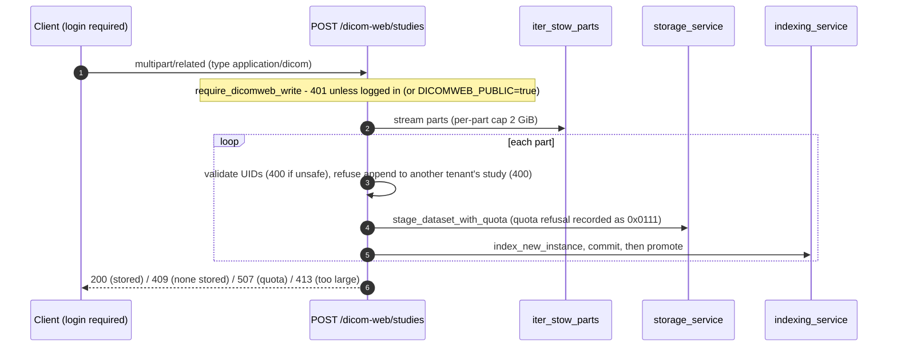

> ⚠️ Reusing another tenant's SOP or series UID still repoints their instance (NEW-05). The header and preamble
> buffers are uncapped. Earlier parts stay stored when a later part raises 400 (NEW-20 also covers the public-mode
> write).

---

## 8. Order-to-report clinical workflow

**Code:** `app/dicom/hl7.py`, `worklist_service.py`, `mpps_service.py`, `reading_worklist_service.py`,
`report_service.py`, `api/v1/reports.py`, `viewer/paxs-study-list-enhance.js`.

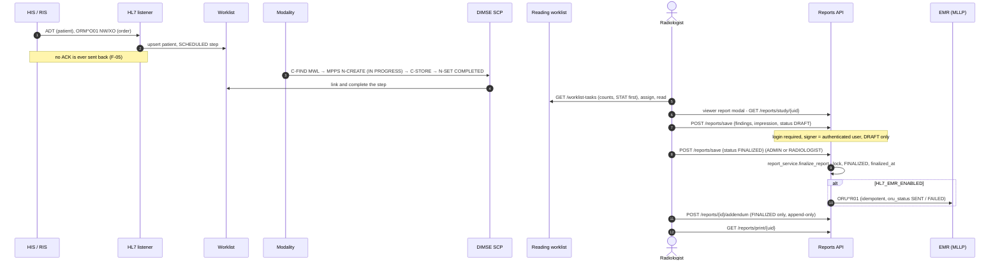

| Path | Endpoints | Finalize gate | ORU | Used by |
|---|---|---|---|---|
| Viewer path | `GET /reports/study/{uid}` → `POST /reports/save` (`DRAFT`/`FINALIZED`) → `GET /reports/print/{uid}` | ADMIN / RADIOLOGIST | Yes (via `finalize_report`) | PaxsViewer report modal (only Finalize-capable roles see the button) |
| API path | `POST /reports` → `PATCH /reports/{id}` → `POST /reports/{id}/finalize` · `/resend` · `/addendum` | ADMIN / RADIOLOGIST | Yes | API clients. The dashboard only reads `GET /reports?study_uid=` |

### Report state machine

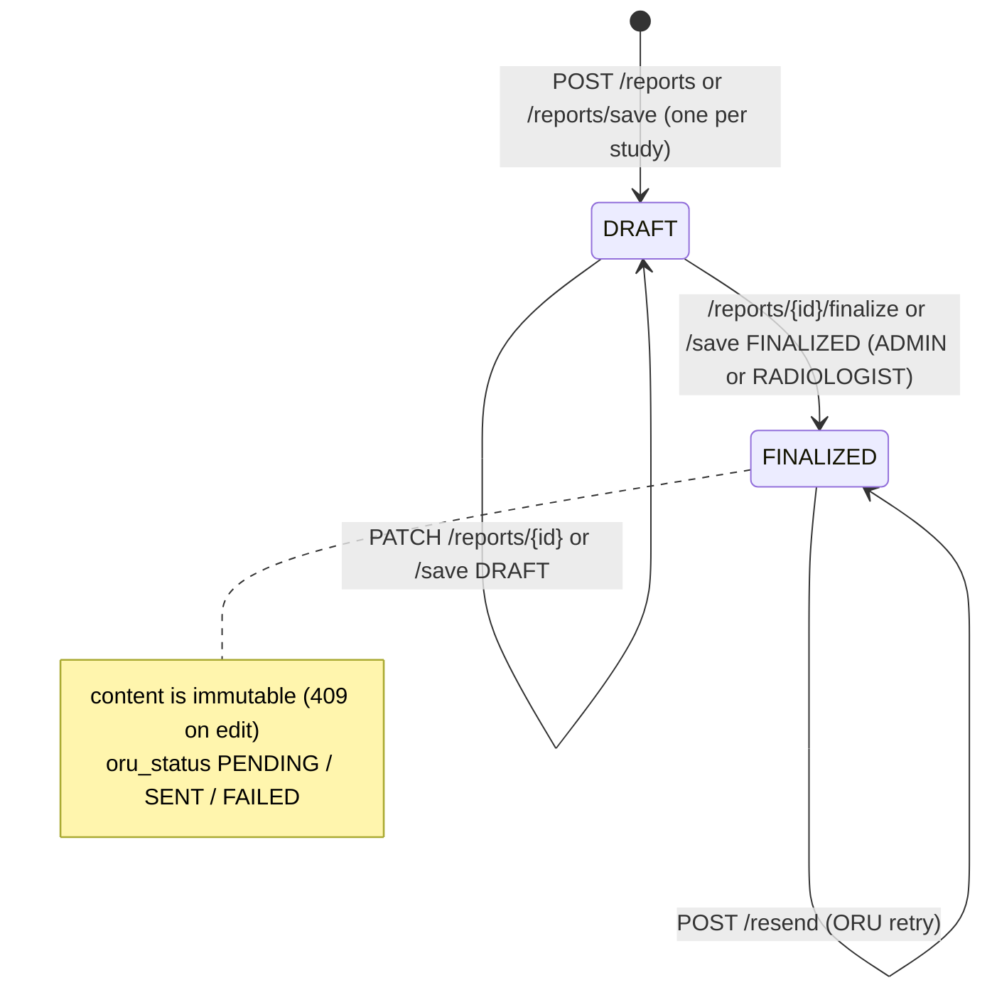

### Worklist step state machine (unchanged)

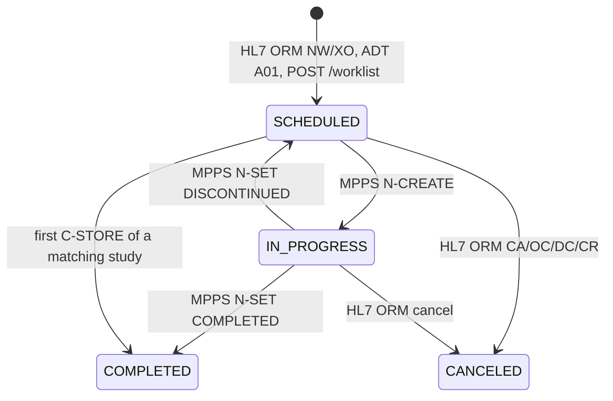

> ⚠️ **NEW-01:** when a draft already exists, `/save` with `FINALIZED` signs the *stored* draft and drops the
> text just submitted, which is exactly what the viewer's Finalize button sends.
> **NEW-09:** report and worklist routes are not tenant-scoped.
> **NEW-24:** ORU CR/LF injection, possible double ORU, misleading print output, and addenda that are never shown
> or sent.
> **S-08:** `POST/PATCH /reports` still accept the signer from the body, and worklist claims are any-role.

---

## 9. Critical results and peer review

Unchanged since the baseline: `POST /api/v1/critical-results` → PENDING_ACK, audit, webhook and script
`CriticalResultFlagged`, STAT overlay in the reading worklist → `POST /{id}/acknowledge`. Peer review goes
PENDING → ASSIGNED → COMPLETED (RADPEER 1–4).

> ⚠️ Any logged-in user can create, acknowledge, assign and score (S-08). Side effects fire before the commit.

---

## 10. Forwarding and routing

- **Manual send:** `POST /api/v1/nodes/{ae}/send` (ADMIN/RADIOLOGIST) → `resolve_keys_sync` (tenant-scoped) →
  C-STORE. The React ForwardModal now calls it.
- **Auto-routing:** rule CRUD is **ADMIN**, and `evaluate`, `queue/run` and `retry` need ADMIN/RADIOLOGIST.
  The queue state machine is unchanged (PENDING → SENDING → COMPLETED / PENDING with `60·attempts²` back-off /
  FAILED). Temporary files from remote S3 backends are now cleaned up.

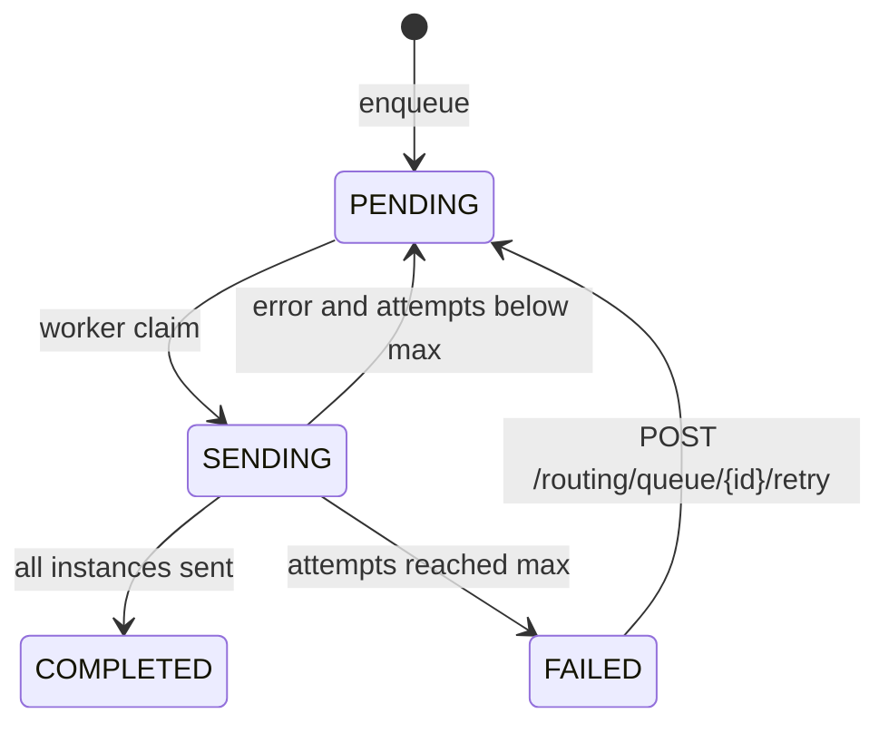

> ⚠️ F-01: ingest-time evaluation still can't see the new study. Manual evaluation fails open on the source AE
> filter.

---

## 11. Pulling from remote nodes, migration and prefetch

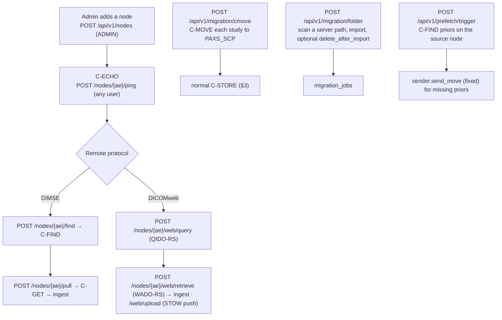

> ⚠️ Folder and C-MOVE migration are still open to **any** logged-in user, and folder import can delete files on
> any server path (S-08). Pull, DICOMweb-client, KIN and migration ingest skip the quota check (F-04). Prefetch
> still has no automatic trigger.

---

## 12. Storage lifecycle, compression, quotas and DR replication

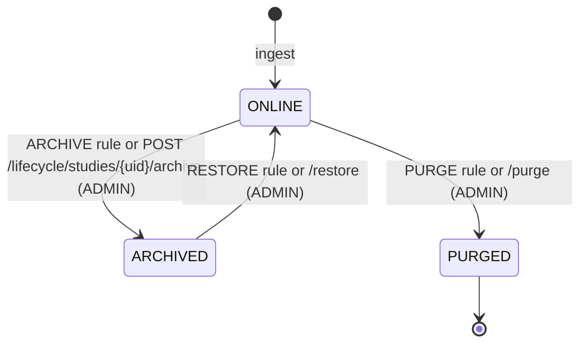

| Mechanism | Trigger and gate | What happens | Notes |
|---|---|---|---|
| Lossless compression | Every stored image → worker | Re-encode in place, then thumbnail | Unchanged |
| Lossy compression | `LOSSY_COMPRESSION_ENABLED=false` by default; rules and run need ADMIN/RADIOLOGIST | Native-pixel JPEG-LS near-lossless or JPEG 2000 lossy only (baseline JPEG rejected). Eligible sources: uncompressed or verified lossless. Encoder, geometry and decode checks before publish; quota charged by delta | ⚠️ The original is replaced before the DB commit (NEW-12) |
| Lifecycle | Rule CRUD, run and per-study actions need **ADMIN**; worker every 12 ticks | First matching rule → ARCHIVE / RESTORE / PURGE | ⚠️ The worker sweep is a no-op (F-02); not transactional (F-14) |
| Quotas | `/api/v1/quotas` (ADMIN) | `reserve_quota` at C-STORE, STOW and lossy staging; 0xA700 / 507 when over | ⚠️ Mis-scoped, and the counter only grows (NEW-11) |
| Storage backends | `/api/v1/storage` (ADMIN) | Default backend, per-study pinning, move between backends | Unchanged |
| DR replication | Worker every 4 ticks when enabled; `/api/v1/replication/*` (ADMIN) | Copy objects to `replica/{study}/{sop}.dcm` | Backfills only the 500 newest studies |

---

## 13. Patient share links

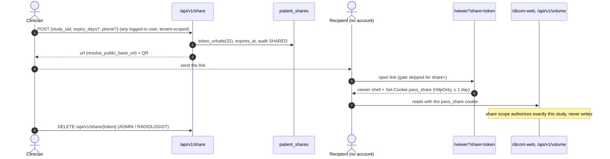

> ⚠️ Recipients can't load the study-metadata endpoints, and share tokens in query strings can leak; the React
> ShareModal creates a link as soon as it opens (NEW-21). Share URLs trust forwarded host headers (NEW-17).

---

## 14. Export: anonymized ZIP and DICOMDIR

- **Anonymized export:** `GET /api/v1/export/{study_uid}/anonymized` (logged-in user, **tenant-checked** with
  `require_study_access`). PHI is stripped at top level, UIDs are remapped and the ZIP is built in memory with an
  `EXPORTED` audit row.
- **DICOMDIR:** `POST /api/v1/export/dicomdir` (`/preview` returns the structure only), tenant-checked, with an
  `EXPORT_DICOMDIR_CREATED` audit row.

> ⚠️ Both still build the ZIP synchronously on the event loop. The preview returns patient names without an
> audit row.

---

## 15. Administration: settings, users and consoles

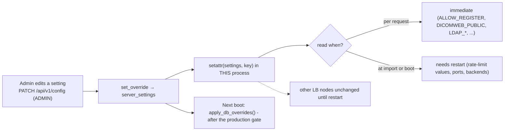

| Console | Routes | Gate | Notes |
|---|---|---|---|
| Users and sessions | `/api/v1/users`, `/users/sessions` | ADMIN | Password reset now revokes cookie sessions |
| Server settings | `/api/v1/config` | GET any user, PATCH ADMIN | ⚠️ GET shows the full registry (LDAP, S3) to every role (NEW-19). Changes are not audited (NEW-18) |
| Organization and templates | `/api/v1/settings/organization`, `/api/v1/templates` | GET any user, writes **ADMIN** | Logo: PNG/JPEG/WEBP ≤ 2 MiB, random name |
| Database | `/api/v1/db/*` | ADMIN (status: any user) | `init` still seeds `admin/admin123` by default |
| DB performance | `/api/v1/db/perf/*` | ADMIN / RADIOLOGIST | — |
| Redis | `/api/v1/redis/*` | status/keys/key/ping any user, the rest ADMIN | ⚠️ `status` returns the saved password to any role (S-05) |
| Health | `/api/v1/health` (ADMIN), `/health/live` and `/health/ready` (public) | — | — |
| Metrics | `/metrics` | IP allow-list (`METRICS_ALLOW_IPS`) or any user | ⚠️ Default allows all RFC1918 (NEW-14) |
| Tenants | `/api/v1/tenants` | ADMIN (list: ADMIN/RADIOLOGIST) | — |
| Scripts | `/api/v1/scripts` | ADMIN | ⚠️ `/stats` still imports every script (S-10) |
| Control Panel | `/admin` + `/api/v1/admin-panel/*` | ADMIN API, page not gated | — |

---

## 16. Licensing: activation and heartbeat

Unchanged on the PAXS side (`app/core/licensing/`):
1. `GET /license/fingerprint` (now ADMIN) shows the hardware ID.
2. `POST /license/activate-online` (ADMIN) sends the key, fingerprint and hardware info to the portal's
   `api/activate.php`.
3. The portal checks the quota and email and returns an RSA-signed, AES-GCM-encrypted container, written to
   `paxs.lic`.
4. A heartbeat every 24 h calls `api/validate.php`.

The portal now loads its signing key from `PAXS_VENDOR_PRIVATE_KEY`, a key file, or the git-ignored
`config.local.php`.

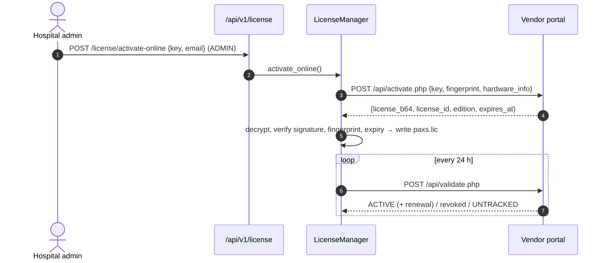

> ⚠️ The old private key is still valid: it's in git history and the public key wasn't rotated (S-02). No route
> enforces the license (F-07).

---

## 17. Event hooks: webhooks and custom scripts

Unchanged. `StudyReceived` (first instance of a new study), `StudyDeleted`, and `CriticalResultFlagged`
(`study_instance_uid`, `patient_id`, `finding_level`, `description`, `reported_by`) go to `WEBHOOK_URLS`
(background thread) and to scripts in `SCRIPTS_DIR` (`EVENTS`, `handle(event, ctx)` / `on_<event>(ctx)`, hot
reload, `.py.disabled` markers, `/api/v1/scripts` ADMIN).

> ⚠️ Hooks fire before the ingest commits. Scripts run in-process. With the default `SCRIPTS_DIR`, the repo's
> tooling scripts are imported whenever any user opens the dashboard (S-10).

---

## 18. Behind a reverse proxy (sub-path)

**New in `5a32aa4`.** **Code:** `app/core/proxy_prefix.py`, `run_paxs.py:72-92`; guide in
`deploy/REVERSE-PROXY.md`.

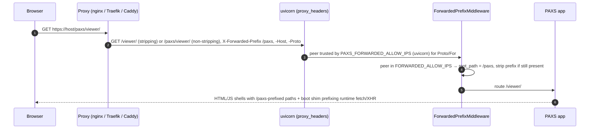

- **Root-mounted (default):** no configuration needed; everything stays byte-for-byte unchanged.
- **Sub-path:** send `X-Forwarded-Prefix` from the proxy (preferred), or set a static root path. Trust the proxy's
  address for **both** uvicorn and the app. `TRUSTED_PROXIES` is what makes the rate limiter see real client IPs,
  and `METRICS_ALLOW_IPS` is checked against the proxy's address.

> ⚠️ NEW-16: the guide and `.env.example` name `PAXS_ROOT_PATH`/`PAXS_FORWARDED_ALLOW_IPS`, which only uvicorn
> reads. The app middleware reads `ROOT_PATH`/`FORWARDED_ALLOW_IPS`, so set both pairs until this is fixed.
> NEW-15: behind a proxy, unless `TRUSTED_PROXIES` includes it, all clients share one rate-limit bucket.
> NEW-14: the proxy's private IP passes the default metrics allow-list. NEW-17: forwarded host headers are trusted
> when building public URLs.
