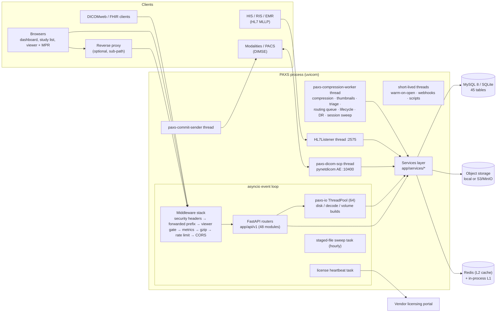
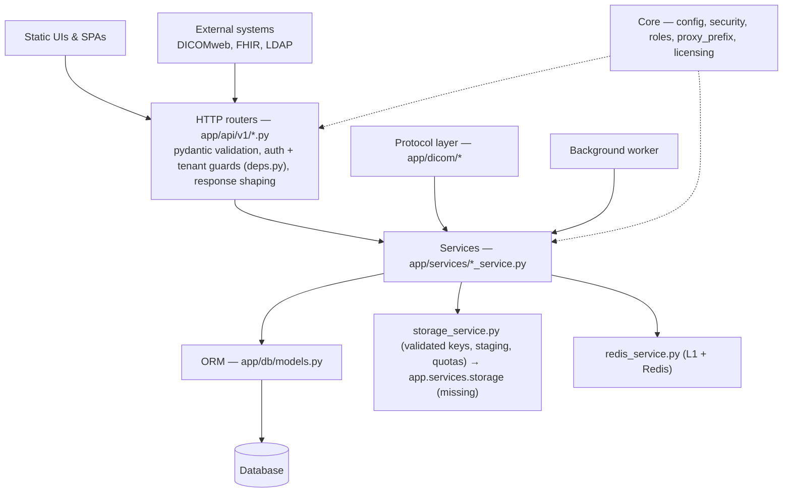
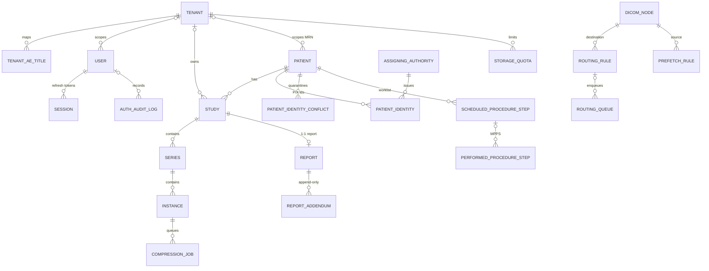
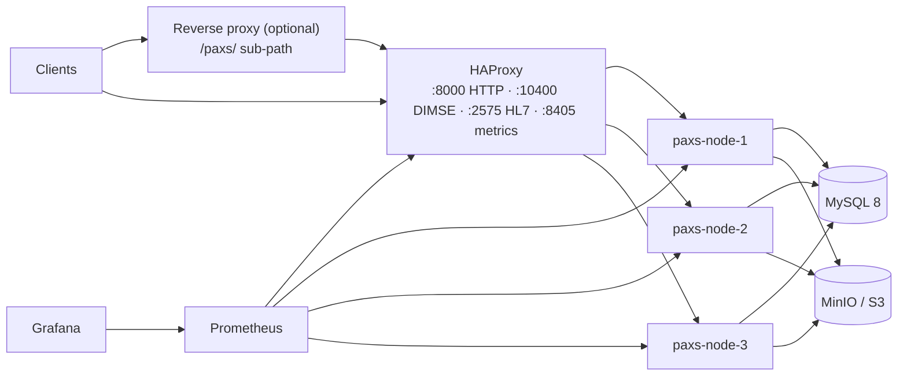

# PAXS Archive — Architecture & Code Structure

> Snapshot of commit `5a32aa4` (main), documented 2026-10-08 by static analysis of the source (baseline
> `e90d32c`). For request-by-request flows see [APP_WORKFLOW.md](APP_WORKFLOW.md); for every HTTP route see
> [API_REFERENCE.md](API_REFERENCE.md); for the defects found see [CODE_REVIEW.md](CODE_REVIEW.md).

---

## 1. What PAXS Archive is

PAXS Archive is a **single-process Python PACS / VNA**. One `uvicorn` process runs:

| Capability | Standard / protocol | Where |
|---|---|---|
| Image ingest, query and retrieve from modalities and PACS | DICOM DIMSE: C-ECHO, C-STORE, C-FIND (Study Root + Modality Worklist), C-MOVE, C-GET, MPPS N-CREATE/N-SET, Storage Commitment N-ACTION | `app/dicom/receiver.py`, `app/dicom/sender.py` |
| Web image access for viewers | DICOMweb: QIDO-RS, WADO-RS, WADO-URI, STOW-RS (+ rendered, thumbnail, frames, bulk), guarded by one router-level dependency | `app/api/v1/dicomweb.py`, `app/api/v1/deps.py` |
| 3D / MPR | Volume streaming, server-side MPR/MIP/VRT, PNG tile batches, and a client/server/hybrid negotiation | `app/api/v1/volume.py`, `app/services/volume_service.py`, `app/static/viewer/paxs-mpr*.js` |
| Hospital system integration | HL7 v2 over MLLP (ADT, ORM^O01, QBP PIX/PDQ in; ORU^R01 out), FHIR R4 read (Patient, ImagingStudy), IHE PIX/PDQ, XDS-I.b, IAN, LDAP / Active Directory login | `app/dicom/hl7.py`, `app/api/v1/fhir.py`, `pix_pdq.py`, `xdsi.py`, `ian.py`, `ldap.py` |
| Clinical workflow | Modality worklist, MPPS, radiologist reading worklist, reports with append-only addenda and EMR write-back, critical results, peer review, dose (RDSR), key images (KO), presentation states (GSPS), hanging and clinical protocols, demo "AI" triage and inference | `app/services/*_service.py` |
| Archive management | Lossless and (gated) lossy compression, storage backends (local / S3), tiering and lifecycle, routing queue, DR replication, quotas (reserved at ingest), multi-tenancy (VNA) with tenant-scoped patient identity, migration, prefetch, split/merge, anonymized export, DICOMDIR, patient share links | `app/services/*` |
| Operations | Licensing (RSA-signed, hardware-bound), admin consoles (DB, Redis, settings, users, sessions), Prometheus metrics, custom Python event scripts, production configuration gate, reverse-proxy / sub-path support | `app/core/*`, `app/api/v1/*_panel.py`, `metrics.py`, `scripting_service.py` |
| User interfaces | Legacy dashboard (vanilla JS), React study list, PaxsViewer (OHIF v3 fork, prebuilt, with PAXS add-ons), Control Panel (prebuilt), settings page, login page | `app/static/`, `study-list-ui/` |

### Codebase at a glance

| Metric | `5a32aa4` | (`e90d32c`) |
|---|---|---|
| Python backend (`app/`) | ≈38,200 lines | ≈32,600 |
| HTTP routes | 278 registrations across 48 router modules, plus about 20 direct routes and mounts in `main.py` | 275 |
| Routes with no auth / optional-anonymous | **6 / 0** | 39 / 23 |
| Service modules | 54 (`app/services/*.py`) | 54 |
| Core modules | `config`, `security`, `roles`, `proxy_prefix`, `cache_stats`, `dicom_diagnostics`, `licensing/` | `config`, `security`, `licensing/` |
| ORM models / tables | 45 (`app/db/models.py`) | 43 |
| Alembic migrations | 42 revisions, single head `d6789012e3f4` | 38, head `c0d1e2f3a4b5` |
| Tests | 101 Python files / 1,085 test functions, plus 8 Node test files / 158 cases (`tests/js/`) | 77 / 621 |
| React study list source | ≈3,100 lines TS/TSX | ≈3,400 |
| Prebuilt bundles committed | PaxsViewer, study-list build, Control Panel build | same |

---

## 2. Technology stack

| Layer | Technology |
|---|---|
| Web framework | FastAPI ≥0.115, Starlette, uvicorn (`run_paxs.py`: `proxy_headers=True`, `reload` only outside production) |
| Settings | pydantic-settings (`app/core/config.py`, ~145 fields, `.env` aware) + DB overrides (`server_settings`) + a production gate (`validate_production_settings`) |
| ORM / DB | SQLAlchemy 2.x async (aiomysql / aiosqlite) + sync (pymysql / sqlite) engines; MySQL 8 by default, SQLite for dev. **Alembic is the only schema authority:** an empty DB is migrated at boot, an existing DB is only checked for drift |
| DICOM | pydicom ≥3.0, pynetdicom ≥2.1, pylibjpeg / pyjpegls / imagecodecs (JPEG-LS, JPEG 2000, HTJ2K, RLE) |
| Imaging | numpy, Pillow (render, thumbnails, MPR/MIP/VRT, tiles) |
| Cache / rate limit | Redis (L2) + in-process byte-budgeted L1 caches (`VOLUME_CACHE_BUDGET_MB`, `DICOM_FRAME_CACHE_MB`). ⚠️ `redis` is still commented out of `requirements.txt` while `redis_service.py` imports it unconditionally (B-01/B-02) |
| Object storage | Local filesystem or S3/MinIO (`boto3`/`botocore` now required) via the `app.services.storage` backend package. ⚠️ That package is **still missing from the repository** (B-01) |
| Crypto | stdlib PBKDF2 + HMAC-SHA256 JWT (`security.py`); `cryptography` for licensing (RSA-PSS/PKCS1v15, AES-256-GCM) |
| Directory | `ldap3` (optional; commented in `requirements.txt`) |
| Frontends | Vanilla JS dashboard; React 19 + Vite 8 + Tailwind 4 + Radix/shadcn study list; OHIF-based PaxsViewer with PAXS add-ons (`paxs-mpr.js`, `paxs-mpr-geometry.js`, `paxs-toolbar-enhance.js`, `paxs-about.js`, `paxs-study-list-enhance.js`); React Control Panel |
| Deployment | Windows scripts / NSSM / PyInstaller; Docker image; HAProxy LB compose (3 nodes + MySQL + MinIO); Prometheus + Grafana; reverse proxy / sub-path (nginx, Traefik, Caddy recipes in `deploy/REVERSE-PROXY.md`) |
| Vendor licensing portal | Plain PHP + SQLite/MySQL (`deploy/vendor-portal-php/`); signing key now loaded from env or `config.local.php` |

---

## 3. Repository structure

```text
Paxs-Archive/
├── run_paxs.py                 # Entry: .env, TLS gate, uvicorn (proxy headers, PAXS_ROOT_PATH, reload only in dev)
├── requirements.txt            # Python deps (boto3 now required; redis/ldap3 still commented)
├── alembic.ini, migrations/    # 42 revisions → head d6789012e3f4
├── .env.example                # ~200-line annotated sample (ENVIRONMENT=development by default)
├── README.md, PROJECT_STRUCTURE.md, RUN_AND_BUILD_GUIDE.md   # rewritten / new project docs
├── audit_and_roadmap/          # NEW: author's audit + upgrade plan (4 docs)
├── PAXS_VIEWER_*.md, plan_*.md # NEW: viewer audit/remediation rounds and plans
├── app/
│   ├── main.py                 # FastAPI app: middleware stack, lifespan (gate → migrate/check → services), routers, SPA mounts
│   ├── core/
│   │   ├── config.py           # Settings + production gate + memory-budget checks + public-base-URL resolution
│   │   ├── security.py         # PBKDF2 passwords, HS256 JWT, refresh-token + cookie helpers
│   │   ├── roles.py            # NEW: canonical UPPERCASE role vocabulary (ROLES, DESTRUCTIVE_ROLES, WRITE_ROLES)
│   │   ├── proxy_prefix.py     # NEW: ForwardedPrefixMiddleware, HTML/JS prefix rewriting, runtime fetch shim
│   │   ├── cache_stats.py      # NEW: cache hit/miss/byte counters for metrics
│   │   ├── dicom_diagnostics.py# NEW: decode-failure context for logs
│   │   └── licensing/          # crypto.py (RSA/AES), fingerprint.py, manager.py, deps.py (unchanged)
│   ├── db/                     # models.py (45 models), session.py (engines, init_db = migrate-or-check), perf.py
│   ├── dicom/                  # receiver (staged, quota-checked C-STORE), sender, hl7, commit_sender, parser, tls
│   ├── api/
│   │   ├── ratelimit.py        # Sliding-window limiter; client IP from X-Forwarded-For only via TRUSTED_PROXIES
│   │   └── v1/                 # 48 routers + deps.py (auth, DICOMweb/share guards, tenant access helpers)
│   ├── services/               # 54 business-logic modules (see §6)
│   └── static/                 # dashboard, login, settings/, admin/, studies-ui/, viewer/ (+ PAXS add-ons), uploads/
├── study-list-ui/              # React study list source (Vite → app/static/studies-ui)
├── tests/                      # pytest suite + tests/js (node --test) MPR/viewer tests
├── scripts/                    # License CLI, event-script examples, Windows service/build, AI-gateway tooling
├── deploy/                     # Dockerfile, LB compose, monitoring, REVERSE-PROXY.md (new), vendor portal
├── feature-plans/, logo/       # Plans/terms; brand assets
└── (committed by accident)     # .workbuddy-ai/ (AI-tool logs/backups), .vscode/mcp.json, logo/index (foreign git index),
                                # app/static/uploads/logo_*.png (test uploads) — see CODE_REVIEW NEW-31
```

> ⚠️ `app/services/storage/` (the storage **backend** package) is imported by `storage_service.py` but is still
> **not in git**: `.gitignore:9 storage/` matches it. A fresh clone cannot import `app.main` (CODE_REVIEW B-01).

---

## 4. Runtime architecture

### 4.1 Process and thread model

Everything runs in **one OS process**. The HTTP side is asyncio. The DICOM and HL7 side uses classic threads that
call into the same DB.



Key points:

- **Two DB engines** (`app/db/session.py`): async `NullPool` for FastAPI, and a sync `QueuePool` for the
  DICOM/HL7/worker threads.
- **Staged ingest:** C-STORE and STOW write each object to a staged key with a quota reservation, index it in one
  transaction, then promote it to `{study}/{series}/{sop}.dcm`. An hourly task sweeps abandoned `.tmp_*` staged
  files.
- **Volume engine:** byte-budgeted L1 caches with single-flight builds. `/negotiate` chooses `client` (WebGL2 in the
  browser), `server` (PNG tiles and reslices) or `split`, based on `VIEWER_PROCESSING_MODE`, per-role overrides and
  a hybrid scoring of GPU score, RTT, server load and memory.

### 4.2 Layering



### 4.3 HTTP middleware chain (outermost first)

| # | Middleware | File | Behaviour |
|---|---|---|---|
| 1 | `SecurityHeadersMiddleware` | `main.py:316` | CSP (still `'unsafe-inline' 'unsafe-eval'`), X-Frame-Options DENY, nosniff, Referrer-Policy, Permissions-Policy, HSTS when `HTTPS_ENABLED` |
| 2 | `ForwardedPrefixMiddleware` (**new**) | `core/proxy_prefix.py` | For peers in `FORWARDED_ALLOW_IPS`: trusts `X-Forwarded-Prefix`/`-Host`/`-Proto`, sets `scope["root_path"]`, and strips a non-stripped prefix. Inert when no prefix is set |
| 3 | `ViewerAuthGateMiddleware` | `main.py:337` | For `/`, `/viewer*`, `/studies-ui*` and `/settings*`, no valid session cookie means a 303 to `/login`. Assets and any query containing `share=` pass through. `/admin` is not gated |
| 4 | `MetricsMiddleware` | `api/v1/metrics.py` | Request counters |
| 5 | `GzipCompressionMiddleware` | `main.py:72` | Text responses 1 KiB–32 MiB; binary paths skipped |
| 6 | `RateLimitMiddleware` | `main.py:426` | Global 300/min per client. The client is the peer IP, or the first `X-Forwarded-For` entry **only** when the peer is in `TRUSTED_PROXIES` (default loopback) |
| 7 | `CORSMiddleware` | `main.py:547` | `CORS_ORIGINS` (default `*`), no credentials |
| 8 | Routers | `main.py:583-684` | The DICOMweb router carries `Depends(require_dicomweb_access)`. `fhir` is mounted when `FHIR_ENABLED`, `fusion` when `FUSION_ENABLED` (decoupled) |

### 4.4 Startup and shutdown (lifespan, `main.py:477-535`)

1. Default executor = `ThreadPoolExecutor(IO_THREAD_POOL_WORKERS=64)`.
2. **`validate_production_settings()`** fails closed in production on a weak `SECRET_KEY`, an insecure cookie,
   DEBUG, or a disabled rate limit. *Production* means `ENVIRONMENT` is not one of dev/local/test, or `DEBUG`
   was pinned false. The default `ENVIRONMENT=development` skips the gate.
3. `validate_memory_budgets()` logs warnings for incoherent cache budgets.
4. **`init_db()`** runs `alembic upgrade head` on an empty DB. On an existing DB it reports drift and never calls
   `create_all`.
5. `apply_db_overrides()` replays admin-edited settings.
6. `start_worker()` → `start_receiver_in_thread()` → `start_hl7_listener()` (each gated by its flag).
7. Load the license, start the heartbeat task, and start the hourly staged-file sweep task.
8. Serve. On shutdown: cancel the tasks, then stop the SCP, worker and HL7 listener, then dispose the engines.

---

## 5. Security model (as implemented at `5a32aa4`)

| Aspect | Implementation | Remaining gaps (see CODE_REVIEW) |
|---|---|---|
| Passwords | PBKDF2-HMAC-SHA256, 200k iterations | — |
| Access token | HS256 JWT, 15 min, `SECRET_KEY`; role re-read from the DB | The public default key is rejected **only in production mode** (S-01) |
| Refresh session | Hashed opaque token in `sessions`, rotated, family revoked on reuse, **expiry checked on every request**; HttpOnly `paxs_session` cookie | `GET /logout` doesn't revoke; access tokens survive logout |
| Roles | `app/core/roles.py`: `ADMIN`, `RADIOLOGIST`, `PHYSICIAN`, `TECHNOLOGIST`; destructive = ADMIN/RADIOLOGIST; worklist write = ADMIN/TECHNOLOGIST | Several clinical writes are still any-role (S-08) |
| Auth dependencies | `get_current_user`, `get_current_user_any`, `require_admin`, `require_destructive_role`, plus new `require_dicomweb_access` / `require_dicomweb_read` / `require_dicomweb_write`, `require_series_read`, `require_share_or_user`, `require_metrics_access` | 6 deliberate public routes; no optional-anonymous routes |
| DICOMweb exposure | `DICOMWEB_PUBLIC=false` by default and enforced. `true` allows anonymous reads **and STOW writes** | NEW-20 |
| Share links | `secrets.token_urlsafe(32)` token; `/viewer?share=` or `GET /api/v1/share/{token}` sets the HttpOnly `paxs_share` cookie (≤ 1 day); the token authorizes reads of its one study (DICOMweb + volume) and never writes; also accepted as `?share=` or `X-PAXS-Share-Token` | Query-string tokens can leak (NEW-21) |
| Tenancy (VNA) | `require_study_access` / `require_series_access` / `require_instance_access` return **404** cross-tenant; tenant-scoped patient identity (`patients.tenant_id`, PIX tables, conflict quarantine) | Reports, worklist, KIN/dose/critical, GSPS, STOW SOP reuse (S-12, NEW-05/09/22); NULL-tenant MRN uniqueness lost (NEW-03) |
| Registration | Off by default; self-registration limited to `REGISTER_ALLOWED_ROLES` (PHYSICIAN), never destructive roles; the first user becomes ADMIN | First-run takeover (NEW-07); `admin123` seed (S-07) |
| LDAP | Real bind when `LDAP_ENABLED` and server/base DN are set; group→role map; deny by default | `LDAP_USE_TLS` unused (NEW-08); local account adoption (NEW-10) |
| Proxies | `TRUSTED_PROXIES` (rate limit), `FORWARDED_ALLOW_IPS` (prefix middleware), `PAXS_FORWARDED_ALLOW_IPS` (uvicorn), `METRICS_ALLOW_IPS` (`/metrics`) | Overlapping and misnamed settings (NEW-14/15/16) |
| DIMSE | No calling-AE allow-list; optional TLS / mTLS | S-11 |
| Licensing | RSA signature + AES-GCM + fingerprint + heartbeat | The leaked private key still validates (S-02); no route enforces the license |

---

## 6. Module map (backend)

### 6.1 Routers (`app/api/v1`) grouped by domain

| Domain | Routers (prefix) |
|---|---|
| Auth & users | `auth`, `users`, `ldap` |
| Browse & dashboard | `dashboard` (`/api/v1`: health [ADMIN], health/live and ready [public], stats, studies, triage, audit, delete), `export`, `share` |
| DICOMweb & imaging | `dicomweb` (`/dicom-web`, router-guarded), `volume` (`/api/v1/volume`: info, data, mip, mpr/slice, **negotiate**, **tiles**), `fusion`, `gsps`, `kin`, `hanging_protocols`, `dicomdir` |
| Network & data management | `nodes`, `routing`, `replication`, `storage`, `quota`, `lifecycle` (ADMIN), `lossy_compression` (destructive role), `migration`, `prefetch`, `priors`, `split_merge` (destructive role), `tenants`, `commitments`, `scripts` (ADMIN) |
| Clinical / RIS | `worklist`, `worklist_tasks`, `mpps`, `reports` (incl. **addendum**), `critical_results`, `peer_review`, `clinical_protocols`, `dose`, `ian`, `ai` |
| Interoperability | `fhir` (`/fhir`, login required except `metadata`), `pix_pdq`, `xdsi` |
| Administration & ops | `config`, `settings` (org settings and templates: ADMIN writes), `database`, `db_panel`, `redis_panel`, `admin_panel`, `license`, `metrics` |

### 6.2 Services (`app/services`) by responsibility

| Responsibility | Modules |
|---|---|
| Ingest & index | `storage_service` (validated keys, staging/promote, quota reservation), `indexing_service` (tenant-scoped patient identity, conflict quarantine, study/series/instance upsert, audit, job enqueue, derived indexes, hooks), `query_service` |
| Pixel pipeline | `compression_service`, `lossy_compression_service` (native-pixel, safe codecs, verification gates), `imaging`, `thumbnail_service`, `warm_service`, `wado_rs_bulk_service`, `volume_service` (geometry, strided dims, byte-budgeted caches, tiles, MPR/MIP/VRT), `fusion_service`, `triage_service`, `ai_service` |
| DICOMweb | `dicomweb_service`, `dicomweb_client`, `accelerator_service` |
| Presentation | `gsps_service`, `kin_service`, `hanging_protocol_service`, `clinical_protocol_service`, `dicomdir_service`, `anonymizer`, `sharing_service` |
| Clinical | `worklist_service`, `mpps_service`, `storage_commit_service`, `reading_worklist_service`, `report_service` (finalize lock, idempotent ORU, addenda), `critical_results_service`, `peer_review_service`, `dose_service`, `ian_service`, `prior_service`, `prefetch_service`, `pix_pdq_service`, `xdsi_service` |
| Data management | `routing_service`, `replication_service`, `lifecycle_service`, `quota_service` (`used_bytes` reservations), `migration_service`, `split_merge_service` (verified rewrite), `tenant_service`, `node_service` |
| Platform | `worker`, `settings_service`, `redis_service`, `db_admin` (migrate, schema drift, advisory lock), `db_panel`, `admin_panel_service`, `audit_service`, `webhook_service`, `scripting_service`, `ldap_service` |

Per-module references: baseline in [reference/](reference/), changes in [reference/5a32aa4/](reference/5a32aa4/).

---

## 7. Data model

45 tables. The imaging core is a strict hierarchy; most feature tables link to it by **DICOM UID string**.



| Group | Tables |
|---|---|
| Imaging core | `patients` (now `tenant_id`, `UNIQUE(tenant_id, patient_id)`), `studies`, `series`, `instances` |
| Identity & access | `users`, `sessions`, `auth_audit_log`, `tenants`, `tenant_ae_titles` |
| Patient identity (PIX) | `assigning_authorities`, `patient_identities` (tenant-scoped), **`patient_identity_conflicts`** (new: demographic mismatches quarantined, never overwritten) |
| Workflow | `scheduled_procedure_steps`, `performed_procedure_steps`, `commitment_statuses`, `reports`, **`report_addenda`** (new), `critical_results`, `peer_review_cases`, `ian_notifications` |
| Derived objects | `presentation_states`, `key_image_notes`, `radiation_dose_reports`, `triage_flags`, `xds_documents` |
| Archive management | `compression_jobs`, `lossy_compression_rules`, `lossless_compression_rules`, `study_lifecycle_rules`, `storage_backends`, `storage_quotas` (now `used_bytes`), `replication_records`, `routing_rules`, `routing_queue`, `migration_jobs`, `prefetch_rules`, `prefetch_jobs`, `dicom_nodes` |
| Viewing config | `hanging_protocols`, `clinical_protocols` |
| Sharing & audit | `patient_shares`, `audit_log` |
| Settings | `server_settings`, `organization_settings`, `report_templates` (all now migrated) |

Migration chain since the baseline: `c0d1e2f3a4b5` → `a3456789b0c1` (report addenda) → `b4567890c1d2` (tenant-scoped
identity, PIX tables, conflicts) → `c5678901d2e3` (sync of the remaining unmigrated tables) → **`d6789012e3f4`**
(quota `used_bytes`). ⚠️ See CODE_REVIEW NEW-03/NEW-04 for NULL-tenant uniqueness and the MySQL compatibility of
`b4567890c1d2`.

Object layout: `{StudyUID}/{SeriesUID}/{SOPUID}.dcm` (UIDs validated; unsafe values rejected), staged objects
under `.tmp_*`, thumbnails at `.thumbnails/{SOP}.png`, cold tier under `.archive/`, DR copies under `replica/`.

---

## 8. Configuration

Full baseline table: [reference/01-core-config-db.md](reference/01-core-config-db.md) §4. New variables:
[reference/5a32aa4/07 §5b](reference/5a32aa4/07-deploy-licensing-docs.md). The settings that matter most at `5a32aa4`:

| Setting | Default | Why it matters |
|---|---|---|
| `ENVIRONMENT` | `development` | Anything outside dev/local/test (or `DEBUG` pinned false) turns on the **production gate**. Set `production` in every real deployment |
| `SECRET_KEY` | `paxs-insecure-dev-key-change-me` | Rejected only by the production gate. Always set a random value of 32+ characters |
| `ALLOW_REGISTER` / `REGISTER_ALLOWED_ROLES` | `false` / `PHYSICIAN` | Self-registration policy (destructive roles never allowed) |
| `DICOMWEB_PUBLIC` | `false` | `true` = anonymous DICOMweb reads **and writes** |
| `AUTH_COOKIE_SECURE` / `AUTH_COOKIE_SAMESITE` | `false` / `lax` | Production requires Secure |
| `CORS_ORIGINS` | `*` | Restrict to the viewer origin |
| `TRUSTED_PROXIES` | `127.0.0.1,::1` | Peers whose `X-Forwarded-For` the rate limiter believes (add the LB's address) |
| `FORWARDED_ALLOW_IPS` / `ROOT_PATH` | `127.0.0.1` / `""` | App-level prefix-middleware trust and static sub-path. ⚠️ The docs use `PAXS_*` names, which only uvicorn reads |
| `METRICS_ALLOW_IPS` | loopback + RFC1918 | Unauthenticated `/metrics` scrapers. Narrow this on a hospital LAN |
| `LDAP_ENABLED`, `LDAP_SERVER`, `LDAP_BASE_DN`, `LDAP_USER_DN_TEMPLATE`, `LDAP_GROUP_ROLE_MAP`, `LDAP_DEFAULT_ROLE`, `LDAP_TIMEOUT_SECONDS` | off / empty | Directory login. Use `ldaps://` (`LDAP_USE_TLS` is not implemented) |
| `LOSSY_COMPRESSION_ENABLED` | `false` | Gate for lossy re-encoding |
| `STORAGE_ALLOW_LEGACY_PATHS` | `false` | Migration-only switch for absolute or relative legacy keys |
| `VIEWER_PROCESSING_MODE` / `VIEWER_PROCESSING_ROLE_MAP` | `hybrid` / — | MPR client/server/hybrid policy, optionally per role |
| `HYBRID_*` (score 40, min 20, RTT 150 ms, max 20 server sessions, server volume budget) | see config | Hybrid MPR decision thresholds |
| `VOLUME_CACHE_BUDGET_MB` / `DICOM_FRAME_CACHE_MB` | `1024` / `256` | L1 cache byte budgets |
| `FHIR_ENABLED` / `FUSION_ENABLED` | `true` / `true` | Now independent |
| `PUBLIC_BASE_URL` | `""` | Empty means derived from the request (trusted forwarded headers) |
| `SCRIPTS_DIR` | `scripts` | ⚠️ Still the repo's tooling folder when run from the repo root (S-10) |
| `DATABASE_URL`, `DICOM_*`, `HL7_*`, `STORAGE_*`, `REDIS_*`, `WORKER_*` | as baseline | — |

---

## 9. Frontends

| UI | URL | Source | Talks to |
|---|---|---|---|
| Login | `/login` | `login.html` | `/api/v1/auth/login`, `/register` (when enabled) |
| Legacy dashboard | `/` | `index.html` + `app.js` | Bearer via `api()`. A new "viewer" settings panel. Prefix-aware viewer links |
| Study list (React) | `/viewer` (root), `/studies-ui` | `study-list-ui/src` | `/api/v1/studies`, `/auth/me`, **real** `DELETE /studies/{uid}`, `GET /nodes` + `POST /nodes/{ae}/send`, `POST /share`, `GET /studies/{uid}`, `GET /reports/study/{uid}` |
| PaxsViewer + PAXS add-ons | `/viewer?StudyInstanceUIDs=…`, `/viewer?share=…` | `app/static/viewer/` | `/dicom-web` (session or share cookie), `/api/v1/volume/{uid}/{info,negotiate,data,mpr/slice,mip,tiles}`, `/api/v1/fusion/{study}`, `/api/v1/reports/{study,save,print}`, `/api/v1/templates`, `/auth/{me,refresh,logout}` |
| 3D MPR workspace | "⚡ 3D MPR" in study-list rows | `paxs-mpr.js`, `paxs-mpr-geometry.js` | Layouts, W/L presets, cine, LOD, crosshair, calipers (mm), ellipse ROI (HU stats), Cobb, CTR, PET/CT fusion, 3D cut planes / VRT / MIP. Client GL, split or server mode. ⚠️ NEW-02, NEW-06 |
| Toolbar / About | OHIF header | `paxs-toolbar-enhance.js`, `paxs-about.js` | Grouped icons, processing-mode telemetry pill, clinical About dialog |
| Settings | `/settings` | `settings/index.html` | Org settings (ADMIN), templates (ADMIN), license |
| Control Panel | `/admin` | `admin/` + `admin-bridge.js` | `/api/v1/admin-panel/*` |

---

## 10. Deployment topologies

| Topology | Files | Summary |
|---|---|---|
| Single node (Windows) | `run_paxs.py`, `run_all.bat` (now requires `venv\` and runs an `import app.main` + `init_db()` pre-flight), `health_monitor.bat`, `scripts/install_service.bat`, `build_standalone.bat` | uvicorn on `0.0.0.0:8000`. Reload is off in production. The pre-flight fails on the committed tree (B-01) |
| Docker image | `deploy/Dockerfile` (unchanged) | Root user; sets neither `ENVIRONMENT` nor `SECRET_KEY`, so it runs in dev mode with the public key |
| Load-balanced | `deploy/docker-compose.lb.yml`, `deploy/haproxy.cfg` (unchanged) | HAProxy → 3 nodes → MySQL + MinIO. Every client shares one rate-limit bucket (NEW-15); `/metrics` reachable through the LB (NEW-14) |
| Reverse proxy / sub-path (**new**) | `deploy/REVERSE-PROXY.md`, `core/proxy_prefix.py` | Root-mounted (default) or under `/paxs/` behind nginx, Traefik or Caddy: `X-Forwarded-Prefix` or a static root path; HTML/JS shells and runtime `fetch` calls are prefixed. ⚠️ Fix the env-var names first (NEW-16) |
| Monitoring | `deploy/docker-compose.monitoring.yml`, `deploy/prometheus.yml`, `deploy/grafana/`, `deploy/MONITORING.md` (updated) | Prometheus scrapes HAProxy and `/metrics` (IP allow-list); Grafana dashboard |
| Vendor licensing portal | `deploy/vendor-portal-php/` | Key from `PAXS_VENDOR_PRIVATE_KEY` env, a key file, or `config.local.php` (git-ignored) |



---

## 11. Tests

- **Python:** 101 files, 1,085 test functions. `conftest.py` isolates a temp SQLite DB and storage and sets
  `SECRET_KEY`. A guard (`test_test_db_guard.py`) refuses to run destructive fixtures against a non-test
  `DATABASE_URL`.
- **New suites:**
  - Structural: route auth matrix (`test_route_auth_matrix.py`) and a no-embedded-secrets scan.
  - Access control: registration guard, tenant isolation, FHIR tenant isolation, viewer role overrides.
  - Data: storage containment, quota and atomic ingest, split/merge integrity, report integrity, lossy safety,
    patient identity, schema authority.
  - Volume: client, server and hybrid mode negotiation, geometry, strided dims.
- **JavaScript:** `tests/js/*.test.js` (158 cases: MPR client/server mode, geometry, plane extraction, disposal,
  worker lifecycle, study-list refresh), run with `node --test tests/js/`.

```bash
pip install -r requirements.txt redis
pytest -q
```

```bash
node --test tests/js/
```

As committed, Python collection still fails (the missing storage package, B-01). The auth-matrix test is expected
to fail on `/metrics` (NEW-27). Details: [reference/5a32aa4/06-tests-hygiene.md](reference/5a32aa4/06-tests-hygiene.md).
