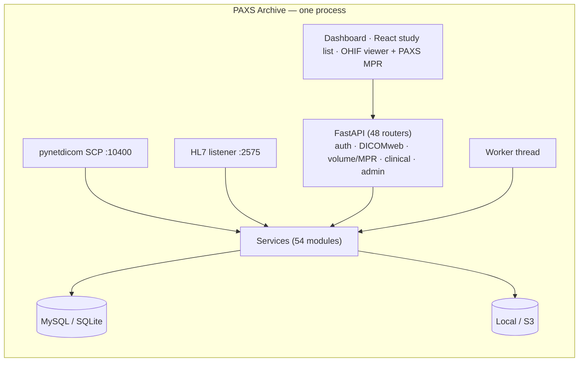
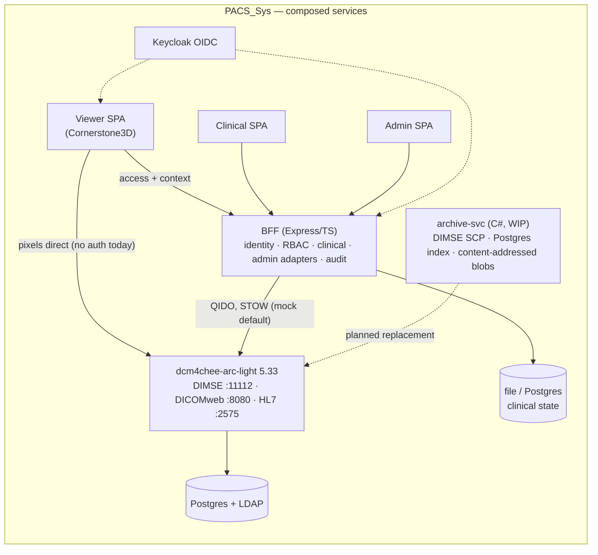

# PAXS Archive vs PACS_Sys — Side-by-side Comparison

> **Compared:**
> - **PAXS Archive** at commit `5a32aa4` (this repository). The detailed review is in [CODE_REVIEW.md](CODE_REVIEW.md).
> - **PACS_Sys** (`C:\Users\dody1\source\repos\PACS_Sys`) at HEAD `2ebdbf4`, **plus its uncommitted working tree**,
>   which holds most of `archive-svc`.
>
> Both were analysed statically on 2026-10-08/10. Neither was built, run or modified. Four parallel analyses of
> PACS_Sys are in [comparison/pacs-sys/](comparison/pacs-sys/). The lead reviewer re-checked the claims marked ✅ in
> the source.
>
> **Status words:**
> - **Real**: implemented and wired to live infrastructure.
> - **Real via arc-light**: provided by the unmodified dcm4chee archive that PACS_Sys deploys.
> - **Adapter/mock**: an in-memory or placeholder implementation behind a real-looking UI or API.
> - **WIP**: code exists in PACS_Sys's uncommitted `archive-svc` but is not deployed.
> - **Planned**: the feature exists only in a plan document.
> - **Absent**: not implemented and not planned.

---

## 0. At a glance

| | **PAXS Archive** | **PACS_Sys** |
|---|---|---|
| One-line summary | One Python process that *is* the archive, PACS, RIS-lite and VNA, plus several UIs | An **unmodified dcm4chee-arc-light 5.33.0** archive, a thin Node/TS **BFF**, three React SPAs (viewer, clinical, admin), and an in-progress native **C# archive** meant to replace dcm4chee |
| Philosophy | Build everything in-house, broad feature coverage | Compose a proven archive with separately owned surfaces, a conservative clinical posture, phased delivery (a Sudan field pilot is planned) |
| Languages and size | Python ≈38k lines; hand-written JS/HTML ≈9.7k; React study list ≈3.1k TS; **+ ≈149 MB prebuilt OHIF viewer** committed | BFF ≈18k TS; frontends ≈34k TS (strict); tests ≈11.7k; infra ≈2.4k; **archive-svc ≈40k C#, about 14k of it uncommitted** |
| Authors and history | 10 commits (9 by Mohammed Omer, 1 merge by Awad Emad); most code arrived in two large commits (`8af1381`, `5a32aa4`) | 1 author (you), 19 commits, May–Sep 2026 |
| Builds from git today? | **No.** `app/services/storage/` is gitignored and missing; `redis` is not in requirements | **Yes**, per your own audit (`npm run build`, `typecheck` and tests pass). `archive-svc` exists only on your disk |
| Tests | 1,085 Python test functions + 158 JS cases. **Cannot collect** as committed | 629 TS unit cases (49 files) + 5 mocked Playwright e2e + ≈400 C# test methods (uncommitted). About 40% statement coverage per your audit |
| Auth foundation | Home-grown: PBKDF2 + HS256 JWT + rotating refresh cookie | **Keycloak OIDC** (PKCE in the browser, JWT validated in the BFF with `jose`) |
| Production-ready? | No: build, data-integrity and secret-handling blockers | No: an open archive edge, an incomplete production overlay, and mocked admin features |

### Verdict in one paragraph

**PACS_Sys has the sounder foundation, and PAXS has more working features.**
- PACS_Sys puts its most safety-critical part, the archive, on a mature, standards-conformant engine (dcm4chee). It
  uses real enterprise identity (OIDC). It keeps the pixel path out of the BFF and builds clean, typed code.
- PAXS has *more working features* end to end: HL7 in and out, FHIR, IHE PIX/PDQ/XDS-I, routing, lifecycle,
  replication, quotas, multi-tenancy, real admin consoles and server-side MPR. But all of it sits on a custom
  archive core with data-integrity and build problems.
- Both share several serious defects. Each can **sign or finalize stale report text**. Each has **3D/MPR
  correctness bugs**. Each runs an **unauthenticated HL7 listener**. Each has **mocked functionality that the UI
  presents as real**.
- PACS_Sys's biggest risk is its **open archive edge**: arc-light DICOMweb and its admin UI have no auth. PAXS's
  biggest risk is **its own archive core**.

---

## 1. Architecture

| Aspect | PAXS Archive | PACS_Sys |
|---|---|---|
| Archive engine | Custom Python: pynetdicom SCP, SQLAlchemy index, filesystem/S3 objects, staged ingest | **dcm4chee-arc-light** (Java, unmodified). The replacement `archive-svc` (C#, net10.0) has its own PS3.8 upper layer, DIMSE SCPs, EF Core Postgres index, SHA-256 content-addressed blob store and orphan sweeper. It is WIP: no DICOMweb or HL7 yet, and not deployed |
| Pixel path | Same process (`/dicom-web`), router-guarded, tenant-scoped | Browser → arc-light DICOMweb **directly**; the BFF never proxies pixels |
| Business logic | In one service layer next to the archive | In the BFF, separate from the archive (clean ownership boundary) |
| UIs | One server hosts all UIs; the OHIF fork plus custom add-ons | Three independently built SPAs plus shared packages (`api-client`, `auth`, `deep-link`, `dicomweb-sdk`, `ui`) |
| API contracts | FastAPI auto-OpenAPI (always on) | Hand-written OpenAPI (99 of 121 operations documented) + a typed API client |
| Deployment unit | One process, which fits a no-Docker site well | Docker Compose today; `archive-svc` targets **systemd, no Docker** (your plan constraint CON-001) |

---

## 2. Capability matrix

### 2.1 DICOM and archive services

| Capability | PAXS Archive | PACS_Sys |
|---|---|---|
| C-STORE / C-FIND / C-MOVE / C-GET | **Real** (custom). No calling-AE allow-list; empty-UID retrieve returns everything | **Real via arc-light**. WIP in archive-svc, tested against dcm4che and arc-light |
| Modality Worklist (MWL) | **Real** (SCP + HL7 ORM + manual entry) | Claimed by arc-light (not configured in the repo). BFF walk-in MWL is an **adapter/mock**. archive-svc has an MWL SCP, unwired |
| MPPS | **Real** | **Absent** on the deployed stack. **WIP** in archive-svc (in-memory store) |
| Storage Commitment | **Real** (sweep issues false failures) | **Absent** deployed. **WIP** in archive-svc |
| DICOMweb QIDO / WADO / STOW | **Real** (custom), login required by default | **Real via arc-light**, **unauthenticated**. Not yet in archive-svc |
| DICOM TLS | Real (optional; the bootstrap deletes the operator's certs) | HAProxy DIMSE-TLS **scaffolded** (no CA, optional client cert) |
| Lossless compression | **Real** (JPEG-LS / J2K / HTJ2K / RLE worker) | arc-light (claimed, no rules in the repo). archive-svc: JPEG-LS only |
| Lossy compression | Real, gated, off by default | Absent (admin "lossless-only" rules are a mock) |
| Storage tiers / lifecycle / purge | **Real** (ADMIN). The scheduled sweep is a no-op (F-02) | **Scaffolded** (MinIO descriptor LDIF never imported). Admin retention rules are a mock |
| Routing / forwarding queue | **Real** (durable queue + back-off). Auto-route at ingest is broken (F-01) | Admin routing builder is a **mock**. archive-svc has static move destinations |
| DR replication | Real (S3 target; backfills only 500 studies) | **Absent** (plan only) |
| Quotas | Real (reserved at ingest; mis-scoped) | Absent |
| Multi-tenancy (VNA) | **Real, partial** (404 guards; gaps in reports, worklist, GSPS) | **Absent** (declared limitation) |
| Split / merge, anonymized export, DICOMDIR | Real | Absent (admin "anonymize" returns *accepted* and does nothing) |
| Conformance statement | Absent | **Present** (v1.0 draft; partly out of date: it states 5.31.2, deploys 5.33.0) |

### 2.2 Clinical workflow

| Capability | PAXS Archive | PACS_Sys |
|---|---|---|
| Reading worklist | Real: claim, STAT, read. Any role; last writer wins | **Real**: assign, **atomic take-next**, priority, release. Capped at 200 archive rows |
| Reports | Real: draft → final → **addendum**, HL7 ORU to the EMR | **Real**: draft → preliminary/final/corrected sign → addendum/withdraw, **DICOM SR generation**, **idempotency keys + optimistic preconditions**, HIS precedence modes (in_app / external / hybrid). SR STOW is **mock by default**, yet the UI says "Signed … SR SOP …" |
| Sign or finalize safety | 🔴 **Finalize signs the stored draft and drops edits** (NEW-01) | 🔴 **Sign uses the last autosaved draft when one exists** (`ReportAuthorPage.tsx:502`, BFF signs `draft.sections`), then clears the local copy ✅ |
| Templates / macros / dictation | Templates (ADMIN) | Templates (seeded mock), macros, dictation, saved searches |
| Critical results | Real (any role can ack) | Real state; escalation fires only on read |
| Peer review | Real (any role) | Absent |
| Share links | Study-scoped token **grants image reads** (cookie); any user can create | **Metadata/report-only by design** (refuses image sharing until a scoped-credential exchange exists); token in the URL path |
| Notifications / events | Webhooks + scripts | **In-app notifications + SSE events** (email is log-only but reported "sent") |
| HL7 | ADT/ORM in, PIX/PDQ queries (**no ACKs**), ORU out | ORU and ADT in via the BFF MLLP listener (**unauthenticated, default on**, ACK fallback reads the wrong field). arc-light HL7 listener published |
| FHIR / IHE (PIX, PDQ, XDS-I, IAN) | Real (FHIR read, PIX/PDQ, XDS-I, IAN) | **Absent** (an IHE closure plan exists) |
| AI / triage | Demo heuristics, on by default (D-09) | Absent |

### 2.3 Viewer

| Capability | PAXS Archive (OHIF v3 fork + PAXS add-ons) | PACS_Sys (custom React + Cornerstone3D 1.86) |
|---|---|---|
| 2D tools: W/L drag, zoom, pan, measurements | **Real** (OHIF toolset) | ⚠️ **Mouse W/L, zoom and pan are absent** (tools not initialised); custom length/angle/rect-ROI overlay; rotate and flip are **CSS only** |
| Orientation markers | OHIF | **Absent** |
| SR / GSPS display | GSPS applied server-side to rendered images; SR display comes from the OHIF bundle (not verified in this fork) | **Absent** (classified and excluded) |
| MPR / MIP / VR | Client WebGL2, server reslice and tiles, **hybrid negotiation**, fusion, 3D cut planes | Orthogonal MPR, MIP/MinIP, VR (CT presets), **geometry-gated**, memory guards for VR |
| MPR correctness | 🔴 **GPU read-back copies the wrong rows** (NEW-02); 🔴 **fusion aligned by index** (NEW-06) | 🔴 **Multi-phase series pass the geometry gate**: sort by `SliceLocation` and drop zero gaps, so phases are interleaved into one volume ✅ (`geometry.ts:217-221`); measurement overlay stretched `viewBox 0 0 100 100`, `preserveAspectRatio="none"` (❓ needs a live check) |
| Prior compare / hanging protocols | OHIF hanging protocols | **Real**: side-by-side, reference and overlay compare (stack), 6 BFF hanging-protocol rules |
| Unsupported objects | Rendered or attempted | **SOP-class allow-list**; unsupported series are listed, not rendered |
| Weak-client support | **Server-side MPR/tiles** for thin clients | Client-side only |

### 2.4 Administration, security and operations

| Capability | PAXS Archive | PACS_Sys |
|---|---|---|
| Admin consoles | **Real**: users, sessions, settings registry, DB, Redis, storage, routing, lifecycle, tenants, scripts, license | **Mostly adapter/mock** (`ADMIN_ADVANCED_MODE` hard-wired to `local_mvp`). The users page says Keycloak but writes an in-memory map. A fixed "Production" license is shown. Real: archive study search, health/metrics, audit |
| Authentication | Local accounts + LDAP (`LDAP_USE_TLS` unused) | **OIDC/Keycloak**, fail-closed default; a dev static-token mode with no production guard |
| Authorization | Role dependencies on 272/278 routes; structural auth-matrix test | Server-side role guards are consistent for writes; **3 routes lack a role gate** (`/studies/{uid}/context`, `/hanging-protocols/match`, `/events`) |
| PHI at the archive edge | Login required; share-scoped reads | 🔴 **Open**: unsecured arc image, Traefik `/dicom-web` has no auth middleware ✅, and **port 8080 (archive UI and REST) is published** ✅ |
| Tokens in the browser | localStorage bearer + HttpOnly refresh cookie | localStorage OIDC token, no silent renew. The BFF returns the user's JWT for DICOMweb use ✅ |
| Secrets in repo | 🔴 Leaked vendor licence key still in history | `.env` files untracked ✅; Keycloak dev client secret, dev passwords and ROPC grants in realm files; default-credential fallbacks in the production overlay |
| Audit | Auth audit + archive audit (gaps on PHI reads) | Real file sink (**1,000-event window**); fire-and-forget Postgres sink |
| HA / LB | HAProxy + 3 nodes (working compose, dev-mode defaults) | **Scaffolded**: single instances; the production overlay lacks BFF/SPA/Keycloak services and has an 11112 port collision |
| TLS / reverse proxy | Optional HTTPS; new sub-path proxy support (misnamed env vars) | **Traefik TLS 1.2+ / HSTS** (scaffolded) |
| Backup / restore | DB-admin backups; no tested DR | Scripts + pgBackRest template + restore-drill doc (**no drill recorded**, backups local only) |
| Monitoring | Prometheus `/metrics` + Grafana | Prometheus + Grafana provisioned; BFF `/metrics` unauthenticated; anonymous Grafana |
| CI | None in the repo | GitHub Actions: build + unit tests + compose config (no typecheck, e2e, .NET or security scan) |

---

## 3. Engineering quality

| Area | PAXS Archive | PACS_Sys |
|---|---|---|
| Typing | Python, untyped in places; TS strict **off** in the study list | **TS `strict: true`** in the BFF and all three apps; C# nullable + warnings-as-errors |
| Consistency of patterns | Uneven: good primitives (tenant guards, share scope, production gate) applied inconsistently | Consistent seams: adapters, repository boundary, command registry, typed client. The UX has a11y utilities (announcer, focus trap, roving tabindex) |
| Concurrency safety | Atomic claim idea, but many check-then-insert races | **Idempotency-Key + optimistic preconditions** on clinical mutations; atomic take-next |
| Honest UI | Fixed the fake React actions; demo AI still on by default | Several mocks presented as real (admin pages, SR "signed" toast, license, email "sent", anonymize "accepted") |
| Docs | Many explainer notes, partly stale; these generated docs | **Phased plans, a self-audit (CODE_HEALTH_AUDIT), a conformance statement, a UX direction and audits** |
| Hygiene | AI-tool logs (`.workbuddy-ai/`), a foreign git index, test uploads committed | ≈700 KB of terminal logs committed, `tsbuildinfo` tracked, a 219-file LF→CRLF flip, **≈14k lines of archive-svc not committed** |

---

## 4. Shared weaknesses (fix in both)

1. **Signing or finalizing can commit stale report text.** In PAXS, `/reports/save` with FINALIZED skips the
   update. In PACS_Sys, `sign()` reuses the autosaved `draft`. In both, the radiologist's latest edits never reach
   the signed report. Fix: persist the editor content, then sign that version, in one server call.
2. **3D correctness.** PAXS reads back the wrong GPU rectangle and aligns fusion by index. PACS_Sys accepts
   multi-phase series into one volume and has overlay/CSS-transform mapping errors. Both need phantom-based pixel
   tests (PAXS already has a geometry phantom in `tests/js`).
3. **Unauthenticated HL7 listeners.** PAXS: off by default, but no ACKs. PACS_Sys: **on by default on 0.0.0.0**.
4. **Bearer tokens in localStorage** with a permissive or absent CSP.
5. **Mocks or demos presented as real**, the most dangerous kind of bug in clinical software.
6. **Default credentials and dev-mode switches** that production configs don't override.
7. **Thin CI** and committed noise.

---

## 5. What each project can borrow from the other

### PACS_Sys could adopt from PAXS (ideas, not code)

| Idea | Why it matters for PACS_Sys |
|---|---|
| **Study-scoped share token as a read credential** (validated per request, HttpOnly cookie, one study, never writes; `deps.py:164-344`) | This is exactly the "scoped-credential exchange" PACS_Sys is waiting for before it allows image sharing |
| **Router-level guard on the whole pixel surface**, plus a 404 for cross-tenant access | A template for a Traefik ForwardAuth → BFF check in front of `/dicom-web` |
| **Structural route-auth matrix test** (every route must be on a public allow-list or carry an auth dependency) | Would have caught the 3 un-gated BFF routes |
| **Production config gate that fails closed** (refuse a default secret, insecure cookies, a disabled rate limit) | PACS_Sys's dev-auth mode and default MLLP have no such guard. Make production the *default*, which PAXS also hasn't done |
| **Server-side MPR / tiles with client/server/hybrid negotiation** | Relevant for low-end workstations and constrained bandwidth at a field-pilot site |
| HL7 **ORU outbound** to the EMR, a durable routing queue with back-off, lifecycle tiers, quotas | Missing on the PACS_Sys side and planned for later phases |

### PAXS could adopt from PACS_Sys

| Idea | Why it matters for PAXS |
|---|---|
| **A proven archive core** (dcm4chee-arc-light, or Orthanc) instead of custom ingest | Removes the D-01 / NEW-03 / NEW-05 integrity class entirely |
| **OIDC / Keycloak** instead of home-grown JWT and LDAP | Removes S-01, NEW-07, NEW-08 and NEW-10 at a stroke |
| **Idempotency keys + optimistic preconditions** on clinical mutations | Fixes double-finalize/ORU (NEW-24) and last-writer-wins worklist claims |
| **SOP-class allow-list and geometry gating** before rendering | A conservative clinical-safety posture |
| **A conformance statement and phased plans with a self-audit** | Governance that regulators and hospitals expect |
| **Typed strict TS, separate SPAs and a typed API client** | Fewer integration bugs than the hand-written 4.4k-line `app.js` |
| archive-svc's **store ordering + content-addressed blobs + conformance tests against dcm4che** | A disciplined template if PAXS keeps its own archive |

---

## 6. Recommendations

### If PACS_Sys is the product

**Stop-ship:**
1. **Close the archive edge.** Use the `-secure` arc-light image with Keycloak, or a Traefik **ForwardAuth** that
   validates the user and study scope through the BFF. Stop publishing 8080, 9990, 5432, 389 and plain 11112 on the
   host.
2. **Fix the stale-draft sign.** Save the editor content as part of sign, and gate the sign buttons on unsaved
   changes.
3. **MLLP listener:** default off, bind to localhost or an allow-list, add auth or a network ACL, and ACK from
   MSH-10.
4. **Fix the viewer geometry gate.** Sort by `ImagePositionPatient` projected on the normal, reject duplicate
   positions or split by temporal index, add orientation markers, enable the Cornerstone W/L, pan and zoom tools,
   and do rotate/flip in the camera rather than CSS.

**Then:**

5. **Commit `archive-svc`** to a branch now. About 14k lines and 400 test methods exist only on one disk.
6. **Label or replace the mocks.** Admin `local_mvp` pages, the SR STOW mock "signed" toast, the license and email
   delivery.
7. **Complete the production overlay.** Add the BFF, SPA and Keycloak services, fix the 11112 collision, remove the
   default credentials, do off-site backups, and run and record a restore drill.

### If PAXS Archive is the product

Follow [CODE_REVIEW.md §5](CODE_REVIEW.md#5-remediation-plan) and seriously consider **replacing its archive
core**: run dcm4chee or Orthanc underneath and keep PAXS's clinical, VNA and admin layers on top.

### Strategic view

- **For a near-term hospital pilot, PACS_Sys is the safer base.** Its weak points are at the edge (configuration
  and wiring), and those are faster to close than PAXS's weak point, the core (data integrity).
- **Your `archive-svc` plan is the riskiest item on your roadmap.** It re-creates what PAXS attempted (a native,
  single-process archive without Docker), with much better engineering discipline but a long way to go: DICOMweb,
  HL7, migration and cutover.
- PAXS is evidence of how much a single-process archive has to get right. Consider running arc-light, or Orthanc as
  a lighter native alternative, at the pilot site, and keep `archive-svc` on a parallel track until it passes the
  same conformance suite with DICOMweb included.

---

## 7. Evidence index

| Topic | PAXS evidence | PACS_Sys evidence |
|---|---|---|
| Full findings | [CODE_REVIEW.md](CODE_REVIEW.md), [reference/5a32aa4/](reference/5a32aa4/) | [comparison/pacs-sys/01–04](comparison/pacs-sys/) |
| Stale-draft sign | `app/api/v1/reports.py:249-262` | `frontends/apps/clinical/src/pages/ReportAuthorPage.tsx:502`; `bff-svc/src/clinical/reportService.ts:127` |
| Open pixel path | (fixed by default: `deps.py:226-344`) | `phase-0/docker-compose.yml:62, 71`; `infra/traefik/dynamic/routers.yml:17-20` |
| HL7 listener | `app/dicom/hl7.py` (no ACK), `HL7_ENABLED=false` | `bff-svc/src/config.ts:163-164` (default on, 0.0.0.0) |
| 3D defects | `app/static/viewer/paxs-mpr.js:2036-2037, 2203, 2229` | `frontends/apps/viewer/src/dicom/geometry.ts:217-221`; `components/MeasurementOverlay.tsx:307` |
| BFF returns the user token for DICOMweb | — | `bff-svc/src/app.ts:337` |
| Self-audit | — | `CODE_HEALTH_AUDIT.md` (12 Aug 2026; its critical MLLP finding is still open) |
