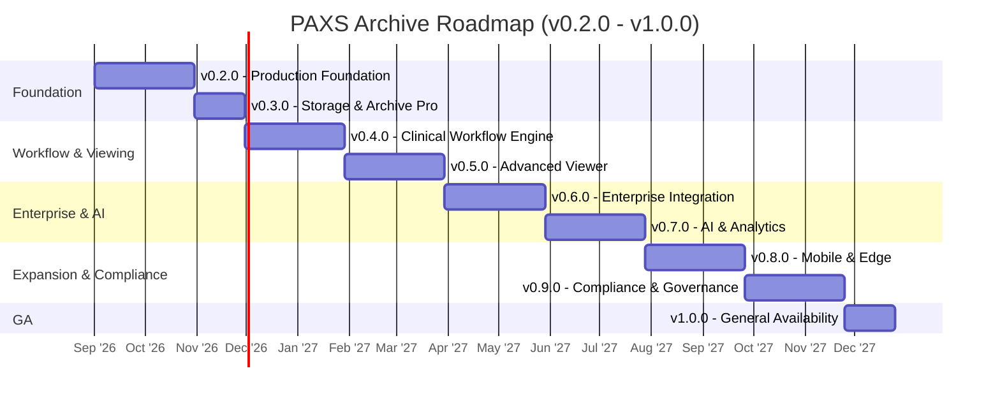
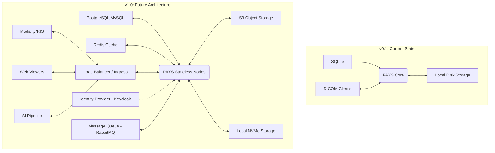

# 🚀 PAXS Archive Server Roadmap (v0.1 to v1.0)

## 📋 52-Feature Status Matrix (canonical — verified 2026-08-06)

> Legend: ✅ Done · 🟡 Partial · ⬜ Planned (not yet) — **41 ✅ · 1 🟡 · 10 ⬜**.
> Details per feature in `plan.md` and `MASTER-ROADMAP.md`.

| # | Feature | Status |
| :-: | :--- | :--- |
| 1 | C-STORE (SCP/SCU) | ✅ |
| 2 | C-FIND (SCP/SCU) | ✅ |
| 3 | C-MOVE (SCP/SCU) | ✅ |
| 4 | C-GET (SCP/SCU) | ✅ |
| 5 | C-ECHO (SCP/SCU) | ✅ |
| 6 | Storage Commitment (N-ACTION/N-EVENT) | ✅ |
| 7 | Modality Worklist (MWL) | ✅ |
| 8 | MPPS | ✅ |
| 9 | IAN | ✅ |
| 10 | DICOM TLS | ✅ |
| 11 | Lossless Compression | ✅ |
| 12 | Lossy Compression | ✅ |
| 13 | VNA (Vendor Neutral Archive) | ✅ |
| 14 | Study Lifecycle Management | ✅ |
| 15 | Auto-routing Rules Engine | ✅ |
| 16 | Prefetching | ✅ |
| 17 | DICOMDIR Creation | ✅ |
| 18 | Migration Tools | ✅ |
| 19 | Transfer Accelerator | ✅ |
| 20 | WADO-URI | ✅ |
| 21 | WADO-RS / QIDO-RS / STOW-RS | ✅ |
| 22 | Hanging Protocols | ✅ |
| 23 | Prior Study Linking | ✅ |
| 24 | GSPS (Presentation State) | ✅ |
| 25 | Key Image Notes (KIN) | ✅ |
| 26 | 2D MPR Backend Prep | ✅ |
| 27 | 3D VRT / MIP Support | ✅ |
| 28 | Dose Monitoring (RDSR) | ✅ |
| 29 | Fusion (PET/CT, MRI/US) | ✅ |
| 30 | Worklist Management (Unread/Stat/Dictated) | ✅ |
| 31 | Clinical Protocols Library | ✅ |
| 32 | Peer Review / QA | ✅ |
| 33 | Critical Results Tracking | ✅ |
| 34 | Reporting / Dictation Bridge | 🟡 (reporting + ORU done; dictation ⬜) |
| 35 | Chat & Collaboration | ⬜ |
| 36 | Teaching Files | ⬜ |
| 37 | Study Split/Merge | ✅ |
| 38 | HL7 v2.x ORU/ORM/ADT | ✅ |
| 39 | LDAP / Active Directory | ✅ |
| 40 | XDS-I | ✅ |
| 41 | REST API (General) | ✅ |
| 42 | Webhooks | ✅ |
| 43 | Lua / Python Scripting | ✅ |
| 44 | FHIR ImagingStudy mapping | ✅ |
| 45 | Audit Logging (ATNA) | ✅ (SHA-256; ATNA XML ⬜) |
| 46 | Role-Based Access Control | ✅ |
| 47 | Load Balancing | ✅ (HAProxy + stateless nodes + liveness/readiness probes) |
| 48 | High Availability / Clustering | ⬜ |
| 49 | Disaster Recovery Replication | ✅ (background sweep to S3/named backend + replication_records) |
| 50 | Dashboard & Analytics | ✅ |
| 51 | Anonymization Engine | ✅ |
| 52 | Storage Tiering (HSM) | ✅ (via Study Lifecycle cold tier + S3) |

---

## 1. Executive Summary
The PAXS Archive Server aims to become a fully-featured, highly scalable, and secure open-source Picture Archiving and Communication System (PACS) that rivals industry standards. This roadmap outlines the strategic timeline for evolving PAXS from its current foundational state (v0.1) into a production-ready General Availability (v1.0) system. Over the next 16 months, we will implement critical enterprise capabilities, advanced visualization, AI integrations, and rigorous compliance measures, drawing inspiration from robust systems like Orthanc, dcm4chee, and commercial enterprise imaging solutions.

---

## 2. Version Release Plan & Details

### 📦 v0.2.0 - Production Foundation (Month 1-2)
**Theme**: *Solidifying the Core*
- **Key Features**:
  - PostgreSQL & MySQL Support: Robust database backends.
  - Basic DICOM C-FIND, C-MOVE, C-STORE robustness.
  - Logging & Telemetry: Structured logging for observability.
  - Basic Authentication: User management and role-based access control (RBAC).
  - Docker Compose & Helm Charts: Standardized deployments.
- **Technical Prerequisites**: Refactored core DICOM parsing engine.
- **Breaking Changes**: Database schema migration required from v0.1 SQLite.
- **Migration Notes**: Use the provided `paxs-migrate` tool to convert SQLite to PostgreSQL.
- **Feature Source**: Orthanc (Simplicity), dcm4chee (Robustness).

### 🗄️ v0.3.0 - Storage & Archive Pro (Month 2-3)
**Theme**: *Scalable Long-term Archiving*
- **Key Features**:
  - S3 / Azure Blob Storage Integration: Direct to cloud storage tiers.
  - Hierarchical Storage Management (HSM): Auto-tiering of old studies.
  - Image Compression: JPEG2000, JPEG-LS, and RLE support.
  - Deduplication: Block-level storage savings.
  - DICOM Part 10 Export/Import Tools.
- **Technical Prerequisites**: VFS (Virtual File System) abstraction layer.
- **Breaking Changes**: None.
- **Migration Notes**: Existing local storage will be mapped to the `local-tier1` storage class.
- **Feature Source**: dcm4chee (Storage Management).

### ⚙️ v0.4.0 - Clinical Workflow Engine (Month 3-5)
**Theme**: *Automating the Radiology Department*
- **Key Features**:
  - DICOM Modality Worklist (MWL): Connecting to RIS.
  - MPPS (Modality Performed Procedure Step): Tracking study status.
  - Auto-routing rules: Lua or JavaScript-based rule engine.
  - Forwarding & Peer-to-Peer sharing: Multi-node routing.
  - HL7 v2.x Gateway (ORU, ADT messages).
- **Technical Prerequisites**: Integrated message queue (e.g., RabbitMQ or built-in NATS).
- **Breaking Changes**: None.
- **Migration Notes**: Legacy manual routing rules must be recreated in the new rule engine.
- **Feature Source**: Orthanc (Lua scripting), ClearCanvas (Workflow).

### 🖥️ v0.5.0 - Advanced Viewer (Month 5-7)
**Theme**: *Diagnostic Zero-Footprint Visualization*
- **Key Features**:
  - WADO-RS, QIDO-RS, STOW-RS: Complete DICOMweb support.
  - Integrated Web Viewer (OHIF v3.12.11 — served at /ohif, DICOMweb same-origin, deep links from the dashboard). ✅
  - Multi-planar Reconstruction (MPR) in browser.
  - Annotations & Measurements (DICOM SR and PR).
  - Hanging Protocols.
- **Technical Prerequisites**: High-performance HTTP server capable of streaming large instances.
- **Breaking Changes**: API endpoint restructuring for DICOMweb compliance.
- **Migration Notes**: Update any custom API integrations to standard DICOMweb paths.
- **Feature Source**: Horos (Viewing capabilities), Orthanc (DICOMweb).

### 🏢 v0.6.0 - Enterprise Integration (Month 7-9)
**Theme**: *Playing Well with Others*
- **Key Features**:
  - Active Directory / LDAP Integration.
  - OIDC / OAuth2 Support (Keycloak integration).
  - Cross-Enterprise Document Sharing (XDS-I.b).
  - FHIR ImagingStudy Integration.
  - High Availability (HA) Clustering.
- **Technical Prerequisites**: Stateless architecture for core services; distributed cache (Redis).
- **Breaking Changes**: User authentication database decoupled.
- **Migration Notes**: Migrate local users to LDAP/OIDC if applicable.
- **Feature Source**: dcm4chee (Enterprise/IHE features).

### 🧠 v0.7.0 - AI & Analytics (Month 9-11)
**Theme**: *Intelligence and Insights*
- **Key Features**:
  - AI Model Inference Pipeline: Trigger models via API on study arrival.
  - NVIDIA Clara / MONAI Integration.
  - BI Dashboard: Storage metrics, study volume, modality utilization.
  - Anonymization Engine: Rule-based PHI removal for research.
  - DICOM Segmentation (SEG) support.
- **Technical Prerequisites**: Event-driven architecture for pipeline triggers.
- **Breaking Changes**: None.
- **Migration Notes**: None.
- **Feature Source**: Commercial Enterprise Imaging systems (Agfa, GE).

### 📱 v0.8.0 - Mobile & Edge (Month 11-13)
**Theme**: *PACS Everywhere*
- **Key Features**:
  - Progressive Web App (PWA) for mobile viewing.
  - PAXS Edge Node: Lightweight caching node for remote clinics.
  - Offline mode for Edge Nodes (store and forward).
  - Push notifications for critical findings.
  - SMS / Email gateway for patient sharing.
- **Technical Prerequisites**: Websocket support for real-time notifications.
- **Breaking Changes**: None.
- **Migration Notes**: None.
- **Feature Source**: Modern commercial systems, Horos (mobile concepts).

### 🛡️ v0.9.0 - Compliance & Governance (Month 13-15)
**Theme**: *Enterprise Security*
- **Key Features**:
  - Comprehensive Audit Trails (ATNA IHE Profile).
  - Data Retention Policies (legal holds, automatic deletion).
  - End-to-End Encryption (TLS 1.3 everywhere).
  - DICOM Digital Signatures.
  - FDA/CE marking preparatory documentation mode.
- **Technical Prerequisites**: Syslog/ATNA integration.
- **Breaking Changes**: TLS enforced by default; self-signed certificates generated if none provided.
- **Migration Notes**: Review and configure audit logging destinations.
- **Feature Source**: dcm4chee (ATNA, Security).

### 🎯 v1.0.0 - General Availability (Month 15-16)
**Theme**: *Production Ready*
- **Key Features**:
  - LTS (Long Term Support) release branch.
  - Polished Admin UI.
  - Comprehensive Documentation (Admin, Developer, User).
  - Bug fixes and performance tuning.
  - Migration toolkits from legacy systems.
- **Technical Prerequisites**: 90%+ Test Coverage.
- **Breaking Changes**: Finalized API v1 stabilization.
- **Migration Notes**: Seamless upgrade from v0.9.x.
- **Feature Source**: Industry standard GA requirements.

---

## 3. Mermaid Gantt Chart

---

## 4. Feature Comparison Matrix

| Feature Category | Feature Name | PAXS (v1.0) | Orthanc | dcm4chee | Horos | ClearCanvas | Conquest |
|---|---|:---:|:---:|:---:|:---:|:---:|:---:|
| **Core DICOM** | C-ECHO | ✅ | ✅ | ✅ | ✅ | ✅ | ✅ |
| | C-STORE | ✅ | ✅ | ✅ | ✅ | ✅ | ✅ |
| | C-FIND | ✅ | ✅ | ✅ | ✅ | ✅ | ✅ |
| | C-MOVE | ✅ | ✅ | ✅ | ✅ | ✅ | ✅ |
| | C-GET | ✅ | ✅ | ✅ | ✅ | ✅ | ✅ |
| | Storage Commitment | 🔜 | ✅ | ✅ | ❌ | ✅ | ❌ |
| **DICOMweb** | WADO-URI | ✅ | ✅ | ✅ | ✅ | ❌ | ✅ |
| | WADO-RS | ✅ | ✅ | ✅ | ❌ | ❌ | ❌ |
| | QIDO-RS | ✅ | ✅ | ✅ | ❌ | ❌ | ❌ |
| | STOW-RS | ✅ | ✅ | ✅ | ❌ | ❌ | ❌ |
| **Storage** | Local Disk | ✅ | ✅ | ✅ | ✅ | ✅ | ✅ |
| | PostgreSQL / MySQL | ✅ | ✅ | ✅ | ❌ | ✅ | ✅ |
| | SQLite | ✅ | ✅ | ❌ | ✅ | ❌ | ✅ |
| | S3 / Cloud Object Storage | ✅ | ✅ | ✅ | ❌ | ❌ | ❌ |
| | Hierarchical Storage (HSM) | 🔜 | ❌ | ✅ | ❌ | ❌ | ❌ |
| | Image Compression (JPEG2k) | ✅ | ✅ | ✅ | ✅ | ✅ | ✅ |
| | Deduplication | 🔜 | ❌ | ❌ | ❌ | ❌ | ❌ |
| **Routing & Rules**| Scripting Engine (Lua/JS) | ✅ | ✅ | ❌ | ❌ | ❌ | ✅ |
| | Auto-routing / Forwarding | ✅ | ✅ | ✅ | ✅ | ✅ | ✅ |
| | Modality Worklist (MWL) | ✅ | ✅ | ✅ | ❌ | ✅ | ✅ |
| | MPPS | ✅ | ❌ | ✅ | ❌ | ✅ | ❌ |
| **Enterprise** | HL7 v2.x Gateway | 🔜 | ❌ | ✅ | ❌ | ✅ | ❌ |
| | LDAP / Active Directory | ✅ | ❌ | ✅ | ❌ | ✅ | ❌ |
| | OIDC / OAuth2 | ✅ | ❌ | ✅ | ❌ | ❌ | ❌ |
| | XDS-I.b (Cross-Enterprise) | 🔜 | ❌ | ✅ | ❌ | ❌ | ❌ |
| | High Availability (HA) | ✅ | ❌ | ✅ | ❌ | ❌ | ❌ |
| **Security** | HTTPS / TLS | ✅ | ✅ | ✅ | ❌ | ✅ | ❌ |
| | ATNA Audit Logging | 🔜 | ❌ | ✅ | ❌ | ❌ | ❌ |
| | RBAC (Role Based Access) | ✅ | ❌ | ✅ | ❌ | ✅ | ❌ |
| | Anonymization / De-id | ✅ | ✅ | ✅ | ✅ | ❌ | ✅ |
| | End-to-End Encryption | 🔜 | ❌ | ❌ | ❌ | ❌ | ❌ |
| **Viewing** | Built-in Web Viewer | ✅ | ✅ | ✅ | ❌ | ❌ | ❌ |
| | MPR / 3D Reconstruction | 🔜 | ❌ | ❌ | ✅ | ❌ | ❌ |
| | Mobile / PWA Viewer | 🔜 | ❌ | ❌ | ❌ | ❌ | ❌ |
| | Hanging Protocols | 🔜 | ❌ | ❌ | ✅ | ✅ | ❌ |
| | DICOM SR / PR Support | ✅ | ✅ | ✅ | ✅ | ✅ | ✅ |
| **AI & Analytics** | AI Inference Hooks | 🔜 | ❌ | ❌ | ❌ | ❌ | ❌ |
| | Analytics Dashboard | ✅ | ❌ | ❌ | ❌ | ❌ | ❌ |
| | DICOM SEG (Segmentation) | ✅ | ❌ | ✅ | ✅ | ❌ | ❌ |
| | REST API for Automation | ✅ | ✅ | ✅ | ❌ | ❌ | ❌ |
| | Event Webhooks | ✅ | ❌ | ✅ | ❌ | ❌ | ❌ |

---

## 5. Technical Architecture Evolution

---

## 6. Release Criteria for v1.0 GA

To officially label PAXS as v1.0 General Availability, the following criteria must be met:

*   **Performance Benchmarks**:
    *   Ingest rate of > 100 studies per second on standard enterprise hardware.
    *   Sub-200ms response time for DICOMweb QIDO-RS queries with 10M+ studies.
    *   Support for 50+ concurrent WADO-RS streaming sessions without degradation.
*   **Security Requirements**:
    *   Zero critical or high vulnerabilities in automated SAST/DAST scans.
    *   Full support for TLS 1.3 for all internal and external communication.
    *   Secure default configuration (no default passwords, secure headers).
*   **Compliance Checkboxes**:
    *   Basic IHE profiles supported (SWF, BIR).
    *   ATNA logging capabilities for HIPAA/GDPR auditability.
    *   DICOM Conformance Statement finalized and published.
*   **Test Coverage Targets**:
    *   > 90% Unit Test coverage.
    *   100% integration test coverage for core DICOM C-STORE, C-FIND, C-MOVE.
*   **Documentation Requirements**:
    *   Complete API Reference (Swagger/OpenAPI).
    *   Deployment guides for Docker, Kubernetes, and Bare Metal.
    *   Administrator guide for configuring storage, routing, and users.

---

## 7. Community & Ecosystem Goals (post v1.0)
Once the v1.0 milestone is reached, focus will shift towards:
*   **Plugin Ecosystem**: Establishing a marketplace or registry for PAXS plugins (similar to Orthanc's plugin architecture).
*   **Global Community**: Fostering an open-source community of developers, radiologists, and IT admins via forums and Discord.
*   **Vendor Neutrality**: Partnering with open-source AI models and viewers (like OHIF and MONAI) to create full-stack solutions.
*   **Certification**: Seeking formal FDA 510(k) or CE mark clearances for specific diagnostic combinations.

---

## 8. Key Decisions Log
*   **Decision 001 (Database)**: Move from SQLite-only to supporting PostgreSQL/MySQL for v0.2.0. *Reason*: SQLite cannot support the concurrent write demands of a high-volume hospital environment.
*   **Decision 002 (Storage)**: Adopt S3-compatible API as the primary cloud storage interface. *Reason*: Industry standard, supported by AWS, MinIO, Azure (via gateways), ensuring lock-in prevention.
*   **Decision 003 (Architecture)**: Transition to a stateless core node design. *Reason*: Required for High Availability (HA) and horizontal scaling, relying on Redis for session state and locking.
*   **Decision 004 (Viewer Integration)**: Do not build a custom web viewer; integrate deeply with OHIF. *Reason*: OHIF is already an industry standard open-source viewer; reinventing the wheel wastes development resources.
