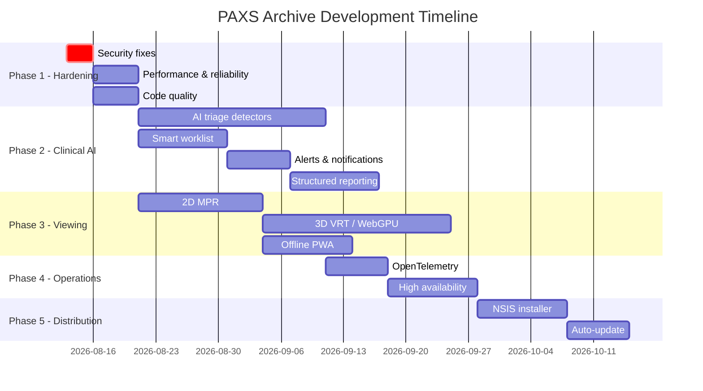

# 🗺️ PAXS Archive — New Execution Plan (August 2026)

> **Context:** This plan replaces [`feature-plans/new_plan.md`](file:///D:/Paxs%20Archive/feature-plans/new_plan.md) which was written early in development for DeepSeek V4 prompts.
> Most of its phases (1–3, 6) are **already built**. This is a fresh plan based on what actually exists today.

---

## 📊 Where You Stand Right Now

| Metric | Value |
|---|---|
| **Features complete** | **44 of 52** (85%) |
| **Services implemented** | 48 Python modules in `app/services/` |
| **Test files** | 65 files, 317+ tests passing |
| **DICOM protocols** | ✅ All 10 core (C-STORE/FIND/GET/MOVE/ECHO + MWL + MPPS + Storage Commit + IAN + TLS) |
| **Integrations** | ✅ HL7 ADT/ORM/ORU + FHIR R4 + Webhooks + DICOMweb + XDS-I + LDAP |
| **Storage** | ✅ Local + S3/MinIO + VNA + Lifecycle + Compression (lossless + lossy) |

### What the old `new_plan.md` planned vs reality:

| Old Plan Phase | Status |
|---|---|
| Phase 1: Zero-Lag Core + C-STORE | ✅ **Done** — but without Celery/Redis (uses threaded worker instead, works fine) |
| Phase 2: Database + Audit Trail | ✅ **Done** — 8+ tables, Alembic, SHA-256 audit, HIPAA audit log |
| Phase 3: Smart Worklist + Reports + Alerts | ✅ **Mostly done** — MWL, reading worklist, reports/ORU, critical results tracking |
| Phase 2.5: Clinical Pack (ASPECTS, PE, Agatston, Lung-RADS, RECIST) | ⬜ **Not done** — only heuristic pneumothorax detector exists |
| Phase 5: Viewer upgrade (WebGPU + Offline PWA) | ⬜ **Not done** |
| Phase 6: Packaging (.exe + Installer) | 🟡 **Partial** — PyInstaller + NSSM done, NSIS installer not done |

---

## 🚀 New Plan — 6 Phases

```
Phase 1                Phase 2                Phase 3
Production             Clinical               Advanced
Hardening              Intelligence            Viewing
(2-3 weeks)            (4-6 weeks)            (4-6 weeks)
    │                      │                      │
    ▼                      ▼                      ▼
Phase 4                Phase 5                Phase 6
Enterprise             Distribution           Market
Operations             & Deploy               Differentiators
(3-4 weeks)            (2-3 weeks)            (ongoing)
```

---

## Phase 1: Production Hardening 🔒
> **Priority: IMMEDIATE** · Effort: 2-3 weeks · Dependencies: None

These are blockers for any real hospital deployment. Several were identified in the code review.

### 1.1 — Security Fixes (P0)

| Task | Detail | Effort |
|---|---|---|
| **Force `SECRET_KEY` in production** | Error on startup if `SECRET_KEY` equals the dev default in [`config.py L103`](file:///D:/Paxs%20Archive/app/core/config.py#L103) | 1h |
| **Fix triage race condition** | Add `FOR UPDATE` or atomic `UPDATE ... WHERE status='PENDING' LIMIT N` in [`worker.py L186`](file:///D:/Paxs%20Archive/app/services/worker.py#L186) | 2h |
| **Add CSP/HSTS headers** | Middleware in [`main.py`](file:///D:/Paxs%20Archive/app/main.py) — `Content-Security-Policy`, `Strict-Transport-Security`, `X-Content-Type-Options` | 3h |
| **Dockerfile non-root** | Add `RUN useradd paxs && USER paxs` to [`Dockerfile`](file:///D:/Paxs%20Archive/Dockerfile) | 30m |
| **Gitignore cleanup** | Add `.env`, `paxs.db`, `check*.txt`, `*.json` reports to [`.gitignore`](file:///D:/Paxs%20Archive/.gitignore) | 15m |
| **Strict CORS config** | Replace permissive CORS with configurable allowed origins via `CORS_ORIGINS` env var | 1h |

### 1.2 — Performance & Reliability

| Task | Detail | Effort |
|---|---|---|
| **DB connection retry** | Exponential backoff on MySQL connection failures in [`session.py`](file:///D:/Paxs%20Archive/app/db/session.py) | 4h |
| **Enforce query limits** | Cap all list endpoints at configurable max (default 1000) | 2h |
| **Healthcheck in Docker** | `HEALTHCHECK curl http://localhost:8000/api/v1/health` in [`docker-compose.yml`](file:///D:/Paxs%20Archive/docker-compose.yml) | 30m |
| **Thumbnail batching** | Generate thumbnail only for middle/representative slice per series, not every instance | 4h |

### 1.3 — Code Quality

| Task | Detail | Effort |
|---|---|---|
| **Split `main.py`** | Extract middleware, lifespan, route registration into separate modules | 4h |
| **Separate `requirements-dev.txt`** | Move `pytest`, `httpx` out of production requirements | 30m |
| **Clean repo root** | Remove `check*.txt`, `paxs_tray_report.json`, `.freebuff/`, `.tools/` | 15m |
| **Structured logging** | Replace print-based logging with `structlog` or `logging` with JSON formatter | 8h |

> [!IMPORTANT]
> Phase 1 is **non-negotiable** before any hospital or commercial deployment. Everything here is low-effort, high-impact.

---

## Phase 2: Clinical Intelligence 🧠
> **Priority: HIGH** · Effort: 4-6 weeks · Dependencies: Phase 1

This is the **highest commercial value** remaining. The old plan's "Clinical Pack 2.5" was never built — only a heuristic pneumothorax detector exists in [`triage_service.py`](file:///D:/Paxs%20Archive/app/services/triage_service.py).

### 2.1 — Real AI Triage Detectors

| Detector | What it does | Model | Effort |
|---|---|---|---|
| **Pneumothorax (upgrade)** | Replace heuristic with trained model | MONAI / TorchXRayVision | 1 week |
| **ICH (Intracranial Hemorrhage)** | Flag brain bleeds on head CT | MONAI pretrained | 1 week |
| **Pulmonary Embolism** | Detect PE on CTPA | MONAI / custom ResNet | 2 weeks |
| **Midline Shift** | Measure midline shift on head CT | SimpleITK + heuristic | 1 week |

Architecture: plug into the existing detector pipeline in [`triage_service.py`](file:///D:/Paxs%20Archive/app/services/triage_service.py) — the claim-then-run pattern is already built.

### 2.2 — Smart Priority Worklist Enhancement

| Task | Detail | Effort |
|---|---|---|
| **Priority scoring** | `Score = UrgencyWeight + (WaitMinutes × 1.5)` — auto-sort by triage + wait time | 4h |
| **Status management UI** | Unread → In Progress → Dictated → Signed workflow in reading worklist | 8h |
| **Worklist management UI** (#30) | Full CRUD for worklist steps in the dashboard | 1 week |

### 2.3 — Clinical Alerts & Notifications

| Task | Detail | Effort |
|---|---|---|
| **Alert gateway** | Telegram / Slack / email / WhatsApp webhook when AI flags critical finding | 1 week |
| **Escalation rules** | If not acknowledged in N minutes → escalate to on-call radiologist | 3 days |
| **Audit integration** | Log every alert send/ack/escalate in audit trail | 4h |

### 2.4 — Structured Reporting (upgrade)

| Task | Detail | Effort |
|---|---|---|
| **Report templates** | JSON-based templates (Arabic + English) for common exams | 3 days |
| **Auto-populate measurements** | Pull measurements from viewer annotations into report fields | 3 days |
| **Dictation bridge** (#34) | WebSocket endpoint for speech-to-text integration (browser `SpeechRecognition` API) | 1 week |

---

## Phase 3: Advanced Viewing 🖥️
> **Priority: MEDIUM-HIGH** · Effort: 4-6 weeks · Dependencies: None (parallel with Phase 2)

### 3.1 — 2D MPR (#26)

| Task | Detail | Effort |
|---|---|---|
| **Backend MPR endpoint** | `GET /api/v1/mpr/{study}/{series}?plane=axial|sagittal|coronal&slice=N` — returns PNG/JPEG of reformatted slice | 2 weeks |
| **Viewer MPR mode** | Frontend MPR rendering via Cornerstone3D / VTK.js | 2 weeks |

### 3.2 — 3D Volume Rendering (#27)

| Task | Detail | Effort |
|---|---|---|
| **WebGPU render bridge** | Client-side 3D VRT/MIP using Cornerstone3D + WebGPU compute shaders | 3 weeks |
| **Server-side fallback** | VTK server rendering for browsers without WebGPU | 1 week |

### 3.3 — Offline-First PWA

| Task | Detail | Effort |
|---|---|---|
| **Service Worker** | Cache recent series metadata + thumbnails in IndexedDB | 1 week |
| **Offline viewing** | View cached DICOM locally without server connection | 1 week |
| **Auto-sync** | Sync draft reports and audit logs when reconnected | 3 days |

### 3.4 — Fusion (#29)

| Task | Detail | Effort |
|---|---|---|
| **PET/CT overlay** | Co-register PET and CT volumes, render fused color overlay | 2 weeks |

---

## Phase 4: Enterprise Operations 🏗️
> **Priority: MEDIUM** · Effort: 3-4 weeks · Dependencies: Phase 1
166
16174 
5 items 

2 1758 1657
### 4.1 — Observability

| Task | Detail | Effort |
|---|---|---|
| **OpenTelemetry** | Tracing + metrics for DIMSE operations, API latency, worker throughput | 1 week |
| **`/metrics` endpoint** | Prometheus-compatible metrics (studies/day, compression backlog, active associations) | 3 days |
| **Structured log shipping** | JSON logs → ELK/Loki via stdout | 3 days |

### 4.2 — High Availability (#48)

| Task | Detail | Effort |
|---|---|---|
| **Stateless API nodes** | Move session state to Redis, multiple API instances behind HAProxy | 1 week |
| **Worker coordination** | Redis-based task locking to prevent duplicate processing across nodes | 3 days |
| **DB failover** | MySQL replication (primary + read replica) with auto-failover | 1 week |

### 4.3 — Automated Backups

| Task | Detail | Effort |
|---|---|---|
| **Scheduled DB backup** | Cron-triggered MySQL dump to S3 with retention policy | 3 days |
| **Storage integrity checks** | Periodic SHA-256 verification of stored DICOM files against audit log | 3 days |

---

## Phase 5: Distribution & Deployment 📦
> **Priority: MEDIUM** · Effort: 2-3 weeks · Dependencies: Phase 1

### 5.1 — NSIS Windows Installer

| Task | Detail | Effort |
|---|---|---|
| **NSIS script** | `C:\Program Files\PAXS Archive\`, Windows Service auto-start, firewall rules for :10400 + :8000 | 1 week |
| **First-run wizard** | GUI dialog for AE title, port, storage path, admin credentials | 3 days |
| **Auto-update** | Check GitHub releases on startup, download + apply patch | 1 week |

### 5.2 — Linux Deployment

| Task | Detail | Effort |
|---|---|---|
| **systemd unit** | `paxs-archive.service` with proper restart policy, user isolation | 2 days |
| **Helm chart** | Kubernetes deployment for cloud-hosted PACS | 1 week |

---

## Phase 6: Market Differentiators 🌟
> **Priority: LOW** · Effort: Ongoing · Dependencies: Phases 1-3

| # | Feature | Description | Effort |
|---|---|---|---|
| 35 | **Chat & Collaboration** | WebSocket-based real-time chat per study, shared cursor/annotations | 2 weeks |
| 36 | **Teaching Files** | Tag studies as teaching cases, searchable teaching library with annotations | 1 week |
| 31 | **Clinical Protocols Library** | Pre-built scan protocol templates per body part/modality | 1 week |
| — | **Patient Portal** | OTP-secured patient access to their own studies (upgrade existing share) | 1 week |
| — | **Multi-language Dashboard** | Arabic/English/French UI with i18n | 1 week |
| — | **Mobile App (PWA)** | Responsive mobile-optimized viewer for on-call radiologists | 2 weeks |

---

## 📅 Suggested Timeline



---

## 🎯 Quick Wins (can do TODAY)

If you want to start immediately, these can each be done in under an hour:

1. **Force `SECRET_KEY` validation** — 15 min
2. **Add `.env` and `paxs.db` to `.gitignore`** — 5 min
3. **Add `USER paxs` to Dockerfile** — 10 min
4. **Add Docker healthcheck** — 10 min
5. **Separate dev requirements** — 15 min
6. **Clean repo root** (remove `check*.txt`) — 5 min

> [!TIP]
> Want me to start implementing? I'd recommend beginning with the Phase 1 quick wins — I can knock out all 6 in about 30 minutes. Just say the word.
