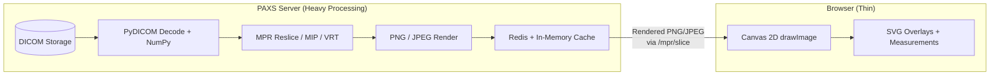
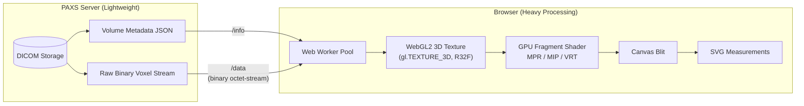
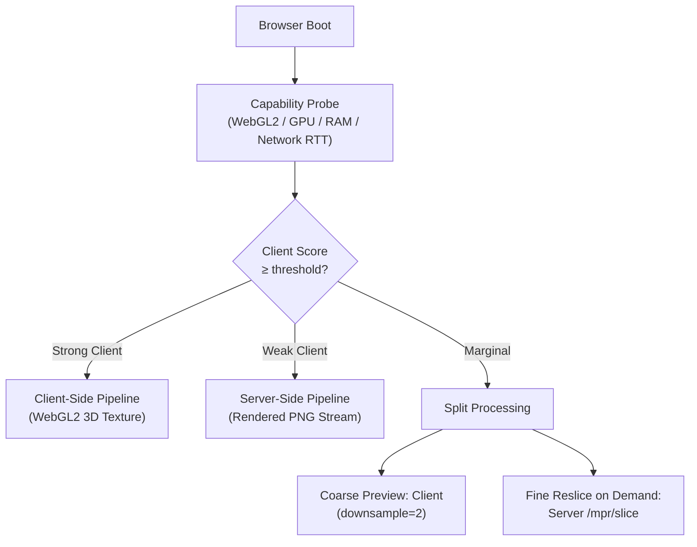
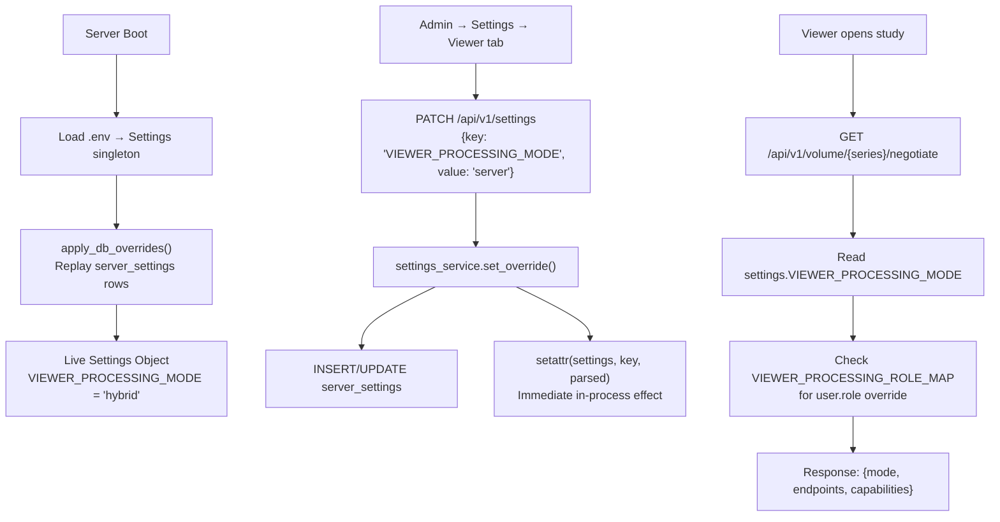
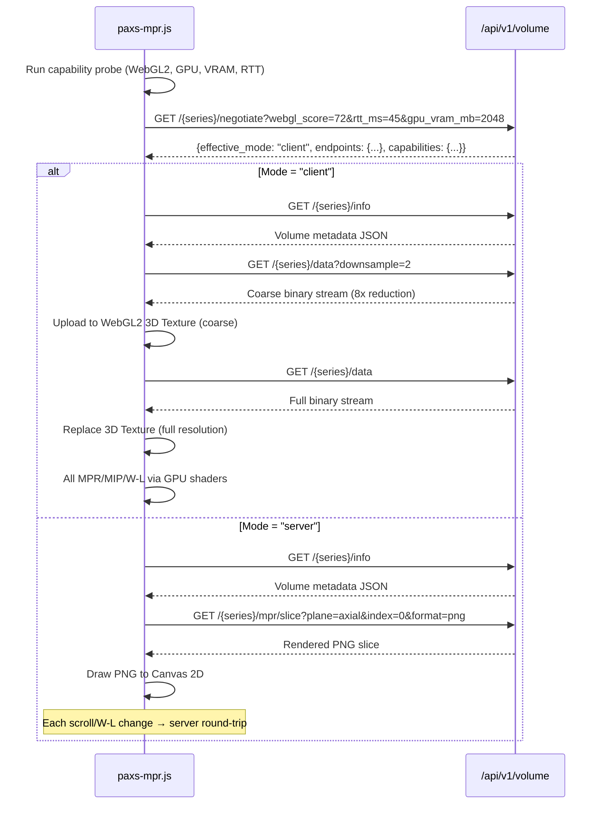

# Hybrid DICOM Viewer Processing — Architectural Plan

> **Project**: PAXS Archive Server  
> **Feature**: Configurable Processing Distribution Strategy for DICOM Viewing  
> **Author**: Mohamed O. Elsamani · PAXS Archive Platform (2026)  
> **Status**: Architecture — Pending Implementation  
> **Date**: 2026-09-24

---

## Table of Contents

| § | Section |
| :--- | :--- |
| 1 | [Executive Summary](#1-executive-summary) |
| 2 | [Codebase Audit & Baseline Architecture](#2-codebase-audit--baseline-architecture) |
| 3 | [Mode Definitions & Decision Matrix](#3-mode-definitions--decision-matrix) |
| 4 | [Configuration Keys & Database Schema](#4-configuration-keys--database-schema) |
| 5 | [Backend API Adaptations](#5-backend-api-adaptations) |
| 6 | [Frontend State Management & Fallback Mechanisms](#6-frontend-state-management--fallback-mechanisms) |
| 7 | [Hybrid Mode — Dynamic Load Balancing Engine](#7-hybrid-mode--dynamic-load-balancing-engine) |
| 8 | [Implementation Phases](#8-implementation-phases) |
| 9 | [Testing Strategy](#9-testing-strategy) |
| 10 | [Risk Analysis & Rollback Plan](#10-risk-analysis--rollback-plan) |
| 11 | [File Change Inventory](#11-file-change-inventory) |

---

## 1. Executive Summary

PAXS Archive Server currently operates with an **implicit dual-mode** viewer pipeline:

1. **Client-side WebGL2 MPR** (`paxs-mpr.js`) — raw binary voxel streaming via `/api/v1/volume/{series}/data`, decoded by Web Workers into `Float32Array`, uploaded as `gl.TEXTURE_3D` on the GPU.
2. **Server-side thin-client fallback** (`/api/v1/volume/{series}/mpr/slice`) — server materializes the volume, reslices via trilinear interpolation, and streams rendered PNG or raw float32 planes.
3. **Server-rendered WADO-RS** (`/dicom-web/.../rendered`) — the standalone viewer (`viewer.js`) uses fully server-rendered JPEG/PNG frames.

Mode selection is **currently implicit** — the MPR engine auto-detects WebGL2 availability and falls back to `state.mode === 'server'`, and the standalone viewer always uses server rendering. There is **no unified, configurable** processing strategy that:

- Can be set per-deployment, per-user role, or per-device class
- Is visible and editable in the Admin Settings UI
- Dynamically balances processing between server and client based on network latency, client hardware, and server load

This plan introduces a **three-mode configurable processing distribution** system:

| Mode | Code | Description |
| :--- | :--- | :--- |
| **SERVER** | `server` | Heavy Server / Thin Client — all decoding, MPR, MIP/VRT on the server |
| **CLIENT** | `client` | Thick Client / Diagnostic Workstation — raw streams to WebGL client |
| **HYBRID** | `hybrid` | Balanced — dynamic split based on capabilities and network probing |

> [!IMPORTANT]
> The default mode is **`hybrid`** — backward-compatible with the existing implicit auto-detection behavior. Existing deployments will see zero change in behavior unless an administrator explicitly switches modes.

---

## 2. Codebase Audit & Baseline Architecture

### 2.1 Existing Server-Side Processing Capabilities

| Capability | Service | Endpoint | Status |
| :--- | :--- | :--- | :--- |
| Volume metadata | [`volume_service.volume_info()`](file:///D:/Paxs%20Archive/app/services/volume_service.py#L525) | `GET /api/v1/volume/{series}/info` | ✅ Production |
| Raw voxel streaming | [`volume_service.iter_volume_bytes()`](file:///D:/Paxs%20Archive/app/services/volume_service.py#L555) | `GET /api/v1/volume/{series}/data` | ✅ Production |
| Server MPR reslicing | [`volume_service.reslice_plane()`](file:///D:/Paxs%20Archive/app/services/volume_service.py#L886) | `GET /api/v1/volume/{series}/mpr/slice` | ✅ Production |
| Server MIP/VRT projection | [`volume_service.mip_project()`](file:///D:/Paxs%20Archive/app/services/volume_service.py#L1090) | `GET /api/v1/volume/{series}/mip` | ✅ Production |
| PNG plane rendering | [`volume_service.render_plane_png()`](file:///D:/Paxs%20Archive/app/services/volume_service.py#L1008) | (via MPR/MIP endpoints) | ✅ Production |
| Frame transcoding | [`wado_rs_bulk_service.decode_frames_to_raw()`](file:///D:/Paxs%20Archive/app/services/wado_rs_bulk_service.py) | `GET .../frames/{n}?transcode=1` | ✅ Production |
| Server-rendered frames | [`imaging.dataset_to_bytes()`](file:///D:/Paxs%20Archive/app/services/imaging.py) | `GET .../rendered` | ✅ Production |
| Fusion alignment | [`fusion_service.study_frame_of_references()`](file:///D:/Paxs%20Archive/app/services/fusion_service.py) | `GET /api/v1/fusion/study/{uid}/fusion` | ✅ Production |

### 2.2 Existing Client-Side Processing Capabilities

| Capability | Component | Technology | Status |
| :--- | :--- | :--- | :--- |
| Web Worker voxel decode | [`paxs-mpr.js#L966-L1174`](file:///D:/Paxs%20Archive/app/static/viewer/paxs-mpr.js) | Web Workers + `Float32Array` | ✅ Production |
| WebGL2 3D texture reslicing | [`paxs-mpr.js#L1284-L1350`](file:///D:/Paxs%20Archive/app/static/viewer/paxs-mpr.js) | `sampler3D`, `R32F`, GPU shaders | ✅ Production |
| GPU MIP/MinIP/AverageIP | [`paxs-mpr.js`](file:///D:/Paxs%20Archive/app/static/viewer/paxs-mpr.js) fragment shader | WebGL2 raymarching loop | ✅ Production |
| Three.js 3D VRT | [`paxs-mpr.js`](file:///D:/Paxs%20Archive/app/static/viewer/paxs-mpr.js) | Three.js r128 + custom shaders | ✅ Production |
| WASM DICOM codecs | `app/static/viewer/*.wasm` (5.6MB+2.1MB+...) | OpenJPEG/CharLS/GDCM WASM | ✅ Production |
| Cornerstone3D decoding | OHIF v3 / PaxsViewer | Cornerstone3D + WebGL2 | ✅ Production |
| SVG measurement overlays | [`paxs-mpr.js`](file:///D:/Paxs%20Archive/app/static/viewer/paxs-mpr.js) | SVG layer + Canvas 2D | ✅ Production |
| PET/CT fusion blending | [`paxs-mpr.js`](file:///D:/Paxs%20Archive/app/static/viewer/paxs-mpr.js) | WebGL colormaps + alpha blend | ✅ Production |

### 2.3 Existing Implicit Mode Detection

The current fallback logic in `paxs-mpr.js`:

```
if (!hasWebGL2 || forceServer) {
    state.mode = 'server';     // → /mpr/slice + PNG streaming
} else {
    state.mode = 'gl';         // → /data + WebGL2 3D texture
}
```

The standalone viewer (`viewer.js`) always operates in a fully server-rendered mode via `/rendered` WADO-RS.

### 2.4 Configuration Architecture Baseline

Settings are managed via a **three-tier hierarchy** ([`settings_service.py`](file:///D:/Paxs%20Archive/app/services/settings_service.py)):

$$\text{Live Value} = \text{DB Override (server\_settings table)} \mathbin{??} \text{.env / Default (config.py)}$$

- **42 existing editable keys** in `EDITABLE_KEYS` across 6 groups (`sys`, `dicom`, `interop`, `storage`, `security`, `workflow`)
- **DB model**: [`ServerSetting`](file:///D:/Paxs%20Archive/app/db/models.py#L1603) — table `server_settings` with `key` (unique, varchar(64)), `value` (text), `updated_at`
- **Runtime mutation**: `setattr(settings, key, parsed)` — instant in-process application
- **Boot replay**: `apply_db_overrides()` replays stored overrides on startup

### 2.5 Multi-Tier Cache Architecture

| Tier | Cache | Key Pattern | TTL | Relevance |
| :--- | :--- | :--- | :--- | :--- |
| L1 (RAM) | `_VOL_CACHE` | `array:{series}:{len}` | LRU 8 entries | Server MPR/MIP reslice |
| L1 (RAM) | `_BUNDLE_CACHE` | `{series_uid}` | LRU 32 entries | Volume metadata |
| L1 (RAM) | `_FRAME_CACHE` | `(sop_uid, frame_idx)` | LRU 16 frames | WADO-RS frame decode |
| L2 (Redis) | Volume cache | `paxs:vol:array:{series}:{len}` | 3,600s | Server MPR/MIP shared |
| L2 (Redis) | Stream cache | `paxs:vol:stream:{series}:...` | 3,600s | Volume data endpoint |
| L2 (Redis) | Frame cache | `paxs:frame:{sop}:{frame}` | 1,800s | Transcoded frame bytes |
| L2 (Redis) | Render cache | `paxs:rendered:{sop}:...` | 600s | Server-rendered images |

---

## 3. Mode Definitions & Decision Matrix

### 3.1 Mode: `server` — Heavy Server / Thin Client



| Aspect | Behavior |
| :--- | :--- |
| **Volume data endpoint** | Disabled (`/data` returns 503 with mode hint) |
| **MPR reslicing** | Server-side via `/mpr/slice?format=png` for each plane |
| **Slice navigation** | Each scrub/scroll triggers `GET /mpr/slice?plane=axial&index=N` |
| **MIP / VRT** | Server-side via `/mip?format=png` |
| **Window/Level** | Server-side: re-renders PNG with new `window_center`/`window_width` params |
| **Measurements** | Client-side SVG over server-rendered slices (HU values fetched from `?format=raw`) |
| **3D volume** | Server-rendered image tiles (not interactive 3D) |
| **Fusion** | Server blends overlays into rendered output |
| **Client requirements** | HTML5 Canvas 2D only — works on tablets, phones, legacy browsers |
| **Network** | High request volume (one HTTP round-trip per slice/W-L change) |
| **Server cost** | High CPU + RAM (volume materialization + PIL rendering per request) |

### 3.2 Mode: `client` — Thick Client / Diagnostic Workstation



| Aspect | Behavior |
| :--- | :--- |
| **Volume data endpoint** | Full raw binary stream via `/data` |
| **MPR reslicing** | Client GPU shader — zero server calls after initial load |
| **Slice navigation** | Instant (GPU re-samples from 3D texture) |
| **MIP / VRT** | Client GPU raymarching shader loop |
| **Window/Level** | Instant (shader uniform update, zero network) |
| **Measurements** | Client-side from HU voxel buffer |
| **3D volume** | Interactive Three.js + WebGL raymarching |
| **Fusion** | Client-side dual texture blending with colormaps |
| **Client requirements** | WebGL2 + sufficient GPU VRAM (~500MB–2GB) |
| **Network** | One large transfer upfront, then zero |
| **Server cost** | Minimal after metadata + stream |

### 3.3 Mode: `hybrid` — Dynamic / Balanced (Default)



| Aspect | Behavior |
| :--- | :--- |
| **Initial load** | Client runs a capability probe (see §7) |
| **Strong client** | Operates as `client` mode |
| **Weak client** | Falls back to `server` mode |
| **Marginal client** | Coarse client-side preview (downsample=2) + server-side fine slices on demand |
| **Network latency** | If RTT > threshold, prefers local GPU processing even on modest hardware |
| **Server load** | Backend reports `X-PAXS-Server-Load` header; high load shifts work to client |
| **Adaptive** | Re-evaluates periodically during session (e.g. when switching series) |

---

## 4. Configuration Keys & Database Schema

### 4.1 New Settings in [`app/core/config.py`](file:///D:/Paxs%20Archive/app/core/config.py)

Add to the `Settings` class after the existing `VOLUME_MPR_MAX_PIXELS` (line 253):

```python
# --- Viewer Processing Distribution (roadmap #51) ---
# Controls how DICOM viewing, MPR, and 3D rendering are distributed
# between the server and the client browser.
#   "hybrid"  (default) — auto-detect; strong clients get WebGL, weak
#             clients get server-rendered frames, marginal clients get
#             a coarse preview with server-refined slices.
#   "server"  — all decoding, reslicing and rendering on the server;
#             only rendered PNG/JPEG frames stream to the browser
#             (thin client — works on tablets and legacy browsers).
#   "client"  — raw voxel data streams to the browser and the
#             diagnostic workstation does all GPU rendering locally
#             (thick client — requires WebGL2, sufficient VRAM).
VIEWER_PROCESSING_MODE: str = "hybrid"

# Hybrid mode thresholds (§7 dynamic engine)
# Minimum WebGL score (0-100) for the client to qualify for client-side
# processing. Below this, the hybrid engine routes to server mode.
HYBRID_CLIENT_SCORE_THRESHOLD: int = 40

# Maximum server-side volume materialization budget (MB). When the
# in-process volume cache exceeds this, the hybrid engine shifts
# new series to client-side processing to shed server RAM.
HYBRID_SERVER_VOL_BUDGET_MB: int = 4096

# Network RTT threshold (ms). If the client's measured round-trip
# time exceeds this, the hybrid engine prefers client-side processing
# (even on modest hardware) to avoid per-slice latency penalties.
HYBRID_RTT_THRESHOLD_MS: int = 150

# Concurrency cap: maximum number of concurrent server-side MPR
# sessions before the hybrid engine forces new sessions to client mode.
HYBRID_MAX_SERVER_MPR_SESSIONS: int = 20

# Per-user role override (JSON map). Allows pinning specific roles
# to a specific processing mode regardless of the global setting.
# Example: '{"RADIOLOGIST":"client","PHYSICIAN":"server"}'
# Empty string = no role overrides (global mode applies to all).
VIEWER_PROCESSING_ROLE_MAP: str = ""
```

### 4.2 Settings Service Registry

Add to [`EDITABLE_KEYS`](file:///D:/Paxs%20Archive/app/services/settings_service.py#L37) in `settings_service.py`:

```python
# ---- Viewer Processing (roadmap #51) ---------------------------------
"VIEWER_PROCESSING_MODE": {
    "label": "Viewer processing mode",
    "group": "viewer",
    "type": "select",
    "options": ["hybrid", "server", "client"],
    "description": (
        "How DICOM decoding, MPR and 3D rendering are distributed. "
        "'hybrid' auto-detects client capabilities; 'server' renders "
        "all frames server-side (thin client); 'client' streams raw "
        "voxels to the browser GPU (diagnostic workstation)."
    ),
},
"HYBRID_CLIENT_SCORE_THRESHOLD": {
    "label": "Hybrid: min client score (0-100)",
    "group": "viewer",
    "type": "int",
    "description": "WebGL capability score below which the hybrid engine falls back to server mode.",
},
"HYBRID_SERVER_VOL_BUDGET_MB": {
    "label": "Hybrid: server volume budget (MB)",
    "group": "viewer",
    "type": "int",
    "description": "Maximum in-process volume cache size before new sessions are shifted to client mode.",
},
"HYBRID_RTT_THRESHOLD_MS": {
    "label": "Hybrid: network RTT threshold (ms)",
    "group": "viewer",
    "type": "int",
    "description": "Round-trip time above which client-side processing is preferred over per-slice server calls.",
},
"HYBRID_MAX_SERVER_MPR_SESSIONS": {
    "label": "Hybrid: max server MPR sessions",
    "group": "viewer",
    "type": "int",
    "description": "Concurrent server-side MPR sessions before new sessions are forced to client mode.",
},
"VIEWER_PROCESSING_ROLE_MAP": {
    "label": "Per-role mode overrides (JSON)",
    "group": "viewer",
    "type": "str",
    "description": "JSON map of role→mode overrides, e.g. {\"RADIOLOGIST\":\"client\",\"PHYSICIAN\":\"server\"}. Empty = global mode for all.",
},
```

Add a new group entry to [`GROUPS`](file:///D:/Paxs%20Archive/app/services/settings_service.py#L387):

```python
"viewer": {
    "label": "Viewer",
    "description": "Processing distribution, rendering modes and hybrid auto-detection thresholds.",
},
```

### 4.3 Database Schema — No New Tables Required

The existing [`server_settings`](file:///D:/Paxs%20Archive/app/db/models.py#L1603) table is sufficient. New keys are stored as regular `ServerSetting` rows (`key` ≤ 64 chars, `value` as text). No migration needed.

### 4.4 Configuration Flow Diagram



---

## 5. Backend API Adaptations

### 5.1 New Endpoint: Processing Mode Negotiation

**`GET /api/v1/volume/{series_uid}/negotiate`**

This is the cornerstone API that the frontend calls before loading any data. It returns the resolved processing mode and available capabilities.

```python
# app/api/v1/volume.py — new endpoint

@router.get("/{series_uid}/negotiate")
async def volume_negotiate_endpoint(
    series_uid: str,
    request: Request,
    db: AsyncSession = Depends(get_db),
    user: User | None = Depends(require_series_read),
):
    """Negotiate the viewer processing mode for a series.

    Returns the resolved mode (server/client/hybrid) along with the
    endpoint URLs and capabilities the frontend should use. If the mode
    is 'hybrid', the response includes the thresholds the client should
    use for its capability self-assessment.

    Query params (client reports):
      ?webgl_score=N      client's WebGL capability score (0-100)
      ?rtt_ms=N           measured RTT to this server in ms
      ?gpu_vram_mb=N      estimated GPU VRAM in MB
      ?hardware_concurrency=N  navigator.hardwareConcurrency
    """
    if not settings.VOLUME_STREAMING_ENABLED:
        raise HTTPException(503, "Volume streaming is disabled")
    await require_series_access(db, series_uid, user,
                                share_scope=await get_share_scope(request))

    # 1. Resolve the base mode from settings
    mode = settings.VIEWER_PROCESSING_MODE.lower().strip()
    if mode not in ("server", "client", "hybrid"):
        mode = "hybrid"

    # 2. Apply per-role override if configured
    if user and settings.VIEWER_PROCESSING_ROLE_MAP:
        import json
        try:
            role_map = json.loads(settings.VIEWER_PROCESSING_ROLE_MAP)
            role = getattr(user, "role", "").upper()
            if role in role_map:
                mode = role_map[role].lower()
        except (json.JSONDecodeError, AttributeError):
            pass

    # 3. Hybrid negotiation (if still hybrid and client reported scores)
    q = request.query_params
    effective_mode = mode
    if mode == "hybrid":
        webgl_score = int(q.get("webgl_score", 0) or 0)
        rtt_ms = int(q.get("rtt_ms", 0) or 0)
        client_capable = webgl_score >= settings.HYBRID_CLIENT_SCORE_THRESHOLD

        # Server load check
        server_overloaded = (
            len(volume_service._VOL_CACHE) >= settings.HYBRID_MAX_SERVER_MPR_SESSIONS
            or _estimated_vol_cache_mb() > settings.HYBRID_SERVER_VOL_BUDGET_MB
        )
        high_latency = rtt_ms > settings.HYBRID_RTT_THRESHOLD_MS

        if client_capable or server_overloaded or high_latency:
            effective_mode = "client"
        else:
            effective_mode = "server"

    # 4. Build the response
    response = {
        "configured_mode": mode,
        "effective_mode": effective_mode,
        "series_uid": series_uid,
        "endpoints": _mode_endpoints(effective_mode, series_uid),
        "capabilities": _mode_capabilities(effective_mode),
    }
    if mode == "hybrid":
        response["hybrid_thresholds"] = {
            "client_score_threshold": settings.HYBRID_CLIENT_SCORE_THRESHOLD,
            "rtt_threshold_ms": settings.HYBRID_RTT_THRESHOLD_MS,
            "server_vol_budget_mb": settings.HYBRID_SERVER_VOL_BUDGET_MB,
            "max_server_sessions": settings.HYBRID_MAX_SERVER_MPR_SESSIONS,
        }

    return JSONResponse(response, headers={
        "X-PAXS-Processing-Mode": effective_mode,
        "X-PAXS-Server-Load": str(len(volume_service._VOL_CACHE)),
        "Cache-Control": "no-store",
    })
```

### 5.2 Mode-Aware Endpoint Guards

Existing endpoints gain mode awareness without breaking changes:

| Endpoint | `server` mode | `client` mode | `hybrid` mode |
| :--- | :--- | :--- | :--- |
| `GET /volume/{s}/info` | ✅ Returns metadata | ✅ Returns metadata | ✅ Always available |
| `GET /volume/{s}/data` | Returns 503 + `X-PAXS-Mode-Hint: server` | ✅ Full binary stream | ✅ Available (client decides) |
| `GET /volume/{s}/mpr/slice` | ✅ Full reslice | Returns 503 + `X-PAXS-Mode-Hint: client` | ✅ Available (for fallback) |
| `GET /volume/{s}/mip` | ✅ Server-side projection | Returns 503 + `X-PAXS-Mode-Hint: client` | ✅ Available (for fallback) |
| `GET /volume/{s}/negotiate` | ✅ Returns `{mode: "server"}` | ✅ Returns `{mode: "client"}` | ✅ Runs negotiation |
| `GET .../rendered` | ✅ Server-side | ✅ Available (thin client compat) | ✅ Always available |
| `GET .../frames/{n}` | ✅ + auto-transcode | ✅ Native bitstream | ✅ Depends on negotiation |

> [!NOTE]
> Endpoints are **never hard-blocked** — they return 503 with a machine-readable `X-PAXS-Mode-Hint` header and a JSON body explaining the configured mode. This allows graceful degradation and explicit override via `?force=1` query parameter for debugging.

### 5.3 Server-Side Session Tracking

For the hybrid engine to enforce `HYBRID_MAX_SERVER_MPR_SESSIONS`, we add lightweight session tracking:

```python
# app/services/volume_service.py — additions

import time

# Active server-side MPR sessions (series_uid → last_access_timestamp)
_ACTIVE_SERVER_SESSIONS: dict[str, float] = {}
_SESSION_TIMEOUT = 300  # 5 minutes of inactivity = session expired

def register_server_session(series_uid: str) -> None:
    _ACTIVE_SERVER_SESSIONS[series_uid] = time.monotonic()
    _evict_expired_sessions()

def release_server_session(series_uid: str) -> None:
    _ACTIVE_SERVER_SESSIONS.pop(series_uid, None)

def active_server_session_count() -> int:
    _evict_expired_sessions()
    return len(_ACTIVE_SERVER_SESSIONS)

def _evict_expired_sessions() -> None:
    now = time.monotonic()
    expired = [k for k, v in _ACTIVE_SERVER_SESSIONS.items()
               if now - v > _SESSION_TIMEOUT]
    for k in expired:
        _ACTIVE_SERVER_SESSIONS.pop(k, None)

def _estimated_vol_cache_mb() -> int:
    with _VOL_CACHE_LOCK:
        return sum(v.nbytes for v in _VOL_CACHE.values()) // (1024 * 1024)
```

### 5.4 Server-Side Streaming Tiles (New for SERVER Mode)

For interactive server-mode viewing (slice scrolling, W/L adjustment), add a **streaming tile endpoint** that returns pre-rendered tiles efficiently:

**`GET /api/v1/volume/{series_uid}/tiles`**

```
?plane=axial&range=50-60&window_center=40&window_width=400&size=512
```

Returns a multipart/mixed response with 11 pre-rendered PNG tiles in a single HTTP request — enabling prefetching of adjacent slices for smooth scrolling. Uses the existing `render_plane_png()` function with Redis caching.

### 5.5 Settings API — New Viewer Tab

The existing [`GET /api/v1/settings`](file:///D:/Paxs%20Archive/app/api/v1/settings.py) and `PATCH /api/v1/settings` endpoints automatically expose the new viewer keys because they iterate `EDITABLE_KEYS`. The admin Settings UI will gain a new **"Viewer"** tab alongside the existing System, DICOM, Interop, Storage, Security, and Workflow tabs.

---

## 6. Frontend State Management & Fallback Mechanisms

### 6.1 Mode Negotiation Flow (Client-Side)



### 6.2 Client Capability Probe

Add to `paxs-mpr.js`:

```javascript
function probeClientCapabilities() {
    const score = { webgl: 0, vram: 0, workers: 0, total: 0 };

    // 1. WebGL2 support (0 or 30 points)
    const canvas = document.createElement('canvas');
    const gl = canvas.getContext('webgl2');
    if (gl) {
        score.webgl = 30;
        // 2. GPU VRAM estimate via MAX_TEXTURE_SIZE (0-20 points)
        const maxTex = gl.getParameter(gl.MAX_3D_TEXTURE_SIZE);
        score.vram = Math.min(20, Math.floor(maxTex / 512) * 5);
        // 3. Renderer string heuristic (0-20 points)
        const debugInfo = gl.getExtension('WEBGL_debug_renderer_info');
        if (debugInfo) {
            const renderer = gl.getParameter(debugInfo.UNMASKED_RENDERER_WEBGL);
            if (/NVIDIA|AMD|Radeon|GeForce|Quadro/i.test(renderer)) score.vram += 10;
        }
        canvas.remove();
    }
    // 4. Hardware concurrency (0-15 points)
    score.workers = Math.min(15, (navigator.hardwareConcurrency || 2) * 2);
    // 5. Device memory (0-15 points)
    const mem = navigator.deviceMemory || 4;
    score.memory = Math.min(15, Math.floor(mem / 2) * 5);

    score.total = score.webgl + score.vram + score.workers + score.memory;
    return score;
}
```

### 6.3 Network RTT Measurement

```javascript
async function measureRTT(seriesUid) {
    const url = `/api/v1/volume/${seriesUid}/info`;
    const t0 = performance.now();
    await fetch(url, { method: 'HEAD', cache: 'no-store' });
    return Math.round(performance.now() - t0);
}
```

### 6.4 Graceful Fallback Chain

```
client → (WebGL2 context lost?) → hybrid → (server overloaded?) → server
```

The fallback chain ensures zero-downtime viewing:

1. **Client mode failure**: If `gl.isContextLost()` returns true during a session, the viewer automatically transitions to server mode for that viewport.
2. **Server mode failure**: If `/mpr/slice` returns 503 or times out, the viewer attempts client-side rendering with `downsample=4` (very low resolution, works on most hardware).
3. **Total fallback**: If both fail, the viewer degrades to the standalone viewer pipeline (WADO-RS `/rendered` frame-by-frame).

### 6.5 State Management Updates

Add to the central `state` object in `paxs-mpr.js`:

```javascript
state.processing = {
    configuredMode: 'hybrid',    // from server negotiate response
    effectiveMode: 'client',     // resolved mode for this session
    clientScore: 72,             // probed score
    rttMs: 45,                   // measured RTT
    fallbackChain: ['client', 'server', 'rendered'],
    fallbackIndex: 0,            // current position in chain
    negotiateResponse: null,     // full negotiate JSON
};
```

### 6.6 Admin Settings UI — Viewer Tab

The Settings page (`app/static/settings/`) will gain a new **Viewer** tab containing:

| Control | Type | Bound Setting |
| :--- | :--- | :--- |
| Processing Mode | Dropdown (Server / Client / Hybrid) | `VIEWER_PROCESSING_MODE` |
| Client Score Threshold | Number input (0-100) | `HYBRID_CLIENT_SCORE_THRESHOLD` |
| Server Volume Budget (MB) | Number input | `HYBRID_SERVER_VOL_BUDGET_MB` |
| RTT Threshold (ms) | Number input | `HYBRID_RTT_THRESHOLD_MS` |
| Max Server MPR Sessions | Number input | `HYBRID_MAX_SERVER_MPR_SESSIONS` |
| Per-Role Mode Overrides | JSON textarea | `VIEWER_PROCESSING_ROLE_MAP` |

---

## 7. Hybrid Mode — Dynamic Load Balancing Engine

### 7.1 Decision Algorithm

```python
def resolve_hybrid_mode(
    webgl_score: int,
    rtt_ms: int,
    gpu_vram_mb: int,
    hardware_concurrency: int,
    server_vol_cache_mb: int,
    active_server_sessions: int,
    settings: Settings,
) -> str:
    """Resolve the effective processing mode for a hybrid session.

    Returns 'client', 'server', or 'split' (coarse client + fine server).
    """
    # Force server: client has no WebGL2
    if webgl_score == 0:
        return "server"

    # Force client: server is overloaded
    if (active_server_sessions >= settings.HYBRID_MAX_SERVER_MPR_SESSIONS
            or server_vol_cache_mb >= settings.HYBRID_SERVER_VOL_BUDGET_MB):
        return "client" if webgl_score >= 20 else "server"

    # Strong client: high score + good GPU
    if webgl_score >= settings.HYBRID_CLIENT_SCORE_THRESHOLD:
        return "client"

    # High latency: prefer client to avoid per-slice round-trips
    if rtt_ms > settings.HYBRID_RTT_THRESHOLD_MS and webgl_score >= 20:
        return "client"

    # Marginal client: coarse client preview + server fine slices
    if 20 <= webgl_score < settings.HYBRID_CLIENT_SCORE_THRESHOLD:
        return "split"

    # Default: server
    return "server"
```

### 7.2 Split Mode Data Flow

In `split` mode, the client loads a coarse volume locally and requests server-refined slices:

1. **Coarse preview** (client-side): `GET /volume/{s}/data?downsample=4` → 64× data reduction → instant WebGL preview
2. **Fine slices** (server-side): On slice selection, `GET /volume/{s}/mpr/slice?plane=axial&index=N&format=raw` → float32 HU data drawn over the coarse texture
3. **Transition**: When the user stops interacting for >500ms, the fine slice replaces the coarse viewport

### 7.3 Server Load Header

All volume endpoints include a response header:

```
X-PAXS-Server-Load: <active_sessions>/<max_sessions>
X-PAXS-Vol-Cache-MB: <current_mb>/<budget_mb>
```

The frontend periodically (every 30s) reads these to trigger mid-session mode transitions.

---

## 8. Implementation Phases

### Phase 1: Configuration Foundation (Zero Visual Change)

> **Goal**: Add all configuration keys, settings UI, and the negotiate endpoint. No behavioral change.  
> **Regression guarantee**: All existing tests pass; `VIEWER_PROCESSING_MODE=hybrid` produces identical behavior to current implicit auto-detection.

| Step | File | Change |
| :--- | :--- | :--- |
| 1.1 | [`app/core/config.py`](file:///D:/Paxs%20Archive/app/core/config.py) | Add 6 new fields to `Settings` class (lines 253+) |
| 1.2 | [`app/services/settings_service.py`](file:///D:/Paxs%20Archive/app/services/settings_service.py) | Add 6 entries to `EDITABLE_KEYS`, add `"viewer"` to `GROUPS` |
| 1.3 | [`app/api/v1/volume.py`](file:///D:/Paxs%20Archive/app/api/v1/volume.py) | Add `negotiate` endpoint (read-only, no behavioral gates) |
| 1.4 | [`app/services/volume_service.py`](file:///D:/Paxs%20Archive/app/services/volume_service.py) | Add session tracking functions, `_estimated_vol_cache_mb()` |
| 1.5 | [`app/static/settings/`](file:///D:/Paxs%20Archive/app/static/settings/) | Add Viewer tab to Settings UI |
| 1.6 | [`tests/test_config.py`](file:///D:/Paxs%20Archive/tests/test_config.py) | Add tests for new setting defaults and validation |
| 1.7 | `tests/test_negotiate.py` (new) | Add tests for negotiate endpoint responses |

**Estimated effort**: 2 days  
**Risk**: ★☆☆☆☆ (additive only, no behavioral changes)

---

### Phase 2: Server Mode Implementation

> **Goal**: Full `server` mode — all rendering on the server, canvas-only client.  
> **Regression guarantee**: Existing WebGL pipeline unaffected (only activates when mode = `server`).

| Step | File | Change |
| :--- | :--- | :--- |
| 2.1 | [`app/api/v1/volume.py`](file:///D:/Paxs%20Archive/app/api/v1/volume.py) | Add mode-aware guards on `/data` endpoint (503 when mode=server) |
| 2.2 | [`app/api/v1/volume.py`](file:///D:/Paxs%20Archive/app/api/v1/volume.py) | Add `/tiles` batch-rendering endpoint |
| 2.3 | [`app/services/volume_service.py`](file:///D:/Paxs%20Archive/app/services/volume_service.py) | Add `render_tiles()` batch function with Redis caching |
| 2.4 | [`app/static/viewer/paxs-mpr.js`](file:///D:/Paxs%20Archive/app/static/viewer/paxs-mpr.js) | Add server-mode rendering pipeline (fetch PNG → Canvas 2D drawImage) |
| 2.5 | [`app/static/viewer/paxs-mpr.js`](file:///D:/Paxs%20Archive/app/static/viewer/paxs-mpr.js) | Server-mode W/L via re-fetch (debounced, 200ms) |
| 2.6 | [`app/static/viewer/paxs-mpr.js`](file:///D:/Paxs%20Archive/app/static/viewer/paxs-mpr.js) | Server-mode measurement pipeline (fetch `?format=raw` float32 for HU) |
| 2.7 | `tests/test_volume_server_mode.py` (new) | Integration tests for server-mode pipeline |

**Estimated effort**: 5 days  
**Risk**: ★★☆☆☆ (new code path, but isolated behind mode gate)

---

### Phase 3: Client Mode Hardening

> **Goal**: Explicit `client` mode — raw streaming only, server reslice disabled.  
> **Regression guarantee**: Default hybrid mode unaffected; server endpoints return 503 only when mode=client.

| Step | File | Change |
| :--- | :--- | :--- |
| 3.1 | [`app/api/v1/volume.py`](file:///D:/Paxs%20Archive/app/api/v1/volume.py) | Add mode guard on `/mpr/slice` and `/mip` (503 when mode=client) |
| 3.2 | [`app/static/viewer/paxs-mpr.js`](file:///D:/Paxs%20Archive/app/static/viewer/paxs-mpr.js) | Client-mode init: skip server fallback probing |
| 3.3 | [`app/static/viewer/paxs-mpr.js`](file:///D:/Paxs%20Archive/app/static/viewer/paxs-mpr.js) | Add capability probe function |
| 3.4 | [`app/static/viewer/paxs-mpr.js`](file:///D:/Paxs%20Archive/app/static/viewer/paxs-mpr.js) | Add RTT measurement function |
| 3.5 | `tests/test_volume_client_mode.py` (new) | Integration tests for client-mode pipeline |

**Estimated effort**: 3 days  
**Risk**: ★★☆☆☆ (mostly guards + client-side probing)

---

### Phase 4: Hybrid Dynamic Engine

> **Goal**: Full hybrid mode — dynamic negotiation, split processing, adaptive mode switching.  
> **Regression guarantee**: Hybrid produces the same visual result as the current auto-detection for strong clients.

| Step | File | Change |
| :--- | :--- | :--- |
| 4.1 | [`app/api/v1/volume.py`](file:///D:/Paxs%20Archive/app/api/v1/volume.py) | Full negotiate logic with hybrid decision algorithm |
| 4.2 | [`app/services/volume_service.py`](file:///D:/Paxs%20Archive/app/services/volume_service.py) | Server load reporting in response headers |
| 4.3 | [`app/static/viewer/paxs-mpr.js`](file:///D:/Paxs%20Archive/app/static/viewer/paxs-mpr.js) | Split-mode pipeline (coarse client + fine server) |
| 4.4 | [`app/static/viewer/paxs-mpr.js`](file:///D:/Paxs%20Archive/app/static/viewer/paxs-mpr.js) | Mid-session adaptive mode switching |
| 4.5 | [`app/static/viewer/paxs-mpr.js`](file:///D:/Paxs%20Archive/app/static/viewer/paxs-mpr.js) | Graceful fallback chain with WebGL context loss handler |
| 4.6 | `tests/test_hybrid_engine.py` (new) | Decision algorithm unit tests with parameterized edge cases |
| 4.7 | `tests/test_hybrid_integration.py` (new) | End-to-end tests for mode transitions |

**Estimated effort**: 7 days  
**Risk**: ★★★☆☆ (complex decision logic, needs thorough edge-case testing)

---

### Phase 5: Per-Role Overrides & Monitoring

> **Goal**: Role-based mode pinning, monitoring dashboard, production hardening.

| Step | File | Change |
| :--- | :--- | :--- |
| 5.1 | [`app/api/v1/volume.py`](file:///D:/Paxs%20Archive/app/api/v1/volume.py) | Parse `VIEWER_PROCESSING_ROLE_MAP` JSON and apply per-role overrides |
| 5.2 | [`app/api/v1/dashboard.py`](file:///D:/Paxs%20Archive/app/api/v1/dashboard.py) | Add viewer processing metrics to `/stats` (active sessions per mode) |
| 5.3 | [`app/static/admin/`](file:///D:/Paxs%20Archive/app/static/admin/) | Add viewer processing distribution chart to admin dashboard |
| 5.4 | [`app/services/volume_service.py`](file:///D:/Paxs%20Archive/app/services/volume_service.py) | Structured logging for mode decisions (audit trail) |
| 5.5 | `tests/test_viewer_role_overrides.py` (new) | Tests for role-based mode resolution |

**Estimated effort**: 3 days  
**Risk**: ★★☆☆☆

---

## 9. Testing Strategy

### 9.1 Unit Tests

| Test Suite | Scope | Key Assertions |
| :--- | :--- | :--- |
| `test_config.py` | Settings defaults | `VIEWER_PROCESSING_MODE` defaults to `"hybrid"` |
| `test_config.py` | Settings validation | Invalid mode values are rejected by `_coerce()` |
| `test_negotiate.py` | Negotiate endpoint | Returns correct mode for each `VIEWER_PROCESSING_MODE` setting |
| `test_negotiate.py` | Role overrides | `RADIOLOGIST` gets `client` when role map is set |
| `test_hybrid_engine.py` | Decision algorithm | Parameterized matrix of (score, RTT, server_load) → expected mode |
| `test_volume_strided_dims.py` | Existing geometry | Unchanged — validates no regression in stride math |

### 9.2 Integration Tests

| Test Suite | Scope | Key Assertions |
| :--- | :--- | :--- |
| `test_volume_server_mode.py` | Full server pipeline | `/mpr/slice` returns valid PNG; `/data` returns 503 with mode hint |
| `test_volume_client_mode.py` | Full client pipeline | `/data` streams correct bytes; `/mpr/slice` returns 503 with mode hint |
| `test_hybrid_integration.py` | Hybrid negotiation | Mode switches correctly based on client scores |
| `test_volume.py` (existing) | Backward compat | All existing tests pass unmodified (hybrid default = current behavior) |
| `test_volume_mpr_slice.py` (existing) | MPR reslice | Unchanged — validates server reslice still works in server/hybrid modes |
| `test_mip.py` (existing) | MIP projections | Unchanged — validates server MIP still works |
| `test_fusion.py` (existing) | Fusion manifests | Unchanged — always available regardless of mode |

### 9.3 Frontend Tests

| Test Suite | Location | Scope |
| :--- | :--- | :--- |
| `test_viewer_negotiate.js` | `tests/js/` | Capability probe returns valid score |
| `test_viewer_fallback.js` | `tests/js/` | Fallback chain transitions correctly |
| `test_viewer_modes.js` | `tests/js/` | Each mode renders correctly |

### 9.4 Regression Matrix

| Scenario | Expected Behavior | Verification |
| :--- | :--- | :--- |
| Default install (no setting change) | Behaves exactly as today (hybrid = auto-detect) | ✅ All existing tests pass |
| Admin sets mode = `server` | All MPR uses server PNG rendering | ✅ New server-mode tests |
| Admin sets mode = `client` | All MPR uses WebGL2 raw streaming | ✅ New client-mode tests |
| WebGL2 context lost during `client` mode | Automatic fallback to `server` mode | ✅ Fallback chain test |
| Server overloaded during `hybrid` mode | New sessions redirected to `client` mode | ✅ Hybrid integration test |
| Mobile browser (no WebGL2) in `hybrid` mode | Auto-resolves to `server` mode | ✅ Score=0 negotiate test |
| Role override: RADIOLOGIST → `client` | Radiologist always gets client mode | ✅ Role override test |

---

## 10. Risk Analysis & Rollback Plan

### 10.1 Identified Risks

| Risk | Severity | Mitigation |
| :--- | :--- | :--- |
| Mode negotiation adds latency to viewer open | Low | Negotiate is a lightweight JSON endpoint (~5ms); parallelized with `/info` |
| Server mode PNG rendering increases server CPU | Medium | Redis caching of rendered slices (TTL 600s); `/tiles` batch endpoint reduces round-trips |
| Hybrid decision algorithm makes wrong choices | Medium | Conservative defaults (threshold=40); `?force=1` override; per-role pinning escape hatch |
| Breaking change to `/data` or `/mpr/slice` availability | High | **Never hard-block**: 503 includes `X-PAXS-Mode-Hint` and `?force=1` always works |
| WebGL context loss mid-session | Medium | Fallback chain auto-transitions; state is preserved across mode switch |

### 10.2 Rollback Strategy

1. **Instant rollback**: Admin sets `VIEWER_PROCESSING_MODE = hybrid` in Settings UI — immediate runtime effect, no restart
2. **Database rollback**: `DELETE FROM server_settings WHERE key LIKE 'VIEWER%' OR key LIKE 'HYBRID%'` — reverts to config.py defaults
3. **Code rollback**: Phase 1 is purely additive; removing it requires removing 6 config fields and the negotiate endpoint. No existing code is modified until Phase 2+

---

## 11. File Change Inventory

### Modified Files

| File | Phase | Nature of Change |
| :--- | :--- | :--- |
| [`app/core/config.py`](file:///D:/Paxs%20Archive/app/core/config.py) | 1 | Add 6 new `Settings` fields (additive, after line 253) |
| [`app/services/settings_service.py`](file:///D:/Paxs%20Archive/app/services/settings_service.py) | 1 | Add 6 entries to `EDITABLE_KEYS`, add `"viewer"` group |
| [`app/api/v1/volume.py`](file:///D:/Paxs%20Archive/app/api/v1/volume.py) | 1-4 | Add `negotiate` endpoint; add mode guards; add `/tiles` |
| [`app/services/volume_service.py`](file:///D:/Paxs%20Archive/app/services/volume_service.py) | 1-4 | Add session tracking, cache MB estimation, `render_tiles()` |
| [`app/static/viewer/paxs-mpr.js`](file:///D:/Paxs%20Archive/app/static/viewer/paxs-mpr.js) | 2-4 | Add negotiate call, capability probe, server-mode pipeline, fallback chain |
| [`app/api/v1/dashboard.py`](file:///D:/Paxs%20Archive/app/api/v1/dashboard.py) | 5 | Add viewer processing metrics to `/stats` |

### New Files

| File | Phase | Purpose |
| :--- | :--- | :--- |
| `tests/test_negotiate.py` | 1 | Negotiate endpoint unit tests |
| `tests/test_volume_server_mode.py` | 2 | Server-mode integration tests |
| `tests/test_volume_client_mode.py` | 3 | Client-mode integration tests |
| `tests/test_hybrid_engine.py` | 4 | Hybrid decision algorithm unit tests |
| `tests/test_hybrid_integration.py` | 4 | End-to-end hybrid mode tests |
| `tests/test_viewer_role_overrides.py` | 5 | Role-based mode override tests |
| `tests/js/test_viewer_negotiate.js` | 3 | Frontend capability probe tests |
| `tests/js/test_viewer_fallback.js` | 4 | Frontend fallback chain tests |

### Unchanged Files (Zero Regression)

All files not listed above remain **completely untouched**. The following critical files are verified unchanged:

- `app/services/dicomweb_service.py` — DICOMweb serialization unmodified
- `app/services/compression_service.py` — Transfer syntax handling unmodified
- `app/services/fusion_service.py` — Fusion manifests unmodified
- `app/services/warm_service.py` — Warm-on-open unmodified
- `app/static/viewer/paxs-mpr-geometry.js` — Geometry engine unmodified
- `app/dicom/receiver.py` — DIMSE receiver unmodified
- All existing tests — pass unmodified with default `hybrid` mode

---

*Authored by Mohamed O. Elsamani · PAXS Archive Platform (2026)*
